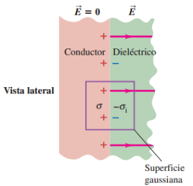

# Resumen de Física II — Gauss en dieléctricos y desplazamiento eléctrico

## Relación entre el vector Polarización y las cargas de Polarización Generalización de la ley de Gauss



Ahora vamos a reformular la ley de Gauss de manera que sea útil en el caso
particular de los dieléctricos. Tomamos una superficie cerrada rectangular en la
unión entre el conductor y el dieléctrico y aplicamos la ley de Gauss. La carga
total encerrada, incluida la carga de la placa del capacitor y la carga inducida
en la superficie del dieléctrico, es $`Q_{\mathrm{enc}}=(\sigma-\sigma_i)A`$ ,
por lo que la ley de Gauss da

```math
EA=\frac{(\sigma-\sigma_i)A}{\epsilon_0}
```

la ecuación $`\sigma_i=\sigma(1-1/K)`$ la podemos escribir como
$`\sigma-\sigma_i=\sigma/K`$ y reemplazamos

```math
EA=\frac{\sigma A}{K\epsilon_0}\quad\text{o bien,}\quad KEA=\frac{\sigma A}{\epsilon_0}
```

Por lo tanto, para cualquier superficie gaussiana, siempre que la carga inducida
sea proporcional al campo eléctrico en el material, la ley de Gauss puede
expresarse como

```math
\oint K\vec E\cdot d\vec A=\frac{Q_{\text{enc-libre}}}{\epsilon_0}
```

## Vector desplazamiento

Para problemas más difíciles introducimos un nuevo formalismo. Teniendo en
cuenta estas tres ecuaciones

```math
E_0=\frac\sigma{\epsilon_0}\qquad E=\frac{\sigma-\sigma_i}{\epsilon_0}
```

```math
E=\frac{E_0}{K}
```

Remplazando y ordenando nos queda

```math
\frac q{K\epsilon_0A}=\frac q{\epsilon_0A}-\frac{q^{\prime}}{\epsilon_0A}
```

Donde q es la carga en la placa del capacitor y q’ es la carga en la superficie
del dieléctrico.

```math
\frac q{K\epsilon_0A}+\frac{q^{\prime}}{\epsilon_0A}=\frac q{\epsilon_0A}
```

```math
\frac qA=\epsilon_0\left(\frac q{K\epsilon_0A}\right)+\frac{q^{\prime}}A
```

La expresión que esta entre paréntesis es la intensidad del campo eléctrico E en
el dieléctrico. El último término en la ecuación es la carga superficial
inducida por unidad de área, la llamamos polarización eléctrica P, o sea que
$`\vec P=q^{\prime}/A`$ , donde la dirección de P es de la carga inducida
negativa a la carga inducida positiva.

Lo tanto podemos volver a escribir la ecuación como

```math
\frac qA=\epsilon_0E+P
```

La expresión del segundo miembro ocurre tan a menudo en problemas de
electrostática que se le da el nombre especial de desplazamiento eléctrico D, o
sea,

```math
D=\epsilon_0E+P
```

Como P y E son vectores, también debe serlo

```math
\vec D=\epsilon_0\vec E+\vec P
```

## Rigidez dieléctrica

Cuando un material dieléctrico se somete a un campo eléctrico suficientemente
intenso, tiene lugar la ruptura del dieléctrico, convirtiéndose en conductor.
Esto ocurre porque el campo eléctrico es tan intenso que arranca los electrones
de sus moléculas y los lanza sobre otras moléculas, con lo cual se liberan aún
más electrones formando una chispa o descarga de arco. Esta descarga de arco
crea una trayectoria conductora entre los conductores, quedando inutilizado de
manera permanente en su función de capacitor.

La magnitud máxima de campo eléctrico a que puede someterse un material sin que
ocurra la ruptura se denomina rigidez dieléctrica. Esta cantidad se ve afectada
de manera significativa por la temperatura, las impurezas, las pequeñas
irregularidades en los electrodos metálicos y otros factores que son difíciles
de controlar.

## Procedencia y observaciones

- Original: `2015/Resumen-Fisca-2.pdf`, páginas [16, 17]; sectores delimitados
  por encabezados. SHA-256:
  `b9903f972224365c1a74b5d2732c9a34675c9b719da4c9c2d28e4a0f34e0b0cc`.
- PyMuPDF4LLM y Poppler; cotejo visual de todos los sectores. Ecuaciones de
  imagen transcritas en LaTeX y figura original conservada.
- Se conservan «Remplazando», «Lo tanto», la igualdad entre P vector y el
  cociente escalar q′/A, y la frase incompleta «Como P y E son vectores, también
  debe serlo». No se añade el sujeto ausente.
