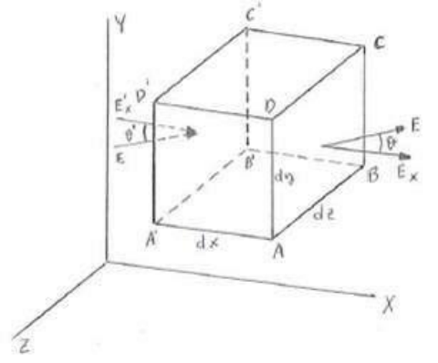

# Resumen de Física II — forma diferencial de la ley de Gauss

Hemos visto que la ley de Gauss puede aplicarse a superficies de cualquier
forma. Vamos a aplicarla a la superficie que rodea un volumen infinitesimal de
aristas paralelas a los ejes XYZ. Los lados del elemento de volumen elemental
son: dx, dy, dz. El área de la superficie ABCD es dy, dz, por lo tanto, según la
expresión general, el flujo a través de ella será:

```math
\Phi_1=E\cdot dS\cdot\cos\alpha=(E\cdot\cos\alpha)dy\cdot dz=E_x\cdot dy\cdot dz
```

El flujo a través de la cara A'B'C'D\* tiene una expresión similar pero es
negativo porque el campo está dirigido hacia el interior del volumen. Se tiene
por tanto:



```math
\Phi_1^{\prime}=-E_x^{\prime}\cdot dy\cdot dz
```

y el flujo total o través de estas dos superficies será la suma:

```math
\Phi_{\mathrm{tx}}=E_x\cdot dy\cdot dz+(-E_x^{\prime}\cdot dy\cdot dz)=(E_x-E_x^{\prime})\cdot dy\cdot dz
```

Pero como la distancia A'A = dx entre las dos superficies es muy pequeña, la
cantidad Ex – E’x es también muy pequeña y podemos escribir:

```math
E_x-E_x^{\prime}=dE_x=\frac{\partial E_x}{\partial x}\cdot dx
```

lo que nos permite expresar el flujo total en la dirección X como:

```math
\Phi_{\mathrm{tx}}=(E_x-E_x^{\prime})\cdot dy\cdot dz=\frac{\partial E_x}{\partial x}\cdot dx\cdot dy\cdot dz=\frac{\partial E_x}{\partial x}\cdot dV
```

donde dV = dx.dy.dz es el volumen de la caja.

Como se obtienen resultados análogos para el flujo a través de las cuatro caras
restantes del volumen elemental, el flujo total a través del mismo es:

```math
\Phi_t=\frac{\partial E_x}{\partial x}\cdot dV+\frac{\partial E_y}{\partial y}\cdot dV+\frac{\partial E_z}{\partial z}\cdot dV=\left(\frac{\partial E_x}{\partial x}+\frac{\partial E_y}{\partial y}+\frac{\partial E_z}{\partial z}\right)dV
```

Si la carga eléctrica dentro del elemento de volumen es dQ, según el teorema de
Gauss se tiene:

```math
\left(\frac{\partial E_x}{\partial x}+\frac{\partial E_y}{\partial y}+\frac{\partial E_z}{\partial z}\right)dV=\frac{dQ}{\epsilon_0}
```

Llamando ahora **ρ** a la densidad de carga eléctrica, se tiene: dQ = **ρ** •dV
, y sustituyendo:

```math
\left(\frac{\partial E_x}{\partial x}+\frac{\partial E_y}{\partial y}+\frac{\partial E_z}{\partial z}\right)dV=\frac{\rho\cdot dV}{\epsilon_0}\quad\longrightarrow\quad\frac{\partial E_x}{\partial x}+\frac{\partial E_y}{\partial y}+\frac{\partial E_z}{\partial z}=\frac\rho{\epsilon_0}
```

que es la ley de Gauss expresada en forma diferencial. La expresión en el primer
miembro de la ecuación anterior se llama divergencia de E, de modo que podemos
poner:

```math
\nabla\cdot E=\frac\rho{\epsilon_0}
```

## Procedencia y observaciones

- Original: `2015/Resumen-Fisca-2.pdf`, final de página6 desde «Forma
  diferencial» y página7 completa. SHA-256:
  `b9903f972224365c1a74b5d2732c9a34675c9b719da4c9c2d28e4a0f34e0b0cc`.
- PyMuPDF4LLM, Poppler y cotejo visual completo de ambos sectores. Nueve
  ecuaciones originalmente en imágenes transcritas como LaTeX; figura original
  conservada.
- Se conserva A'B'C'D\* con asterisco y «flujo total o través», como en el
  texto. El dibujo tiene etiquetas propias; no se cambian para ajustar el texto.
- El resumen continúa en página8 con la Unidad Temática2.
