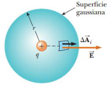
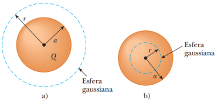
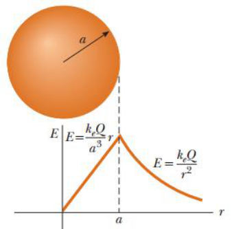
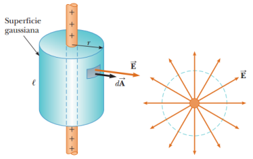
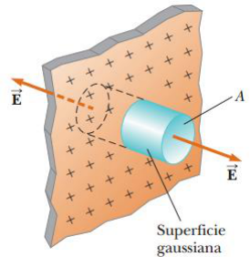

# Resumen de Física II — ley de Gauss y simetrías

Suponga de nuevo una carga puntual positiva q ubicada en el centro de una esfera
de radio r, se sabe que la magnitud del campo eléctrico en todos los puntos de
la superficie de la esfera es $`E=k_eq/r^2`$. Las líneas de campo están
dirigidas radialmente hacia afuera y por tanto son perpendiculares a la
superficie en todos sus puntos, E es paralelo al vector Ai. Por lo tanto,



```math
\vec E\cdot\Delta\vec A_i=E\Delta A_i
```

```math
\Phi_E=\oint\vec E\cdot d\vec A=\oint E\,dA=E\oint dA
```

donde se ha retirado E afuera de la integral ya que, por simetría, E es
constante en la superficie y se conoce por $`E=k_eq/r^2`$. Y como la superficie
es esférica, $`\oint dA=A=4\pi r^2`$. Por lo tanto, el flujo neto a través de la
superficie gaussiana es

```math
\Phi_E=k_e\frac q{r^2}(4\pi r^2)=4\pi k_eq
```

Como $`k_e=1/4pe_0`$ permite escribir esta ecuación de la forma

```math
\Phi_E=\frac q{\epsilon_0}
```

Por lo tanto, el flujo neto a través de cualquier superficie cerrada que rodea a
una carga puntual q tiene un valor de $`q/e_0`$ y es independiente de la forma
de la superficie. Ahora considere una carga puntual localizada en el exterior de
una superficie cerrada de forma arbitraria. Cualquier línea de campo eléctrico
que entre en la superficie saldrá de la misma en algún otro punto. Por lo tanto,
el flujo eléctrico neto a través de una superficie cerrada que no rodea a
ninguna carga es igual a cero.

Suponiendo que dos o más cargas se encuentran dentro de la superficie cerrada,
el campo eléctrico E total es igual a la suma vectorial de los campos eléctricos
de cada una de las cargas, por lo tanto

```math
\oint\vec E\cdot d\vec A=\oint(\vec E_1+\vec E_2+\cdots)\cdot d\vec A
```

La ley de Gauss, que es una generalización de lo anterior, dice que el flujo
neto a través de cualquier superficie cerrada es

```math
\Phi_E=\oint\vec E\cdot d\vec A=\frac{q_{\mathrm{in}}}{\epsilon_0}
```

donde $`q_{\mathrm{in}}`$ representa la carga neta en el interior de la
superficie y E el campo eléctrico en cualquier punto de la misma.

## Alcance y cálculo de intensidades de campo eléctrico con simetrías planas, esféricas y cilíndricas

### Distribución de carga con simetría esférica

Una esfera sólida aislante con radio a tiene una densidad de carga volumétrica
uniforme r y tiene una carga positiva total Q

a)

```math
\Phi_E=\oint\vec E\cdot d\vec A=\oint E\,dA=\frac Q{\epsilon_0}
```



```math
\oint E\,dA=E\oint dA=E(4\pi r^2)=\frac Q{\epsilon_0}
```

Como $`k_e=1/4\pi e_0`$

```math
E=\frac Q{4\pi\epsilon_0r^2}=k_e\frac Q{r^2}\quad(\text{para }r\gt a)
```

b)

```math
q_{\mathrm{in}}=\rho V^{\prime}=\rho\left(\frac43\pi r^3\right)
```

```math
\oint E\,dA=E\oint dA=E(4\pi r^2)=\frac{q_{\mathrm{in}}}{\epsilon_0}
```

```math
E=\frac{q_{\mathrm{in}}}{4\pi\epsilon_0r^2}=\frac{\rho(\frac43\pi r^3)}{4\pi\epsilon_0r^2}=\frac\rho{3\epsilon_0}r
```

Como

```math
\rho=Q/\frac43\pi a^3\qquad\text{y}\quad\epsilon_0=1/4\pi k_e
```

```math
E=\frac{(Q/\frac43\pi a^3)}{3(1/4\pi k_e)}r=k_e\frac Q{a^3}r\quad(\text{para }r\lt a)
```



### Distribución de carga con simetría cilíndrica

El campo eléctrico a una distancia r desde una línea de carga positiva de
longitud infinita y carga constante por unidad de longitud λ

```math
\Phi_E=\oint\vec E\cdot d\vec A=E\oint dA=EA=\frac{q_{\mathrm{in}}}{\epsilon_0}=\frac{\lambda\ell}{\epsilon_0}
```



```math
E(2\pi r\ell)=\frac{\lambda\ell}{\epsilon_0}
```

```math
E=\frac\lambda{2\pi\epsilon_0r}=2k_e\frac\lambda r
```

### Plano con carga

Encuentre el campo eléctrico debido a un plano infinito de carga positiva con
densidad de carga superficial uniforme σ.

```math
\Phi_E=2EA=\frac{q_{\mathrm{in}}}{\epsilon_0}=\frac{\sigma A}{\epsilon_0}
```

```math
E=\frac\sigma{2\epsilon_0}
```



## Procedencia y observaciones

- Original: `2015/Resumen-Fisca-2.pdf`, página5 y página6 hasta «Forma
  diferencial». SHA-256:
  `b9903f972224365c1a74b5d2732c9a34675c9b719da4c9c2d28e4a0f34e0b0cc`.
- PyMuPDF4LLM, Poppler y cotejo visual de ambos sectores. Cinco figuras
  originales y ecuaciones restauradas como LaTeX. La gráfica conserva sus
  ecuaciones y etiquetas.
- Las fracciones en línea con barra oblicua se mantienen sin añadir paréntesis
  que cambien su agrupación. El texto escribe r para la densidad de la esfera,
  mientras las fórmulas usan ρ; se conserva esa diferencia.
