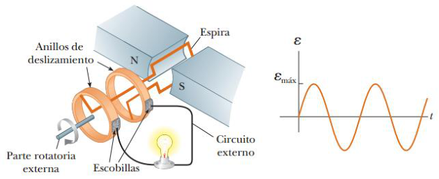
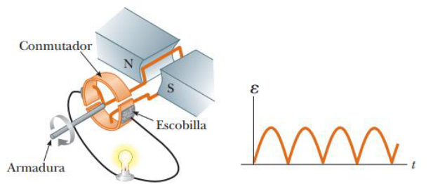

# Resumen de Física II — generadores y motores

Los generadores eléctricos reciben energía mediante trabajo y la transfieren al
exterior por medio de una transmisión eléctrica. Para comprender cómo funciona,
piense en **el generador de corriente alterna (CA)** .



Conforme gira una espira en un campo magnético, el flujo magnético a través del
área encerrada por la espira cambia en función del tiempo; esto induce una fem
así como una corriente en la espira. Los extremos de la espira se conectan a
anillos de deslizamiento que giran con ella. Estos anillos se conectan con las
terminales de salida del generador mediante escobillas inmóviles que están en
contacto con ellos.

Suponga que la espira tiene N vueltas, todas con la misma área A, y giran en un
campo magnético con una rapidez angular constante ω. Si u es el ángulo formado
entre el campo magnético y la normal al plano de la espira el flujo magnético a
través de la espira para cualquier instante es

```math
\Phi_B=BA\cos\theta=BA\cos\omega t
```

donde utiliza la correspondencia u=ωt y se ajusta de manera que t=0 cuando u=0.
Por eso, la fem inducida en la bobina es

```math
\mathcal E=-N\frac{d\Phi_B}{dt}=-NAB\frac d{dt}(\cos\omega t)=NAB\omega\mathop{\mathrm{sen}}\nolimits\omega t
```

Este resultado indica que la fem varía de manera senoidal en función del tiempo.
La fem máxima tiene como valor

```math
\mathcal E_{\mathrm{máx}}=NAB\omega
```

En un **generador de corriente directa (CD)** los contactos con la bobina
giratoria se fabrican utilizando un anillo dividido que se conoce como
conmutador, lo que permite que el voltaje de salida tenga siempre la misma
polaridad.



## Procedencia y observaciones

- Original: `2015/Resumen-Fisca-2.pdf`, páginas [36, 37]; sectores delimitados
  por encabezados. SHA-256:
  `b9903f972224365c1a74b5d2732c9a34675c9b719da4c9c2d28e4a0f34e0b0cc`.
- PyMuPDF4LLM, Poppler y cotejo visual completo de los sectores; ecuaciones de
  imagen transcritas a LaTeX, figuras originales preservadas.
- El título original incluye motores; el desarrollo visible de este sector
  describe generadores CA y CD, y se transcribe completo sin agregar contenido
  sobre motores.
