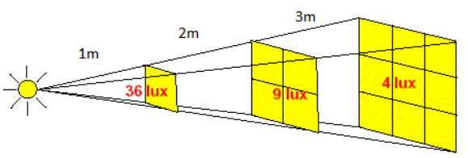
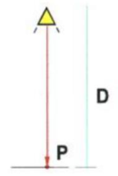
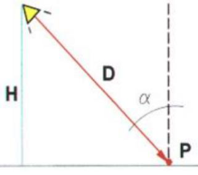
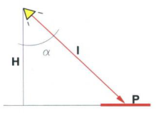
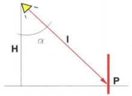

# Resumen de Física II — leyes de iluminación y planos horizontal y vertical

“La iluminación es inversamente proporcional al cuadrado de la distancia
existente entre la fuente de luz y la superficie iluminada”



```math
E=\frac I{D^2}
```

La iluminación es proporcional al coseno del ángulo de incidencia, este ángulo
es formado por la dirección del rayo incidente y la normal a la superficie en el
punto de incidencia P.

```math
E=\frac I{D^2}\cos\alpha
```

Esta fórmula también puede expresarse de la siguiente manera

```math
E=\frac I{H^2}\cos^3\alpha
```





La fórmula precedente, en realidad difiere según se trate de un plano horizontal
o uno vertical, por lo tanto, la ecuación anterior varía de acuerdo a cual se
trate.





Eph es la iluminancia E en un punto P de una superficie horizontal h.

```math
E_{ph}=\frac I{H^2}\cos^3\alpha
```

Epv es la iluminancia E en un punto P de una superficie vertical v.

```math
E_{pv}=\frac I{H^2}\cos^2\alpha\mathop{\mathrm{sen}}\nolimits\alpha
```

## Procedencia y observaciones

- Original: `2015/Resumen-Fisca-2.pdf`, páginas [59, 60]; sectores delimitados
  por encabezados. SHA-256:
  `b9903f972224365c1a74b5d2732c9a34675c9b719da4c9c2d28e4a0f34e0b0cc`.
- PyMuPDF4LLM, Poppler y cotejo visual completo de los sectores; ecuaciones de
  imagen transcritas a LaTeX, figuras originales preservadas.
- Se conservan las expresiones de iluminación de cada plano, sus ángulos y
  diagramas.
