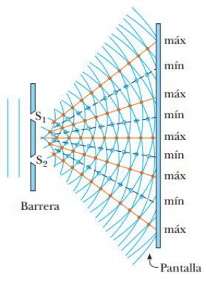
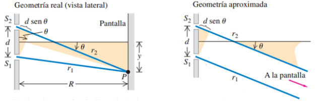

# Resumen de Física II — superposición e interferencia de Young

## Unidad Temática 12. Interferencia

## Superposición de ondas coherentes

El término interferencia se refiere a cualquier situación en la que dos o más
ondas se traslapan en el espacio. Cuando esto ocurre, la onda total en cualquier
punto y en cualquier instante está gobernada por el principio de superposición
el cual también se aplica a las ondas electromagnéticas. Este principio dice

“Cuando dos o más ondas se traslapan, la magnitud resultante en cualquier punto
y en cualquier instante se encuentra sumando los desplazamientos instantáneos
que producirían en el punto las ondas individuales si cada una se presentara
sola.”

## Condiciones para la interferencia

Para observar interferencia en ondas de dos fuentes, se ha de cumplir que las
fuentes deben ser **coherentes** , es decir, deben mantener una fase constante
respecto de otra; y también deben ser **monocromáticas** , es decir, que ambas
tengan una sola longitud de onda.

## Interferómetros de división de frente de onda: Experiencia de Young

Las ondas planas, provenientes de una fuente monocromática, llegan a una barrera
que contiene dos ranuras paralelas S1y S2. La luz que sale de las dos ranuras es
coherente porque una sola fuente produce el rayo de luz original. La luz de S1y
S2 produce, en una pantalla, una configuración visible de bandas brillantes y
oscuras paralelas que ocurre por la interferencia constructiva destructiva. En
el medio de la pantalla se produce una interferencia constructiva porque S1 y S2
recorren la misma distancia, por lo tanto se encuentran en fase. Cuando S1 y S2
recorren diferentes distancias las ondas de luz se desfasan, provocando franjas
oscuras y brillantes

Sea r1 la distancia que hay entre s1 y cualquier punto P, y r2 la distancia
entre s2 y P. para que ocurra una interferencia constructiva, la diferencia de
las trayectorias r2-r1 debe ser múltiplo entero de la longitud de onda λ.



```math
I_{max}=r_2-r_1=m\lambda\quad(m=0,\pm1,\pm2,\pm3\ldots)
```

La condición para una interferencia destructiva es

```math
I_{max}=r_2-r_1=(m+\tfrac12)\lambda\quad(m=0,\pm1,\pm2,\pm3\ldots)
```



Como por lo general, la distancia de las rendijas a la pantalla R es mucho mayor
que la distancia entre las rendijas d, podemos suponer que los rayos son
paralelos, en tal caso su diferencia de trayectoria esta dada por la expresión

```math
r_2-r_1=d\mathop{\mathrm{sen}}\nolimits\theta
```

Donde ϴ es el ángulo entre la normal al plano y el rayo.

Ahora vamos a obtener una expresión para la posición de los centros de las
bandas brillantes en la pantalla. Como la tangente del angulo ϴ es $`x/R`$ ,
siendo R la distancia a la pantalla, y x la distancia del centro al punto P
donde incide el rayo, tenemos que

```math
y_m=R\tan\theta
```

Pero como ϴ es muy pequeño, por ser $`y_m\ll R`$ ,
$`\tan\theta\approx\mathop{\mathrm{sen}}\nolimits\theta`$ , por lo tanto tenemos
que

```math
y_m=R\mathop{\mathrm{sen}}\nolimits\theta
```

Teniendo en cuenta que $`d\mathop{\mathrm{sen}}\nolimits\theta=m\lambda`$ ,
despejamos senϴ y lo reemplazamos en la expresión anterior y tenemos que

```math
y_m=R\frac{m\lambda}d
```

Donde los máximos estarán en las posiciones donde m= 0, ±1, ±2, ±3… y los
mínimos donde m= 0, ±1/2, ±3/2, ±5/2…

La distancia entre dos máximos es entonces:

```math
\Delta y=y_m-y_{m-1}=\frac{m\lambda R}d-\frac{(m-1)\lambda R}d=\frac{\lambda R}d
```

## Procedencia y observaciones

- Original: `2015/Resumen-Fisca-2.pdf`, páginas [61, 62]; sectores delimitados
  por encabezados. SHA-256:
  `b9903f972224365c1a74b5d2732c9a34675c9b719da4c9c2d28e4a0f34e0b0cc`.
- PyMuPDF4LLM, Poppler y cotejo visual completo de los sectores; ecuaciones de
  imagen transcritas a LaTeX, figuras originales preservadas.
- Se conserva Imax en ambas condiciones, incluso la destructiva, y m=0 entre los
  mínimos del párrafo de página62. Se mantienen x/R del texto frente a ym de las
  fórmulas.
