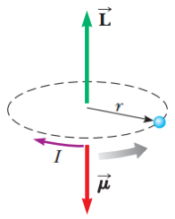
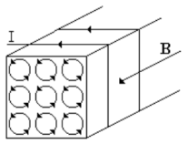
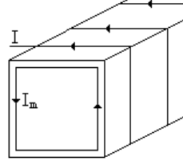

# Resumen de Física II — propiedades magnéticas y magnetización

## Unidad Temática 8. Magnetostática. Propiedades magnéticas de la materia

## Propiedades magnéticas de la materia

Un electrón en órbita forma una espira de corriente minúscula y el momento
magnético del electrón está asociado con este movimiento orbital. Se supone que
un electrón se mueve con una rapidez constante v en una órbita circular de radio
r alrededor del núcleo. La corriente I asociada con este electrón en órbita es
igual a su carga e dividida entre el periodo T. Como T=2π/ω y ω=v/r

```math
I=\frac eT=\frac{e\omega}{2\pi}=\frac{ev}{2\pi r}
```

La magnitud del momento magnético es $`\mu=IA`$ , donde $`A=\pi r^2`$ . Por lo
tanto

```math
\mu=IA=\left(\frac{ev}{2\pi r}\right)\pi r^2=\tfrac12evr
```

Ya que la magnitud del momentum angular orbital del electrón es $`L=m_evr`$ , el
momento magnético puede escribirse como

```math
\mu=\left(\frac e{2m_e}\right)L
```



Ya que el electrón tiene carga negativa, los vectores µ y L apuntan en
direcciones opuestas. La mayor parte de las sustancias no son magnéticas porque
El resultado neto es que, para la mayor parte de los materiales, el efecto
magnético producido por el movimiento orbital de los electrones es cero o muy
pequeño, ya que estos se cancelan unos con otros.

## Magnetización Campo magnético

Un material puede magnetizarse por un campo magnético externo adquiriendo un
momento magnético y creando su propio campo magnético. Ampére propuso que los
momentos magnéticos en un material magnetizado o un imán permanente, están
asociados con las corrientes de los electrones en los átomos del material, o sea
el material estará formado por un gran número de diminutas espiras de corriente
dentro del material. Al introducir un material dentro de una bobina, al circular
la corriente crea un campo magnético dentro de la espira, produciendo una
alineación de los momentos magnéticos de cada molécula o átomo. Si el material
es homogéneo, las corrientes de las espiras tienen direcciones opuestas y se
anulan, por lo que no hay corriente neta dentro del material. Sin embargo, las
porciones de las espiras adyacentes a la superficie exterior no se anulan y la
totalidad del conjunto de espiras equivale a una corriente $`I_m`$ en
circulación por la superficie del material, se la suele denominar corriente
amperiana. Esta corriente superficial es semejante a la corriente de conducción
real en un solenoide ya que producen un campo magnético en un punto, que sigue
las mismas leyes que la corriente real, aunque no supone un flujo neto de carga.





El vector magnetización M, que es igual al momento magnético neto por unidad de
volumen

```math
\vec M=\frac{d\vec\mu}{dV}
```

Si consideramos una barra de longitud L y sección A de material V=AL y como el
momento magnético es $`\mu=IA`$ , entonces

```math
\vec M=\frac{I_m A}{AL}=\frac{I_m}L
```

podemos considerar a esta como un solenoide por la corriente superficial Im crea
un campo magnético en su interior. Por lo tanto el campo $`B_m`$ será
$`B_m=\frac{\mu_0I_m}{L}`$ y como $`\vec M=\frac{I_m}{L}`$, el campo magnético
inducido por la magnetización M es

```math
B_m=\mu_0 M
```

El campo magnético total B en un punto interior de la sustancia depende del
campo magnético externo Bo aplicado y de la magnetización M que produce un campo
$`B_m`$ .

```math
B=B_0+B_m
```

## Procedencia y observaciones

- Original: `2015/Resumen-Fisca-2.pdf`, páginas [42, 43]; sectores delimitados
  por encabezados. SHA-256:
  `b9903f972224365c1a74b5d2732c9a34675c9b719da4c9c2d28e4a0f34e0b0cc`.
- PyMuPDF4LLM, Poppler y cotejo visual completo de los sectores; ecuaciones de
  imagen transcritas a LaTeX, figuras originales preservadas.
- Se conserva «porque El resultado neto», y las expresiones vectoriales y
  escalares del original.
