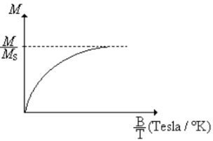
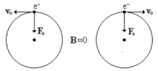
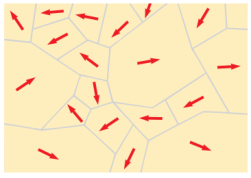
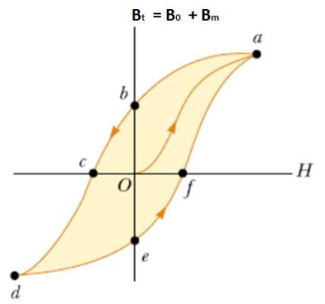

# Resumen de Física II — materiales magnéticos e histéresis

## PARAMAGNETISMO

El paramagnetismo se presenta en sustancias, como el Al y O2, cuyos átomos
tienen unos momentos magnéticos permanentes que interaccionan muy débilmente
entre si, o sea su susceptibilidad es muy pequeña.

Cuando no existe ningún campo magnético externo, estos momentos magnéticos están
orientados al azar. En presencia de un campo magnético externo tienden a
alinearse paralelamente al campo, pero esta alineación está contrarrestada por
la tendencia que tienen los momentos a estar orientados aleatoriamente debido al
movimiento térmico. La fracción de los momentos que se alinean con el campo
depende de la intensidad del campo y de la temperatura. A temperaturas muy bajas
y con campos externos altos casi todos los momentos están alineados con el
campo. En este caso la contribución al campo magnético total debida al material
es muy grande, pero a temperaturas superiores a unos pocos grados absolutos solo
una fracción muy pequeña de las moléculas se alinean con el campo.

Se puede establecer la magnetización por la ley de Curie

```math
M=C\frac BT
```

Donde C es la constante de Curie. En esta ecuación podemos observar que M
aumenta al aumentar el campo magnético y al disminuir la temperatura T. La
susceptibilidad magnética también es inversamente proporcionales a la
temperatura.

Para una sustancia ferromagnética, al aumentar T, para determinado valor de la
misma la sustancia pierde su magnetización residual y se vuelve paramagnética.
Esa temperatura critica se denomina Temperatura de Curie.



## DIAMAGNETISMO

El diamagnetismo fue descubierto por Faraday cuando vio que un trozo de bismuto
se veía repelido por un polo cualquiera de un imán, indicando que el campo
externo del imán induce un dipolo magnético en el bismuto de sentido opuesto al
campo. Este efecto es muy pequeño por lo que en general no se detecta.

Aunque el efecto del diamagnetismo está presente en toda la materia, es débil en
comparación con el paramagnetismo y el ferromagnetismo. Por lo tanto, se puede
observar únicamente en aquellos materiales cuyos átomos no tienen momentos
dipolares magnéticos permanentes.

Es posible captar una idea cualitativa del diamagnetismo si se aplica la ley de
Lenz al movimiento orbital de los electrones de los átomos. Considérense dos
electrones que se mueven en órbitas circulares con la misma velocidad pero con
sentidos contrarios, como en la figura.



Ahora, considérese lo que sucede cuando se aplica un campo magnético externo
perpendicularmente al plano de las órbitas dirigido hacia dentro del papel. De
acuerdo con la ley de Lenz se inducirán corrientes que se opondrán a la
variación de flujo. Al ser el radio constante, el electrón de la derecha se
deberá acelerar para aumentar su flujo hacia fuera del papel y el de la
izquierda deberá disminuir su flujo dirigido hacia dentro del papel. En cada
caso, la variación del momento magnético de los electrones estará en el sentido
dirigido hacia fuera del papel, opuesto al del campo externo

## FERROMAGNETISMO. CICLO DE HISTERESIS

Las sustancias ferromagnéticas como el hierro, cobalto y níquel y aleaciones de
estos metales entre si, contienen momentos magnéticos atómicos que pueden
alinearse fácilmente con la dirección de un campo magnético externo aunque este
sea débil. Incluso puede persistir la alineación aunque no exista el campo
magnetizante externo, en algunos casos.

Esto es debido a que los momentos magnéticos de los átomos de estas sustancias
ejercen fuerzas intensas sobre sus vecinos de modo que en una pequeña región del
espacio los momentos se alinean entre si incluso en ausencia de campos externos.
A estas regiones en las cuales los momentos magnéticos están alineados, se las
denomina dominios. El tamaño de un dominio es normalmente microscópico. Dentro
del dominio, todos los momentos magnéticos están alineados, pero la dirección de
alineación varia de un dominio a otro, de modo que el momento magnético neto de
un trozo macroscópico de material es cero en su estado normal.





En O es Bm=0, cuando aumenta el campo externo B0 los dominios magnéticos se
alinean y crecen hasta que se alcanza la saturación en a. Si se quita el campo
externo la curva de magnetización sigue la trayectoria hasta el punto b, donde
el campo B no es nulo, sino tiene un valor B m denominado campo remanente. Si
aplicamos el campo B0 pero en sentido contrario se alcanza el punto c donde el
material esta desmagnetizado.

Si seguimos aumentando B0 el material se magnetiza hasta alcanzar la saturación
en d, pero con dirección opuesta a la magnetización en el punto a. Si eliminamos
el campo externo llegamos a e con magnetización remanente de dirección opuesta a
la de b. Si aplicamos el campo en la dirección inicial terminamos en el punto a
de saturación. Dependiendo de si el material ferromagnetico es duro o blando, la
curva se hace mas ancha o mas estrecha.

## Procedencia y observaciones

- Original: `2015/Resumen-Fisca-2.pdf`, páginas [43, 44, 45]; sectores
  delimitados por encabezados. SHA-256:
  `b9903f972224365c1a74b5d2732c9a34675c9b719da4c9c2d28e4a0f34e0b0cc`.
- PyMuPDF4LLM, Poppler y cotejo visual completo de los sectores; ecuaciones de
  imagen transcritas a LaTeX, figuras originales preservadas.
- Se conservan «inversamente proporcionales», «critica», «varia»,
  «ferromagnetico» y «mas». El texto habla del punto c de desmagnetización
  aunque el dibujo rotula f; se conserva esa diferencia.
