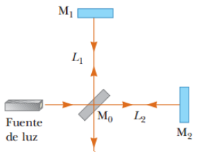
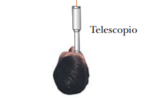

# Resumen de Física II — interferómetro de Michelson

El interferómetro divide un rayo de luz de una fuente monocromática, en dos
rayos por el espejo M0. Los rayos recorren una distancia y se reflejan en un
espejo volviendo al espejo M0, donde se recombinan y se dirigen finalmente al
telescopio.

La condición de interferencia para los dos rayos está determinada por sus
diferencias de distancia de recorrido. Si las distancias L1 y L2 son iguales, en
el centro del telescopio se observa un círculo brillante. Si ahora movemos un
espejo una distancia λ/4 hacia M0, la diferencia en la trayectoria cambia en
λ/2. Lo que era un círculo brillante en el centro se convierte un círculo
oscuro.

## Procedencia y observaciones

- Original: `2015/Resumen-Fisca-2.pdf`, páginas [63]; sectores delimitados por
  encabezados. SHA-256:
  `b9903f972224365c1a74b5d2732c9a34675c9b719da4c9c2d28e4a0f34e0b0cc`.
- PyMuPDF4LLM, Poppler y cotejo visual completo de los sectores; ecuaciones de
  imagen transcritas a LaTeX, figuras originales preservadas.
- La figura de Michelson estaba desplazada bajo el encabezado de película
  delgada en la extracción; se devuelve a su sección original.
