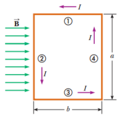

# Resumen de Física II — momento mecánico sobre un circuito plano

Considere una espira rectangular que tiene una corriente I en presencia de un
campo magnético uniforme dirigido paralelamente al plano de la espira. Sobre los
lados1 y 2 no actúa ninguna fuerza magnética, ya que estos alambres son
paralelos al campo. Sobre los lados 2 y 4 al estar orientados perpendicularmente
al campo, actúan una fuerza de magnitud

```math
F_2=F_4=IaB
```



La fuerza en 2 sale de pagina, y la fuerza en 4 entra en la página. Las dos
fuerzas apuntan en direcciones opuestas pero no actúan a lo largo de la misma
línea de acción. Si se logra que la espira gire alrededor del punto O, estas dos
fuerzas producen, en relación con este punto, un momento de torsión que hace que
la espira gire.

La magnitud de este momento de torsión $`\tau_{max}`$ es

```math
\tau_{\mathrm{máx}}=F_2\frac b2+F_4\frac b2=(IaB)\frac b2+(IaB)\frac b2=IabB
```

donde b/2 es el momento de palanca en relación con O para cada una de las
fuerzas. Ya que el área contenida por la espira es A= ab, el momento de torsión
máximo es

```math
\tau_{\mathrm{max}}=IAB
```

Este resultado de máximo momento de torsión sólo es válido cuando el campo
magnético es paralelo al plano de la espira.

Cuando B es perpendicular a los lados 1 y 3 las fuerzas magnéticas F1 y F3 se
cancelan entre sí y no producen momento de torsión, ya que pasan por un origen
común. Para las fuerzas magnéticas F2 y F4 que actúan sobre los lados 2 y 4 el
momento de palanca en relación a O es igual a (b/ 2) sen u. Ya que F2=F4=IaB, la
magnitud del momento de torsión neto en relación a O es

```math
\begin{aligned}
\tau&=F_2\frac b2\mathop{\mathrm{sen}}\nolimits\theta+F_4\frac b2\mathop{\mathrm{sen}}\nolimits\theta\\
&=IaB\left(\frac b2\mathop{\mathrm{sen}}\nolimits\theta\right)+IaB\left(\frac b2\mathop{\mathrm{sen}}\nolimits\theta\right)=IabB\mathop{\mathrm{sen}}\nolimits\\
&=IAB\mathop{\mathrm{sen}}\nolimits\theta
\end{aligned}
```

donde A=ab es el área de la espira. Por lo tanto podemos escribir al momento de
torsión como

```math
\vec\tau=I\vec A\times\vec B
```

donde $`\vec A`$ , es un vector perpendicular al plano de la espira y tiene una
magnitud igual al área de la misma. La dirección de A depende de la dirección de
la corriente en la espira. El producto IA representa el momento dipolar
magnético µ o momento magnético

```math
\vec\mu=I\vec A
```

La unidad del SI del momento dipolar magnético es ( $`Am^2`$ )

Si una bobina de alambre contiene N espiras de igual área, el momento magnético
de la bobina es

```math
\vec\mu_{\mathrm{bobina}}=NI\vec A
```

El momento de torsión ejercido en una espira de corriente en un campo magnético
B

```math
\vec\tau=\vec\mu\times\vec B
```

El momento de torsión es válida para cualquier orientación y para cualquier
forma de espira. La energía potencial de un sistema constituido por un dipolo
magnético en un campo magnético depende de la orientación del dipolo en dicho
campo, y está dada por

```math
U=-\vec\mu\cdot\vec B
```

Por esta expresión, el sistema tiene la mínima energía $`U_{min}=-\mu B`$ cuando
µ apunta en la misma dirección que B. El sistema tiene su máxima energía
$`U_{max}=+\mu B`$ cuando µ apunta en la dirección opuesta a B.

## Procedencia y observaciones

- Original: `2015/Resumen-Fisca-2.pdf`, páginas [30]; sectores delimitados por
  encabezados. SHA-256:
  `b9903f972224365c1a74b5d2732c9a34675c9b719da4c9c2d28e4a0f34e0b0cc`.
- PyMuPDF4LLM, Poppler y cotejo visual completo de los sectores; ecuaciones de
  imagen transcritas a LaTeX, figuras originales preservadas.
- Se conserva «lados1 y2» del primer párrafo aunque la figura y el desarrollo
  usan1 y3; el segundo renglón de la deducción termina en sen sin θ visible. Se
  conservan «es válida» y la notación del original.
