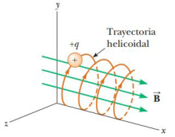

# Resumen de Física II — movimiento de una carga en campo magnético

Consideremos una partícula con carga positiva que se mueve en un campo magnético
uniforme, estando el vector de velocidad inicial de la partícula perpendicular
al campo. Conforme la partícula cambia la dirección de su velocidad como
respuesta a la fuerza magnética, ésta se mantiene en posición perpendicular a la
velocidad, por lo tanto, la partícula describe un movimiento circular en un
plano perpendicular al campo magnético porque la fuerza magnética $`F_B`$ es
perpendicular a v y a B y tiene una magnitud constante igual a qvB. Por la
segunda ley de Newton

```math
\sum F=F_B=ma
```

como a partícula presenta un movimiento circular uniforme y se sustituye la
aceleración con la aceleración centrípeta.

```math
F_B=qvB=\frac{mv^2}r
```

el radio de la trayectoria circular de la partícula es

```math
r=\frac{mv}{qB}
```

La rapidez angular de la partícula es

```math
\omega=\frac vr=\frac{qB}m
```

El periodo del movimiento es igual a la circunferencia del círculo dividido
entre la rapidez de la partícula:

```math
T=\frac{2\pi r}v=\frac{2\pi}\omega=\frac{2\pi m}{qB}
```

Donde la rapidez angular ω se denomina frecuencia de ciclotrón.

Si una partícula con carga se mueve en un campo magnético uniforme con su
velocidad orientada en algún ángulo arbitrario respecto a B, su trayectoria será
una espiral.



## Procedencia y observaciones

- Original: `2015/Resumen-Fisca-2.pdf`, páginas [27, 28]; sectores delimitados
  por encabezados. SHA-256:
  `b9903f972224365c1a74b5d2732c9a34675c9b719da4c9c2d28e4a0f34e0b0cc`.
- PyMuPDF4LLM, Poppler y cotejo visual completo de los sectores; ecuaciones de
  imagen transcritas a LaTeX, figuras originales preservadas.
- Se conserva «como a partícula» del original.
