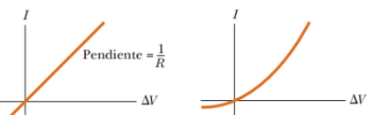

# Resumen de Física II — ley de Ohm y resistividad

## Ley de Ohm. Resistencia eléctrica

Si consideramos un segmento de alambre recto de área de sección transversal
uniforme A y de longitud _l_ . De un extremo al otro del alambre se mantiene una
diferencia de potencial $`\Delta V=\Delta V_b-\Delta V_a`$ , lo que genera en el
alambre un campo eléctrico y una corriente. Si suponemos que el campo es
uniforme, la diferencia de potencial está relacionada con el campo mediante la
relación

```math
\Delta V=E\ell
```

Por lo tanto, la densidad de corriente en el alambre se expresa en la forma

```math
J=\sigma E=\sigma\frac{\Delta V}{\ell}
```

Ya que J = I/A, la diferencia de potencial a través del alambre es

```math
\Delta V=\frac\ell\sigma J=\left(\frac\ell{\sigma A}\right)I=RI
```

La cantidad $`R=l/\sigma A`$ conoce como la resistencia del conductor que es
definida como la relación de la diferencia de potencial aplicada a un conductor
entre la corriente que pasa por el mismo:

```math
R=\frac{\Delta V}{I}
```

la resistencia tiene unidades del SI de volts por ampere que se define como un
ohm (Ω)

## Conductividad y Resistividad

La resistividad ρ de un material se define como la razón de las magnitudes del
campo eléctrico y la densidad de corriente:

```math
\rho=\frac EJ
```

Cuanto mayor sea la resistividad, tanto mayor será el campo necesario para
causar una densidad de corriente dada, o tanto menor la densidad de corriente
ocasionada por un campo dado. El recíproco de la resistividad es la
conductividad

```math
\sigma=\frac1\rho
```

donde $`\rho`$ está en ohms por metros. Ya que $`R=l/\sigma A`$ , es posible
expresar la resistencia a lo largo de la longitud l de un bloque uniforme de
material de la forma

```math
R=\rho\frac\ell A
```

Todo material óhmico tiene una resistividad característica que depende de las
propiedades del material y de la temperatura. Los materiales y otros
dispositivos óhmicos tienen una correspondencia lineal corriente-diferencia de
potencial. La pendiente de la curva I en función de $`\Delta V`$ en la región
lineal, tiene un valor 1/R. Los materiales no óhmicos tienen una correspondencia
no lineal de corriente-diferencia de potencial.



## Procedencia y observaciones

- Original: `2015/Resumen-Fisca-2.pdf`, páginas [19, 20]; sectores delimitados
  por encabezados. SHA-256:
  `b9903f972224365c1a74b5d2732c9a34675c9b719da4c9c2d28e4a0f34e0b0cc`.
- PyMuPDF4LLM, Poppler y cotejo visual completo de los sectores; fórmulas de
  imagen transcritas a LaTeX y figuras originales preservadas.
- Se conserva «La cantidad R… conoce» y «ohms por metros». La fracción σ=1/ρ,
  desordenada por la extracción, fue cotejada y restituida.
