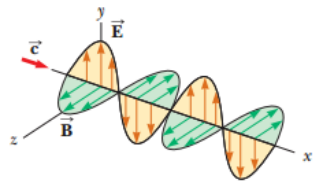
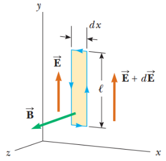
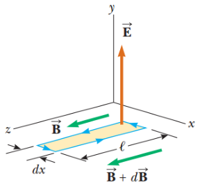

# Resumen de Física II — ecuación de onda electromagnética



Suponga que los vectores para el campo eléctrico y el campo magnético en una
onda electro-magnética tienen un comportamiento espacio-tiempo específico que es
simple, pero consistente con las ecuaciones de Maxwell. La onda electromagnética
se propaga en la dirección x. Para esta onda, el campo eléctrico E está en la
dirección y y el campo magnético B está en la dirección z. Las magnitudes de
campo E y B dependen únicamente de x y t. Se define un rayo como la línea a lo
largo de la cual viaja la onda. A esta colección completa de ondas con
frecuencia se les llama

onda plana. Una superficie que conecta los puntos de igual fase en todas las
ondas es un plano geométrico denominado frente de onda.

Supongamos una onda electromagnética que viaja en la dirección x, con el campo
eléctrico E en la dirección y positiva y el campo magnético B en la dirección z
positiva.

Considere un rectángulo de ancho dx y altura L que yace en el plano xy. La
integral de línea de E . ds alrededor de este rectángulo es cero porque E es
perpendicular a ds. El campo eléctrico en el lado derecho del rectángulo se
expresa como

```math
E(x+dx,t)\approx E(x,t)+\left.\frac{dE}{dx}\right|_{t\text{ constante}}dx=E(x,t)+\frac{\partial E}{\partial x}dx
```

la integral de línea en todo este rectángulo es aproximadamente



```math
\oint\vec E\cdot d\vec s=[E(x+dx,t)]\ell-[E(x,t)]\ell\approx\ell\left(\frac{\partial E}{\partial x}\right)dx
```

(1)

El flujo magnético a través del rectángulo es $`\phi_B=BLdx`$ . Si la derivamos
con respecto al tiempo

```math
\frac{d\Phi_B}{dt}=\left.\ell\,dx\frac{dB}{dt}\right|_{x\text{ constante}}=\ell\,dx\frac{\partial B}{\partial t}
```

(2)

Sustituimos 1 y 2 en la ecuación $`\oint E\cdot ds=\frac{d\phi_B}{dt}`$

```math
\ell\left(\frac{\partial E}{\partial x}\right)dx=-\ell\,dx\frac{\partial B}{\partial t}
```

```math
\frac{\partial E}{\partial x}=-\frac{\partial B}{\partial t}
```

(3)

Hacemos lo mismo entorno a un rectángulo que yace en el plano xz

```math
\oint\vec B\cdot d\vec s=[B(x,t)]\ell-[B(x+dx,t)]\ell\approx-\ell\left(\frac{\partial B}{\partial x}\right)dx
```

(4)

El flujo eléctrico a través del rectángulo es $`\phi_E=ELdx`$ , si la derivamos
con respecto al tiempo

```math
\frac{\partial\Phi_E}{\partial t}=\ell\,dx\frac{\partial E}{\partial t}
```

(5)

Al sustituir 4 y 5 en la ecuación
$`\oint B\cdot ds=\mu_0I+\mu_0\epsilon_0\frac{d\phi_E}{dt}`$

```math
-\ell\left(\frac{\partial B}{\partial x}\right)dx=\mu_0\epsilon_0\ell\,dx\left(\frac{\partial E}{\partial t}\right)
```

```math
\frac{\partial B}{\partial x}=-\mu_0\epsilon_0\frac{\partial E}{\partial t}
```

(6)



Al derivar con respecto a x la ecuación 3 y combinarla con la 6, y viceversa nos
quedan

```math
\frac{\partial^2E}{\partial x^2}=\mu_0\epsilon_0\frac{\partial^2E}{\partial t^2}
```

```math
\frac{\partial^2B}{\partial x^2}=\mu_0\epsilon_0\frac{\partial^2B}{\partial t^2}
```

Esta es la ecuación general de onda, cuya rapidez de onda es

```math
c=\frac1{\sqrt{\mu_0\epsilon_0}}
```

Como estos campos describen una onda sinusoidal, las magnitudes del campo E y B
varían con x y t de acuerdo a

```math
E=E_{\mathrm{máx}}\cos(kx-\omega t)
```

(7)

```math
B=B_{\mathrm{máx}}\cos(kx-\omega t)
```

(8)

donde $`E_{max}`$ y $`B_{max}`$ son los valores máximos de los campos. El número
de onda es k=2π/λ, donde λ es la longitud de onda. La frecuencia angular es
ω=2πf, donde f es la frecuencia de onda. La relación ω/k es igual a la rapidez
de una onda electromagnética, c

```math
\frac\omega k=\frac{2\pi f}{2\pi/\lambda}=\lambda f=c
```

Las derivadas parciales de las ecuaciones 7 (respecto a x) y 8 (respecto a t)
son

```math
\frac{\partial E}{\partial x}=-kE_{\mathrm{máx}}\mathop{\mathrm{sen}}\nolimits(kx-\omega t)
```

```math
\frac{\partial B}{\partial t}=\omega B_{\mathrm{máx}}\mathop{\mathrm{sen}}\nolimits(kx-\omega t)
```

Reemplazamos en 3 y obtenemos que

```math
kE_{\mathrm{máx}}=\omega B_{\mathrm{máx}}
```

```math
\frac{E_{\mathrm{máx}}}{B_{\mathrm{máx}}}=\frac\omega k=c
```

```math
\frac{E_{\mathrm{máx}}}{B_{\mathrm{máx}}}=\frac EB=c
```

En todo instante, la relación de la magnitud del campo eléctrico con la magnitud
del campo magnético en una onda electromagnética es igual a la rapidez de la
luz.

## Propiedades

- Las soluciones de las ecuaciones de Maxwell son de tipo ondulatorio. E y B
  satisfacen la ecuación de ondas.

- Las OEM se desplazan en el vacío con velocidad $`c=1/\sqrt{\mu_0\epsilon_0}`$

- En las OEM planas E y B son perpendiculares entre si, y a la dirección de
  propagación. Las OEM son transversales.

- Las magnitudes de E y B en el espacio están relacionadas según la expresión:
  $`KE_{max}=\omega B_{max}`$

- Las OEM obedecen al principio de superposición.

## Procedencia y observaciones

- Original: `2015/Resumen-Fisca-2.pdf`, páginas [54, 55, 56]; sectores
  delimitados por encabezados. SHA-256:
  `b9903f972224365c1a74b5d2732c9a34675c9b719da4c9c2d28e4a0f34e0b0cc`.
- PyMuPDF4LLM, Poppler y cotejo visual completo de los sectores; ecuaciones de
  imagen transcritas a LaTeX, figuras originales preservadas.
- Se restituyen la derivada de flujo(2) y el orden de las frases partidas por la
  extracción. Se conserva la ecuación de sustitución sin signo negativo en el
  texto aunque el desarrollo lo usa, y K mayúscula en las propiedades frente a k
  del desarrollo. Las etiquetas(1)–(8) están fuera de LaTeX para evitar
  apilamiento en GitHub.
