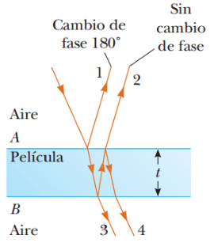

# Resumen de Física II — interferencia en película delgada

Considere una película de grosor uniforme t e índice de refracción n y que los
rayos de luz que se propagan en el aire son casi normales a las dos superficies
de la película. La longitud de onda de luz λn en la película es

```math
\lambda_n=\frac\lambda n
```

donde λ es la longitud de onda de la luz en espacio libre y n es el índice de
refracción del material de la película.

El rayo reflejado 1, que se refleja desde la superficie superior A, se somete a
un cambio de fase de 180° respecto a la onda incidente. El rayo reflejado 2, que
se refleja desde la superficie B, no pasa por el cambio de fase porque se
refleja desde un medio (aire) que tiene un índice de refracción menor. Por lo
tanto, el rayo 1 está fuera de fase en relación con el rayo 2.

La condición para la interferencia constructiva en películas delgadas es

```math
2t=(m+\tfrac12)\lambda_n\quad(m=0,1,2,\ldots)
```

Como λn=λ/n, podemos escribir la ecuación como

```math
2nt=(m+\tfrac12)\lambda\quad(m=0,1,2,\ldots)
```



Si la distancia extra 2t recorrida por el rayo 2 corresponde a un múltiplo de
λn, las dos ondas se combinan fuera de fase, y el resultado es interferencia
destructiva. La ecuación general para la interferencia destructiva en películas
delgadas es

```math
2nt=m\lambda\quad(m=0,1,2,\ldots)
```

Las anteriores condiciones para las interferencias constructiva y destructiva
son válidas cuando el medio que está por encima de la superficie superior de la
película es el mismo que el medio por debajo de la superficie inferior.

## Procedencia y observaciones

- Original: `2015/Resumen-Fisca-2.pdf`, páginas [63]; sectores delimitados por
  encabezados. SHA-256:
  `b9903f972224365c1a74b5d2732c9a34675c9b719da4c9c2d28e4a0f34e0b0cc`.
- PyMuPDF4LLM, Poppler y cotejo visual completo de los sectores; ecuaciones de
  imagen transcritas a LaTeX, figuras originales preservadas.
- Se conservan las dos condiciones y la restricción de medios exteriores
  iguales, sin añadir otros casos.
