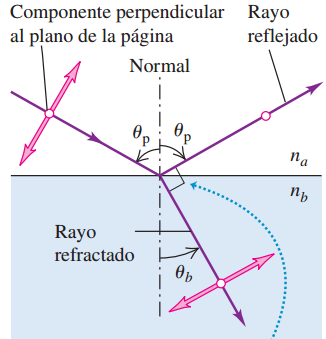
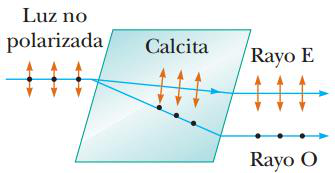
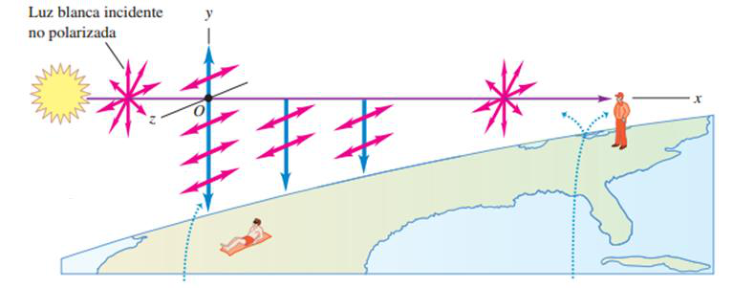
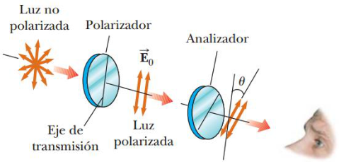

# Resumen de Física II — métodos de polarización, Malus y actividad óptica

## Métodos para obtener luz polarizada

### Polarización por absorción selectiva

La técnica más común para producir luz polarizada es usar material que transmita
ondas cuyos campos eléctricos vibren en un plano paralelo a cierta dirección y
que absorba las ondas cuyos campos eléctricos estén vibrando en todas las demás
direcciones. Este material se fabrica en hojas delgadas de hidrocarburos. Las
láminas u hojas son estiradas durante su fabricación de forma que las moléculas
de la cadena larga se alinean y son sumergidas en una solución que contiene
yodo, que las vuelven buenos conductores eléctricos. La luz cuyo vector de campo
eléctrico es paralelo a las cadenas incide en el material, el campo eléctrico es
absorbido y la luz no pasa a través del material. La luz cuyo vector de campo
eléctrico es perpendicular a las cadenas pasa a través del material porque los
electrones no pueden moverse desde una molécula a la próxima. Como resultado,
cuando incide luz no polarizada en el material, la luz que sale es polarizada
perpendicular a las cadenas moleculares.

### Polarización por reflexión



La luz no polarizada se puede polarizar, ya sea en forma parcial o total, por
reflexión. La luz natural no polarizada incide sobre una superficie reflectante
entre dos materiales ópticos transparentes; el plano que contiene los rayos
incidente y reflejado y la normal a la superficie se llama plano de incidencia.
Para la mayoría de los ángulos de incidencia, las ondas para las que el vector
de campo eléctrico es perpendicular al plano de la incidencia (es decir, es
paralelo a la superficie reflectante) se reflejan con más intensidad que
aquellas que yacen en ese plano. En tal caso, la luz reflejada está parcialmente
polarizada en la dirección perpendicular al plano de incidencia.

Pero en cierto ángulo particular de incidencia, llamado el ángulo de
polarización, $`\theta_p`$ , la luz que yace en el plano de incidencia no se
refleja en absoluto, sino que se refracta por completo. A ese mismo ángulo de
incidencia, la luz que es perpendicular al plano de incidencia se refleja
parcialmente y la otra parte se refracta. Por consiguiente, la luz reflejada
está completamente polarizada en forma perpendicular al plano de incidencia. La
luz refractada (transmitida) está parcialmente polarizada en forma paralela a
este plano.

El ángulo de polarización puede obtenerse en la ecuación de la ley de Brewster

```math
\tan\theta_p=\frac{n_b}{n_a}
```

### Polarización por refracción doble



Cuando la luz se desplaza a través de un material amorfo, como por ejemplo el
vidrio, se desplaza con una rapidez que es la misma en cualquier dirección. Es
decir, el vidrio tiene un solo índice de refracción. No obstante, en ciertos
materiales cristalinos, como por ejemplo la calcita y el cuarzo, la rapidez de
luz no es la misma en todas direcciones. En estos materiales la rapidez de la
luz depende de la dirección de propagación y del plano de polarización de la
luz. Estos materiales se caracterizan por tener dos índices de refracción, por
lo que a menudo se les llama materiales de doble refracción Cuando la luz no
polarizada entra en el material se divide en un rayo ordinario (O) y un rayo
extraordinario (E). Estos dos rayos tienen polarizaciones mutuamente
perpendiculares y viajan con magnitudes de velocidades diferentes a través del
material dependiendo del índice de refracción.

### Polarización por dispersión

La luz del Sol, que no está polarizada, llega desde el lado izquierdo a lo largo
del eje x, pasa sobre un observador que mira verticalmente hacia arriba a lo
largo del eje y. Consideremos las moléculas de la atmósfera terrestre que se
localizan en el punto O. Cuando incide la luz sobre las moléculas del aire, hace
vibrar las cargas eléctricas que se encuentra en el plano yz de estas (no hay
movimiento de cargas, en la dirección del eje x). Estas vibración se resuelve en
dos componentes, una a lo largo del eje y y la otra a lo largo del eje z. Esta
luz está linealmente polarizada, con su campo eléctrico a lo largo del eje z y a
lo largo del eje y.



## Ley de Malus

Un rayo de luz no polarizada incide sobre una primera hoja polarizadora
(polarizador) que la polariza verticalmente. Este rayo es interceptado por una
segunda hoja polarizadora (analizador) rotado un ángulo $`\theta`$ en relación
con el polarizador. Se denomina E0 al vector de campo eléctrico del primer rayo
transmitido. La componente de E0 perpendicular al eje del analizador es
absorbida en su totalidad, y la componente paralela a este lo atraviesa. La
intensidad I del rayo (polarizado) que se transmite través del analizador varía
en función de

```math
I=I_{\mathrm{máx}}\cos^2\theta
```

donde $`I_{max}`$ es la intensidad del rayo polarizado que incide sobre el
analizador. Esta expresión, conocida como ley de Malus, es aplicable para
cualquier par de materiales polarizantes cuyos ejes de transmisión formen entre
sí un ángulo ϴ.



## Actividad óptica

Se dice que un material es ópticamente activo si hace girar el plano de
polarización de cualquier luz transmitida a través del mismo. El ángulo a través
del cual la luz se alterna en un material específico depende de la distancia de
la trayectoria a través del material y de la concentración en el caso de que el
material esté en solución. El cristal líquido que se encuentra en la mayor parte
de las calculadoras cambia su actividad óptica debido a la aplicación de un
potencial eléctrico entre los diversos componentes de la pantalla.

## Procedencia y observaciones

- Original: `2015/Resumen-Fisca-2.pdf`, páginas [68, 69, 70]; sectores
  delimitados por encabezados. SHA-256:
  `b9903f972224365c1a74b5d2732c9a34675c9b719da4c9c2d28e4a0f34e0b0cc`.
- PyMuPDF4LLM, Poppler y cotejo visual completo de los sectores; ecuaciones de
  imagen transcritas a LaTeX, figuras originales preservadas.
- Los diagramas de reflexión y calcita, omitidos por la extracción, se recuperan
  de los objetos originales del PDF. Se conservan «Estas vibración», el campo a
  lo largo de z e y en dispersión y «la luz se alterna» en actividad óptica.
