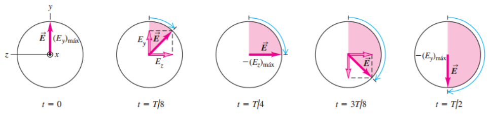

# Resumen de Física II — polarización lineal, circular y elíptica

## Unidad Temática 14. Polarización

## Polarización tipos de luz polarizada: elíptica, circular y lineal

### Polarización Lineal

Una onda está linealmente polarizada si en todo momento el campo eléctrico
resultante E vibra en la misma dirección en un punto en particular. El plano
formado por E y la dirección de propagación se conoce como el plano de
polarización de la onda. Es posible obtener un haz linealmente polarizado,
partiendo de un haz no polarizado, al retirar todas las ondas del haz con
excepción de aquellas cuyos vectores de campo eléctrico oscilan en un solo
plano.

### Polarización elíptica y circular

Suponga dos ondas linealmente polarizadas que están en fase y tienen la misma
amplitud, cuyos vectores son perpendiculares. La onda resultante se encuentra en
un plano orientado a 45° con respecto a los ejes y y z. La amplitud de la onda
resultante es más grande en un factor de $`\sqrt2`$ y está linealmente
polarizada. Ahora suponga que las dos ondas difieren en su fase por un cuarto de
ciclo, produciendo que la onda ya no tiene lugar en un solo plano, sino, que se
mueve en un círculo en un plano paralelo al plano yz teniendo el aspecto de una
hélice giratoria. Esta superposición particular de dos ondas linealmente
polarizadas se llama polarización circular.

Si la diferencia de fase entre las dos ondas componentes es distinta de un
cuarto de ciclo, o si las dos ondas componentes tienen amplitudes diferentes,
entonces cada punto de la cuerda traza no un círculo, sino una elipse. En este
caso, se dice que la onda está **elípticamente polarizada**

## Procedencia y observaciones

- Original: `2015/Resumen-Fisca-2.pdf`, páginas [68]; sectores delimitados por
  encabezados. SHA-256:
  `b9903f972224365c1a74b5d2732c9a34675c9b719da4c9c2d28e4a0f34e0b0cc`.
- PyMuPDF4LLM, Poppler y cotejo visual completo de los sectores; ecuaciones de
  imagen transcritas a LaTeX, figuras originales preservadas.
- Se conserva la descripción de la «cuerda» del original y los cinco instantes
  de la figura.
