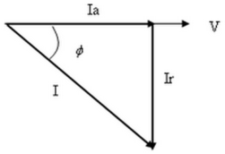

# Resumen de Física II — potencia activa y reactiva

Consideremos un circuito de CA en la que la corriente y la tensión tiene un
desfasaje ϕ. Se define a la componente activa de la corriente $`I_a`$ a la
componente que está en la fase con la tensión, y la componente reactiva $`I_r`$
, a la otra componente. Por lo tanto.

```math
I_a=I\cos\varnothing\qquad I_b=I\mathop{\mathrm{sen}}\nolimits\varnothing
```



Si lo multiplicamos por la tensión $`\Delta V`$ tenemos la potencia aparente
(S), activa (P) y reactiva (Q)

```math
S=I\Delta V\qquad P=I\cos\varnothing\,\Delta V\qquad Q=I\mathop{\mathrm{sen}}\nolimits\varnothing\,\Delta V
```

La potencia activa es la energía eléctrica que se convierte en trabajo. Esta es
la potencia consumida realmente por los circuitos (demanda eléctrica).

```math
P=I\Delta V\cos\varnothing=I^2Z\cos\varnothing=I^2R
```

La potencia reactiva se debe tanto a los elementos inductivos y capacitivos.
Esta potencia no se consume ni se genera en sentido estricto.

## Procedencia y observaciones

- Original: `2015/Resumen-Fisca-2.pdf`, páginas [52]; sectores delimitados por
  encabezados. SHA-256:
  `b9903f972224365c1a74b5d2732c9a34675c9b719da4c9c2d28e4a0f34e0b0cc`.
- PyMuPDF4LLM, Poppler y cotejo visual completo de los sectores; ecuaciones de
  imagen transcritas a LaTeX, figuras originales preservadas.
- Se conserva Ib de la ecuación frente a Ir del texto y diagrama, y ∅ de las
  fórmulas frente a φ del párrafo y dibujo. No se sustituyen silenciosamente.
