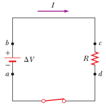

# Resumen de Física II — potencia eléctrica



Supongamos la trayectoria de una carga Q positiva en dirección de las manecillas
del reloj alrededor del circuito. Conforme la carga se mueve de a a b a través
de la batería, la energía potencial eléctrica del sistema aumenta en una
cantidad $`Q\Delta V`$ , en tanto que la energía potencial química de la batería
se reduce en la misma cantidad. Conforme la carga se mueve de c a d a través del
resistor el sistema pierde esta energía potencial eléctrica durante las
colisiones de los electrones con los átomos del resistor transformándose en
energía interna en el resistor. No se se pierde energía en las trayectorias bc y
da. Cuando la carga regresa al punto a, el resultado neto es que parte de la
energía química de la batería ha sido entregada al resistor y está presente en
este en forma de calor y radiacion. Después de algún tiempo transcurrido, el
resistor alcanza una temperatura constante, momento en el cual la energía de
entrada de la batería está equilibrada con la energía de salida por calor y
radiación. Considere ahora la rapidez a la cual el sistema pierde energía
potencial eléctrica conforme la carga Q pasa a través del resistor:

```math
\frac{dU}{dt}=\frac d{dt}(Q\Delta V)=\frac{dQ}{dt}\Delta V=I\Delta V
```

donde I es la corriente en el circuito. El sistema recupera su energía potencial
cuando la carga pasa a través de la batería. La rapidez a la cual el sistema
pierde energía potencial conforme la carga pasa a través del resistor es igual a
la rapidez a la cual el sistema adquiere energía interna en el resistor. Por lo
tanto, la potencia P, que representa la rapidez a la cual se entrega energía al
resistor, es

```math
\mathcal P=I\Delta V
```

Esta ecuación puede utilizarse para calcular la potencia entregada por una
fuente de voltaje a cualquier dispositivo que tenga una corriente I y esté
sujeto a una diferencia de potencial $`\Delta V`$ entre sus terminales.

Con la ecuación anterior, y a partir de que un resistor $`\Delta V=IR`$ , la
potencia entregada al resistor tiene una expresión alterna

```math
\mathcal P=I^2R=\frac{(\Delta V)^2}{R}
```

la unidad del SI para la potencia es el watt.

## Procedencia y observaciones

- Original: `2015/Resumen-Fisca-2.pdf`, páginas [23]; sectores delimitados por
  encabezados. SHA-256:
  `b9903f972224365c1a74b5d2732c9a34675c9b719da4c9c2d28e4a0f34e0b0cc`.
- PyMuPDF4LLM, Poppler y cotejo visual completo de los sectores. Ecuaciones de
  imagen transcritas a LaTeX.
- Se conservan «No se se pierde» y «radiacion». La figura del circuito, omitida
  por la extracción, se recuperó del objeto de imagen original del PDF.
