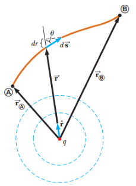
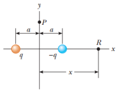
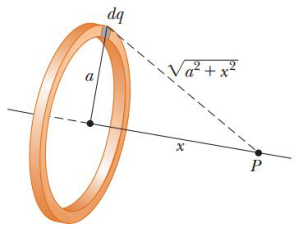
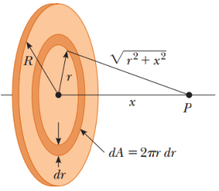
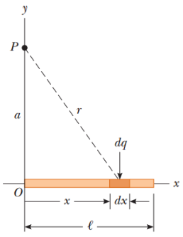

# Resumen de Física II — energía electrostática y potencial eléctrico

Unidad Temática 2. Energía electrostática. Potencial eléctrico

## Diferencia de potencial y potencial eléctrico

Para un desplazamiento infinitesimal ds de una carga puntual q0 inmersa en un
campo eléctrico, el trabajo realizado por un campo eléctrico sobre la misma es
$`F\,ds=q_0E\,ds`$ . Conforme el campo consume esta cantidad de trabajo, la
energía potencial del sistema carga-campo cambia en una cantidad
$`dU=-q_0E\,ds`$ . Para un desplazamiento finito de la carga desde el punto A al
punto B, el cambio en energía potencial del sistema $`\Delta U=U_B-U_A`$ es

```math
\Delta U=-q_0\int_A^B\vec E\cdot d\vec s
```

Porque la fuerza q0E es conservativa, la integral de línea no depende de la
trayectoria de A a B. Al dividir la energía potencial entre la carga de prueba
se obtiene una cantidad física que depende sólo de la distribución de carga
fuente y tiene un valor en cada uno de los puntos de un campo eléctrico. Esta
cantidad se conoce como potencial eléctrico o potencial V:

```math
V=\frac U{q_0}
```

```math
\Delta V\equiv\frac{\Delta U}{q_0}=-\int_A^B\vec E\cdot d\vec s
```

El potencial eléctrico es una cantidad escalar, la unidad del SI, el potencial
eléctrico, es joules por cada coulomb, que se define como un volt (V).

Una unidad de energía comúnmente utilizada en física atómica y nuclear es el
**electrón volt** (eV), que se define como la energía que un sistema carga-campo
gana o pierde cuando se desplaza una carga de magnitud e(un electrón o un
protón) a causa de una diferencia de potencial de 1 V.

## Potencial de cargas puntuales

Para determinar el potencial eléctrico en un punto ubicado a una distancia r de
la carga, inicie con la ex-presión general para la diferencia de potencial:

```math
V_B-V_A=-\int_A^B\vec E\cdot d\vec s
```

A y B son los dos puntos arbitrarios. En cualquier punto en el espacio, el campo
eléctrico a causa de la carga puntual es, donde $`\hat r`$ es un vector unitario
dirigido desde la carga hacia el punto. La cantidad E . ds puede expresarse como

```math
\vec E\cdot d\vec s=k_e\frac q{r^2}\hat r\cdot d\vec s
```



El producto punto $`r\cdot ds=ds\cos(u)`$ , donde u es el ángulo entre r y ds.
Además, $`ds\cos(u)`$ es la proyección de ds sobre r ; debido a eso
$`ds\cos(u)=dr`$ . Por lo tanto, $`E\,ds=(k_eq/r^2)dr`$ en consecuencia, la
expresión de la diferencia de potencial se convierte en

```math
V_B-V_A=-k_eq\int_{r_A}^{r_B}\frac{dr}{r^2}=\left.k_e\frac qr\right|_{r_A}^{r_B}=k_eq\left[\frac1{r_B}-\frac1{r_A}\right]
```

Esta ecuación muestra que la integral de E ds es independiente de la
trayectoria. Por lo común se elige la referencia del potencial eléctrico de una
carga puntual, de forma que sea V = 0 en r = ∞. Con esta referencia, el
potencial eléctrico establecido por una carga puntual a cualquier distancia r de
la carga es

```math
V=k_e\frac qr
```

El potencial eléctrico total en algún punto P debido a varias cargas puntuales
es la suma de los potenciales debidos a las cargas individuales.

```math
V=k_e\sum_i\frac{q_i}{r_i}
```

## Potencial de un dipolo

Un dipolo eléctrico consiste de dos cargas de igual magnitud y signo opuesto
separadas por una distancia 2a. El dipolo está a lo largo del eje xy tiene
centro en el origen.

### El potencial eléctrico en el punto P sobre el eje y

```math
V_P=k_e\sum_i\frac{q_i}{r_i}=k_e\left(\frac q{\sqrt{a^2+y^2}}+\frac{-q}{\sqrt{a^2+y^2}}\right)=0
```



### Calcule el potencial eléctrico en el punto R sobre el eje +x

```math
V_R=k_e\sum_i\frac{q_i}{r_i}=k_e\left(\frac{-q}{x-a}+\frac q{x+a}\right)=-\frac{2k_eqa}{x^2-a^2}
```

## Potencial de distribuciones continúas de cargas

Si conoce la distribución de carga, considere el potencial debido a un elemento
de carga dq pequeño, y trate a este elemento como una carga puntual. El
potencial eléctrico dV en algún punto P, debido al elemento de carga dq, es

```math
dV=k_e\frac{dq}r
```

donde r es la distancia desde el elemento de carga al punto P. Para tener el
potencial total en el punto P, integramos a fin de incluir las contribuciones de
todos los elementos de la distribución de carga.

```math
V=k_e\int\frac{dq}r
```

En esta expresión para V el potencial eléctrico se supone igual a cero cuando el
punto P se encuentra infinita-mente lejos de la distribución de carga.

### Potencial eléctrico debido a un anillo con carga uniforme



```math
\begin{aligned}V&=k_e\int\frac{dq}r=k_e\int\frac{dq}{\sqrt{a^2+x^2}}=\\V&=\frac{k_e}{\sqrt{a^2+x^2}}\int dq=\frac{k_eQ}{\sqrt{a^2+x^2}}\end{aligned}
```

### Potencial eléctrico debido a un disco con carga uniforme



```math
dq=\sigma\,dA=\sigma(2\pi r\,dr)=2\pi\sigma r\,dr
```

```math
dV=\frac{k_e\,dq}{\sqrt{r^2+x^2}}=\frac{k_e2\pi\sigma r\,dr}{\sqrt{r^2+x^2}}
```

```math
V=\pi k_e\sigma\int_0^R\frac{2r\,dr}{\sqrt{r^2+x^2}}=\pi k_e\sigma\int_0^R(r^2+x^2)^{-1/2}2r\,dr
```

```math
V=2\pi k_e\sigma\left[(R^2+x^2)^{1/2}-x\right]
```

### Potencial eléctrico debido a una línea de carga finita



```math
dV=k_e\frac{dq}r=k_e\frac{\lambda\,dx}{\sqrt{a^2+x^2}}
```

```math
V=\int_0^\ell k_e\frac{\lambda\,dx}{\sqrt{a^2+x^2}}=k_e\lambda\int_0^\ell\frac{dx}{\sqrt{a^2+x^2}}
```

```math
\int_0^\ell\frac{dx}{\sqrt{a^2+x^2}}=\ln\left(\ell+\sqrt{a^2+\ell^2}\right)-\ln a
```

```math
V=k_e\frac Q\ell\ln\left(\frac{\ell+\sqrt{a^2+\ell^2}}a\right)
```

## Procedencia y observaciones

- Original: `2015/Resumen-Fisca-2.pdf`, páginas8–9 y comienzo10 hasta «El campo
  eléctrico como gradiente». SHA-256:
  `b9903f972224365c1a74b5d2732c9a34675c9b719da4c9c2d28e4a0f34e0b0cc`.
- PyMuPDF4LLM, Poppler y cotejo visual completo de los sectores. Cinco figuras
  originales y ecuaciones transcritas como LaTeX; fragmentos consecutivos de una
  misma ecuación se reúnen sin alterar sus signos.
- Se conserva el signo positivo de la antiderivada q/r y la diferencia final
  1/rB−1/rA del original, sin corregirla. También «ex-presión»,
  «infinita-mente», «continúas» y «a lo largo del eje xy» (x seguido de la
  conjunción y sin espacio).
- El original omite una expresión del campo después de «la carga puntual es,»;
  no se rellena. Los nombres de puntos A y B se normalizan tipográficamente, sin
  el círculo decorativo que aparece en sus etiquetas.
