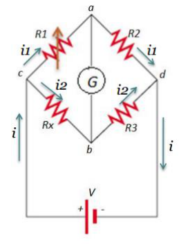

# Resumen de Física II — puente de Wheatstone

Un puente de Wheatstone es un dispositivo que se utiliza para la medición de
resistencias desconocidas. Estos están constituidos por un galvanómetro sensible
y cuatro resistencias que forman un circuito cerrado, siendo una de ellas la
resistencia bajo medida.

Durante la operación se ajusta la resistencia R3 hasta que la corriente que
fluya sobre el galvanómetro sea cero (Equilibrar puente). Cuando el puente esta
equilibrado la corriente que pasa a través de las resistencias R1 y R” es la
misma, y la corriente a través de Rx y R3 es la misma.

Si aplicamos ahora las leyes de kirchhoff a las dos espiras tenemos que

```math
\begin{cases}i_1\cdot R_1=i_2\cdot Rx\\i_1\cdot R_2=i_2\cdot R_3\end{cases}
```



Si dividimos la primera ecuación por la segunda tenemos que

```math
Rx=\frac{R_1}{R_2}R_3
```

## Procedencia y observaciones

- Original: `2015/Resumen-Fisca-2.pdf`, páginas [25]; sectores delimitados por
  encabezados. SHA-256:
  `b9903f972224365c1a74b5d2732c9a34675c9b719da4c9c2d28e4a0f34e0b0cc`.
- PyMuPDF4LLM, Poppler y cotejo visual completo de los sectores; fórmulas de
  imagen transcritas a LaTeX, diagramas originales conservados.
- Se conserva R” en el párrafo frente a R2 del circuito y el sistema. El marcado
  automático no corresponde a resaltado visible y se elimina.
