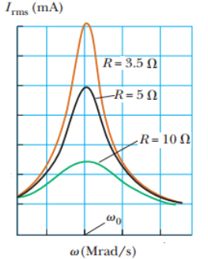

# Resumen de Física II — resonancia

Se dice que un circuito RLC en serie está en resonancia cuando la frecuencia
impulsora es tal que la corriente rms tiene su valor máximo. En general, la
corriente rms se puede escribir como

```math
I_{\mathrm{rms}}=\frac{\Delta V_{\mathrm{rms}}}Z
```

donde Z es la impedancia. La sustitución de la expresión de Z en la ecuación
anterior da

```math
I_{\mathrm{rms}}=\frac{\Delta V_{\mathrm{rms}}}{\sqrt{R^2+(X_L-X_C)^2}}
```

Puesto que la impedancia depende de la frecuencia de la fuente, la corriente del
circuito RLC también depende de la frecuencia. La frecuencia $`\omega_0`$ a la
que $`X_L-X_C=0`$ se denomina frecuencia de resonancia del circuito. Partimos de
que $`X_L=X_C`$ , por lo tanto $`\omega_0L=1/\omega_0C`$ , o sea

```math
\omega_0=\frac1{\sqrt{LC}}
```

La corriente rms en un circuito RLC en serie alcanza su valor máximo cuando la
frecuencia del voltaje aplicado es igual a la frecuencia natural del oscilador,
que depende sólo de L y C. Además, a esta frecuencia la corriente está en fase
con el voltaje aplicado.

Las curvas se hacen más angostas y más altas a medida que la resistencia se
reduce. Cuando R=0, la corriente se hace infinita. (Realmente siempre existe
algún tipo de resistencia)



## Procedencia y observaciones

- Original: `2015/Resumen-Fisca-2.pdf`, páginas [51, 52]; sectores delimitados
  por encabezados. SHA-256:
  `b9903f972224365c1a74b5d2732c9a34675c9b719da4c9c2d28e4a0f34e0b0cc`.
- PyMuPDF4LLM, Poppler y cotejo visual completo de los sectores; ecuaciones de
  imagen transcritas a LaTeX, figuras originales preservadas.
- Se conservan las expresiones lineales de reactancia del texto y el caso ideal
  R=0 del documento.
