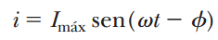
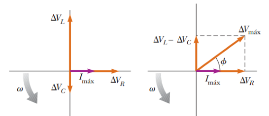
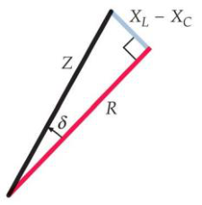

# Resumen de Física II — circuito serie RLC

Es un circuito que contiene un resistor, un inductor y un condensador conectados
en serie a las terminales de una fuente de voltaje alterno. Si el voltaje
aplicado tiene una variación senoidal con el tiempo, el voltaje instantáneo
aplicado es

```math
\Delta v=\Delta V_{\mathrm{máx}}\mathop{\mathrm{sen}}\nolimits\omega t
```

mientras que la corriente varía como

```math
i=I_{\mathrm{máx}}\mathop{\mathrm{sen}}\nolimits(\omega t-\phi)
```



donde φ es cierto ángulo de fase entre la corriente y el voltaje aplicados. La
corriente generalmente no esté en fase con el voltaje en un circuito RLC.

Por estar los elementos conectados en serie, la corriente debe ser la misma en
cada elemento, es decir, tiene la misma amplitud y fase en cualquier punto. Por
otro lado el voltaje en las terminales de cada elemento tiene amplitud y fase
diferentes como

```math
\begin{aligned}
\Delta v_R&=I_{\mathrm{máx}}R\mathop{\mathrm{sen}}\nolimits\omega t=\Delta V_R\mathop{\mathrm{sen}}\nolimits\omega t\\
\Delta v_L&=I_{\mathrm{máx}}X_L\mathop{\mathrm{sen}}\nolimits\left(\omega t+\frac\pi2\right)=\Delta V_L\cos\omega t\\
\Delta v_C&=I_{\mathrm{máx}}X_C\mathop{\mathrm{sen}}\nolimits\left(\omega t-\frac\pi2\right)=-\Delta V_C\cos\omega t
\end{aligned}
```

La suma de los tres voltajes debe ser igual al voltaje de la fuente de CA.
Puesto que los fasores son vectores que giran, se combinan mediante una suma
vectorial dando un vector resultante, cuyo modulo es $`\Delta V_{max}`$ , y
forma un Angulo φ con el fasor de corriente I



```math
\Delta V_{\mathrm{máx}}=\sqrt{\Delta V_R^2+(\Delta V_L-\Delta V_C)^2}=\sqrt{(I_{\mathrm{máx}}R)^2+(I_{\mathrm{máx}}X_L-I_{\mathrm{máx}}X_C)^2}
```

```math
\Delta V_{\mathrm{máx}}=I_{\mathrm{máx}}\sqrt{R^2+(X_L-X_C)^2}
```

Debido a eso, se expresa la corriente máxima como

```math
I_{\mathrm{máx}}=\frac{\Delta V_{\mathrm{máx}}}{\sqrt{R^2+(X_L-X_C)^2}}
```

El denominador de la fracción desempeña el papel de resistencia y se llama
impedancia Z del circuito:

```math
Z=\sqrt{R^2+(X_L-X_C)^2}
```

donde la impedancia también está en ohms. Por lo tanto

```math
I_{\mathrm{máx}}=\frac{\Delta V_{\mathrm{máx}}}Z
```

La corriente de un circuito de CA depende de la resistencia, la inductancia, la
capacitancia y la frecuencia.



El ángulo de fase φ entre la corriente y el voltaje es

```math
\phi=\tan^{-1}\left(\frac{\Delta V_L-\Delta V_C}{\Delta V_R}\right)=\tan^{-1}\left(\frac{I_{\mathrm{máx}}X_L-I_{\mathrm{máx}}X_C}{I_{\mathrm{máx}}R}\right)
```

```math
\phi=\tan^{-1}\left(\frac{X_L-X_C}R\right)
```

Cuando $`X_L\gt X_c`$ , el ángulo de fase es positivo, (la corriente se retrasa
al voltaje aplicado), el circuito es más inductivo que capacitivo. Cuando
$`X_L\lt X_c`$ , el ángulo de fase es negativo, (la corriente se adelanta al
voltaje aplicado), el circuito es más capacitivo que inductivo. Cuando
$`X_L=X_c`$ , el ángulo de fase es cero, (la corriente y el voltaje están en
fase) y el circuito es completamente resistivo

## Procedencia y observaciones

- Original: `2015/Resumen-Fisca-2.pdf`, páginas [49, 50]; sectores delimitados
  por encabezados. SHA-256:
  `b9903f972224365c1a74b5d2732c9a34675c9b719da4c9c2d28e4a0f34e0b0cc`.
- PyMuPDF4LLM, Poppler y cotejo visual completo de los sectores; ecuaciones de
  imagen transcritas a LaTeX, figuras originales preservadas.
- Se conservan «no esté en fase», «modulo» y «Angulo», y c minúscula del texto
  frente a C de las fórmulas.
