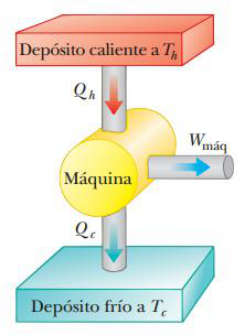
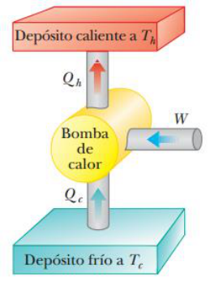

# Resumen de Física II — segundo principio, máquinas y bombas de calor

## Segundo principio de la termodinámica: Enunciado

### Máquinas térmicas



Una máquina térmica es un dispositivo que toma energía por calor y, al funcionar
en un proceso cíclico, expulsa una fracción de dicha energía mediante trabajo.
La máquina absorbe una cantidad de energía Qh del depósito caliente. La máquina
realiza trabajo Wmáq (de modo que el trabajo negativo $`W=-W_{máq}`$ se consume
en la máquina) y después entrega una cantidad de energía Qc al depósito frío. Al
ser un proceso ciclico sus energías internas inicial y final son iguales:
$`\Delta E_{int}=0`$ . Por la primera ley de la termodinámica,
$`\Delta E_{int}=Q+W=Q-W_{maq}=0`$ y el trabajo neto Wmáq realizado por una
máquina térmica es igual a la energía neta Qneta que se le transfiere.
$`Q_{neta}=Qh-Qc`$ ; por lo tanto,

```math
W_{\mathrm{máq}}=|Q_h|-|Q_c|
```

La eficiencia térmica e de una máquina térmica se define como la relación del
trabajo neto invertido por la máquina durante un ciclo, a la entrada de energía
a la mayor temperatura durante el ciclo:

```math
e=\frac{W_{\mathrm{máq}}}{|Q_h|}=\frac{|Q_h|-|Q_c|}{|Q_h|}=1-\frac{|Q_c|}{|Q_h|}
```

En la práctica, todas las máquinas térmicas sólo expulsan una fracción de la
energía de entrada Qh por trabajo mecánico; en consecuencia, su eficiencia
siempre es menor que el 100%. Una máquina térmica con eficiencia perfecta
tendría que expulsar toda la energía de entrada mediante trabajo. La forma de
Kelvin–Planck de la segunda ley de la termodinámica establece lo siguiente:

“Es imposible construir una máquina térmica que, funcionando en un ciclo, con la
entrada de energía por calor de un depósito produzca una cantidad igual de
trabajo”

Durante el funcionamiento de una máquina térmica, Wmáq nunca puede ser igual a
Qh, siempre debe rechazar algo de energía Qc al ambiente.

### Bombas de calor y refrigeradores

La función de la máquina térmica es procesar la energía del depósito caliente de
modo que se transforme en trabajo útil. Los refrigeradores funcionan a la
inversa tomando energía Qc de un depósito frío y expulsa energía Qh a un
depósito caliente realizando trabajo en la máquina. La energía expulsada al
depósito caliente debe ser igual a la suma del trabajo realizado y la energía
que se toma del depósito frío.

La forma de Clausius de la segunda ley de la termodinámica establece lo
siguiente:

“Es imposible construir una máquina cíclica cuyo único efecto sea transferir
energía de manera continua mediante calor desde un objeto mas frio a otro con
mayor temperatura sin la entrada de energía por trabajo”. (Este enunciado es
equivalente al de Kelvin–Planck).



El coeficiente de realización (COP) es la efectividad del refrigerador, este
será más efectivo cuando retire la mayor cantidad de energía del depósito frío a
cambio de la menor cantidad de trabajo. Para una bomba de calor en modo
enfriamiento, COP se define como

```math
\mathrm{COP}\;(\text{modo de enfriamiento})=\frac{|Q_c|}W
```

Y para una bomba de calor en modo calentamiento, el COP se define como

```math
\mathrm{COP}\;(\text{modo de calentamiento})=\frac{|Q_h|}W
```

## Procedencia y observaciones

- Original: `2015/Resumen-Fisca-2.pdf`, páginas [77, 78, 79]; sectores
  delimitados por encabezados. SHA-256:
  `b9903f972224365c1a74b5d2732c9a34675c9b719da4c9c2d28e4a0f34e0b0cc`.
- PyMuPDF4LLM, Poppler y cotejo visual completo de los sectores; ecuaciones de
  imagen transcritas a LaTeX, figuras originales preservadas.
- Se conservan los dos enunciados y COP con sus modos, y «ciclico», «mas frio»
  del original.
