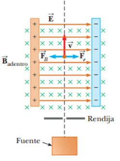
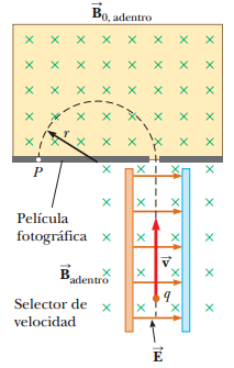
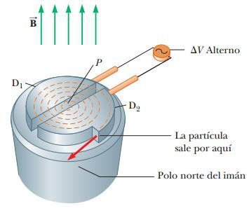

# Resumen de Física II — selector, espectrómetro y ciclotrón

## Selector de velocidad

Permite que todas las partículas se muevan a la misma velocidad. Un campo
eléctrico uniforme se dirige a la derecha y se aplica un campo magnético
uniforme en dirección perpendicular al campo eléctrico. Si q es positiva y la
velocidad v está dirigida hacia arriba, la fuerza magnética qvB se dirige hacia
la izquierda y la fuerza eléctrica qE hacia la derecha. Se escogen las
magnitudes de los dos campos, de forma que qE= qvB, es decir, que no sufra
desviación alguna.

```math
v=\frac EB
```

Sólo aquellas partículas que tengan esta rapidez pasarán sin desviarse a través
de los campos.



## Espectrómetro de masas

Un espectrómetro de masas separa iones según su relación masa a carga. El haz de
iones pasa primero a través de un selector de velocidad y después entra a un
segundo campo magnético donde los iones se mueven en un semicírculo de radio r e
impacta en la película fotográfica en P. Si los iones están con carga positiva,
el haz se desviará hacia la izquierda, si están con carga en forma negativa, el
haz se desviará hacia la derecha. La relación m/q se expresa de la forma

```math
\frac mq=\frac{rB_0}v=\frac{rB_0B}E
```

es posible determinar m/q midiendo el radio de curvatura y conociendo cuáles son
los valores de los campos B, $`B_0`$ y E.



Una variante de esta técnica fue utilizada para medir la relación $`e/m_e`$ para
los electrones. Los electrones se aceleran desde el cátodo y pasan a través de
dos ranuras. A continuación pasan a una región de campos eléctrico y magnético
perpendiculares entre sí. Las magnitudes de los dos campos se ajustan
inicialmente a fin de producir un haz sin desviación. Cuando se desactiva el
campo magnético, el campo eléctrico produce una deflexión medible en el haz que
queda registrada sobre la pantalla fluorescente. A partir de la magnitud de la
deflexión y de los valores medidos para Ey B, es posible determinar la relación
carga a masa.

## El ciclotrón



Un ciclotrón es un dispositivo que puede acelerar partículas con carga a
considerables magnitudes de velocidad. Las cargas se mueven en el interior de
dos recipientes semicirculares, D1 y D2. A las “des” se les aplica una
diferencia de potencial alternante de alta frecuencia y se dirige un campo
magnético uniforme en dirección perpendicular.

Un ion positivo liberado en P cerca del centro del imán en una “de” sigue una
trayectoria semicircular y vuelve al espacio entre las “des” en un intervalo de
tiempo T/2, donde T es el intervalo de tiempo necesario para hacer un recorrido
completo alrededor de dos “des”. Si la diferencia de potencial aplicado se
ajusta de manera que D2 esté a un potencial eléctrico inferior que D1 en una
magnitud $`\Delta V`$ , el ion se acelerará a través del espacio hasta D2 y su
energía cinética se incrementará en la cantidad $`q\Delta V`$ . El movimiento
continúa, así que para cada mitad de recorrido de una “de”, el ion adquiere
energía cinética adicional igual a $`q\Delta V`$ . Cuando el radio de su
trayectoria es prácticamente el de las “des”, el ion sale del sistema a través
de la ranura de salida. T es independiente de la rapidez del ion y del radio de
la trayectoria circular.

Se puede obtener una expresión de la energía cinética del ion cuando sale del
ciclotrón, en función del radio R de las “des”. Se sabe que v = qBR/m. Por
tanto, la energía cinética es

```math
K=\frac12mv^2=\frac{q^2B^2R^2}{2m}
```

## Procedencia y observaciones

- Original: `2015/Resumen-Fisca-2.pdf`, páginas [28, 29]; sectores delimitados
  por encabezados. SHA-256:
  `b9903f972224365c1a74b5d2732c9a34675c9b719da4c9c2d28e4a0f34e0b0cc`.
- PyMuPDF4LLM, Poppler y cotejo visual completo de los sectores; ecuaciones de
  imagen transcritas a LaTeX, figuras originales preservadas.
- La ecuación m/q se une a partir de dos fragmentos de la misma línea. La figura
  del ciclotrón, omitida por la extracción, se recupera del objeto original del
  PDF.
