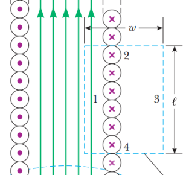

# Resumen de Física II — solenoide y toroide

## Aplicaciones: Solenoide



Considere un solenoide es ideal, en el que B es uniforme en el espacio interior
y paralelo al eje, y las líneas de campo magnético en el espacio exterior forman
círculos alrededor del solenoide. Supongamos la trayectoria rectangular de
longitud L y ancho ω. Si a esta trayectoria aplicamos la ley de Ampere para
evaluar la integral de B.ds en cada lado del rectángulo. La contribución a lo
largo del lado 3 es igual a cero, porque en esta región las líneas de campo
magnético son perpendiculares a la trayectoria. Las contribuciones de los lados
2 y 4 son iguales a cero, de nuevo porque B es perpendicular a ds a lo largo de
estas trayectorias, tanto en el interior como en el exterior del solenoide. El
lado 1 proporciona una contribución a la integral ya que, a lo largo de esta
trayectoria, B es uniforme y paralelo a ds . La integral de la trayectoria
rectangular cerrada es

```math
\oint\vec B\cdot d\vec s=\int_{\text{trayectoria 1}}\vec B\cdot d\vec s=B\int_{\text{trayectoria 1}}ds=B\ell
```

El lado derecho de la ley de Ampère se refiere a la corriente total I a través
del área limitada por la trayectoria de integración. En este caso, la corriente
total a través de la trayectoria rectangular es igual a la corriente en cada
vuelta multiplicada por el número de vueltas. Si en la longitud L, N es el
número de vueltas, la corriente total a través del rectángulo es NI. Por tanto,
la ley de Ampère aplicada a esta trayectoria da

```math
\oint\vec B\cdot d\vec s=B\ell=\mu_0NI
```

```math
B=\mu_0\frac N\ell I=\mu_0nI
```

donde n=N/L es el número de vueltas por unidad de longitud.

## Toroide

Un toroide es una espira que forma un anillo. Dentro del toroide se forma un
campo magnético uniforme circular. Para obtener el valor de este campo aplicamos
la ley de Ampere tomando una trayectoria circular de radio r que pase por dentro
del toroide

```math
\int B\cdot ds=B\int ds=B2\pi r=\mu_0NI
```

N es el número de vueltas, que transportan la corriente I, por lo tanto el campo
magnético B dentro del toroide está dado por

```math
B=\frac{\mu_0NI}{2\pi r}
```

## Procedencia y observaciones

- Original: `2015/Resumen-Fisca-2.pdf`, páginas [34]; sectores delimitados por
  encabezados. SHA-256:
  `b9903f972224365c1a74b5d2732c9a34675c9b719da4c9c2d28e4a0f34e0b0cc`.
- PyMuPDF4LLM, Poppler y cotejo visual completo de los sectores; ecuaciones de
  imagen transcritas a LaTeX, figuras originales preservadas.
- Se conserva «Considere un solenoide es ideal», ancho ω en texto frente a w del
  dibujo, L frente a ℓ, y las integrales no cerradas del desarrollo del toroide.
