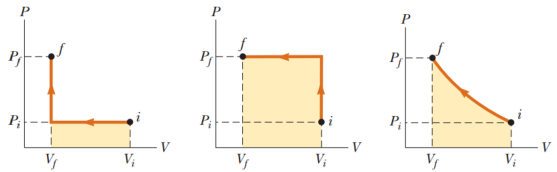

# Resumen de Física II — trabajo y dependencia de la trayectoria

## Unidad Temática 16. Principios de la Termodinámica

## Trabajo exterior. Trabajo y calor. Trabajo depende de la trayectoria

Se llama trabajo exterior, realizado por o sobre el sistema, a todo
desplazamiento sufrido por éste contra o por la acción de fuerzas exteriores. En
termodinámica, por convención, el trabajo es positivo si es realizado por el
sistema sobre el medio exterior y negativo si es realizado sobre el sistema por
el medio exterior

Los estados como presión, volumen, temperatura y energía interna conforman las
variables de estado de un sistema. Las variables de transferencia son aquellas
que involucran energía. Estas variables son válidas si el sistema está en
equilibrio térmico interno, es decir, que cada parte del gas esté a la misma
presión y temperatura.

Consideremos un gas contenido en un cilindro ajustado con un pistón móvil. En
equilibrio, el gas ocupa un volumen V y ejerce una presión uniforme P sobre las
paredes del cilindro y sobre el pistón. Si el pistón tiene un área A, la fuerza
ejercida por el gas sobre el pistón es F=PA. Supongamos que el pistón se empuja
hacia adentro una distancia dy, y comprime el gas de modo que permanece en
equilibrio térmico interno. El trabajo invertido en el gas es

```math
dW=\vec F\cdot d\vec r=-F\hat{\mathbf j}\cdot dy\hat{\mathbf j}=-F\,dy=-PA\,dy
```

donde la magnitud F de la fuerza externa es igual a PA por estar en equilibrio.
Dado que A dy es el cambio en volumen del gas dV, el trabajo realizado sobre el
gas se expresa como

```math
dW=-P\,dV
```

Si el trabajo es positivo o negativo depende del dV. Si se comprime el trabajo
es positivo. Si se expande el trabajo es negativo. El trabajo total invertido en
el gas a medida que su volumen cambia de Vi a Vf es

```math
W=-\int_{V_i}^{V_f}P\,dV
```

La presión no es constante durante el proceso, pero depende del volumen y la
temperatura. La grafica de la presión y el volumen de un gas durante el proceso
se llama diagrama PV. “El trabajo invertido en un gas en un proceso cuasi
estático que lleva al gas de un estado inicial a un estado final, es el negativo
del área bajo la curva en un diagrama PV, evaluada entre los estados inicial y
final”

El trabajo consumido para comprimir un gas depende de la trayectoria particular
que toma entre los estados inicial y final.



```math
W=P_i(v_f-v_i)\qquad W=P_f(v_f-v_i)\qquad W=\int_{v_i}^{v_f}P(v)dv
```

Considere un gas ideal aislado térmicamente de sus alrededores, excepto en el
fondo donde está en contacto térmico con un depósito de energía (mantiene
temperatura constante). El pistón se mantiene en su posición inicial mediante un
agente externo. Cuando la fuerza en el pistón se reduce un poco, este se eleva
con lentitud a su posición final.

Tanto el trabajo realizado entre dos estados como el calor cedido o recibido
dependen de los estados inicial, final e intermedios del sistema, es decir
depende de la trayectoria entre los estados inicial y final.

## Procedencia y observaciones

- Original: `2015/Resumen-Fisca-2.pdf`, páginas [76]; sectores delimitados por
  encabezados. SHA-256:
  `b9903f972224365c1a74b5d2732c9a34675c9b719da4c9c2d28e4a0f34e0b0cc`.
- PyMuPDF4LLM, Poppler y cotejo visual completo de los sectores; ecuaciones de
  imagen transcritas a LaTeX, figuras originales preservadas.
- Se conservan las convenciones contradictorias: el párrafo inicial llama
  positivo al trabajo del sistema, mientras el desarrollo usa dW=−P dV y llama
  positiva la compresión. Las tres fórmulas bajo las gráficas aparecen sin signo
  negativo y se preservan.
