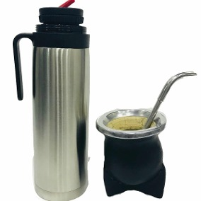
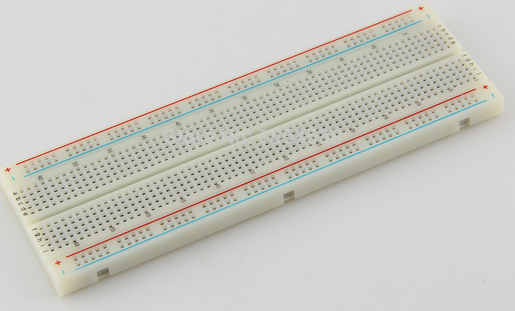
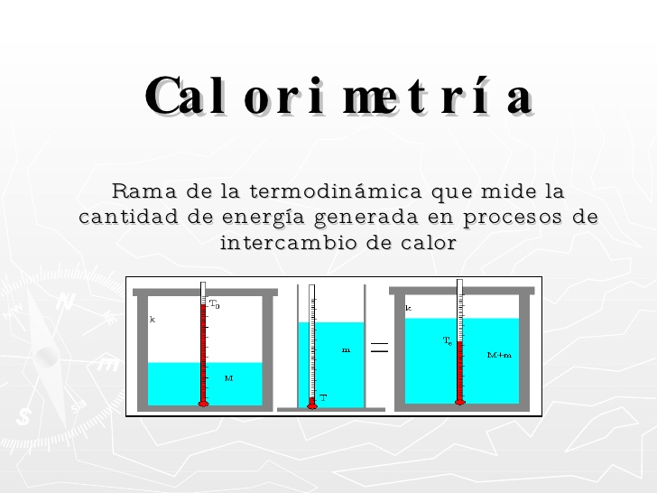
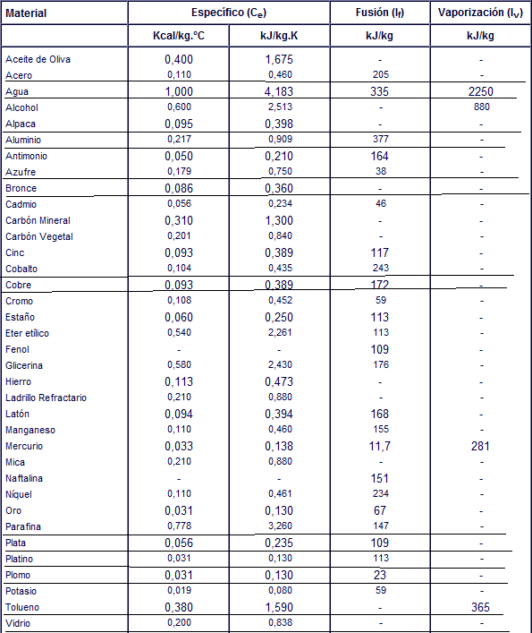
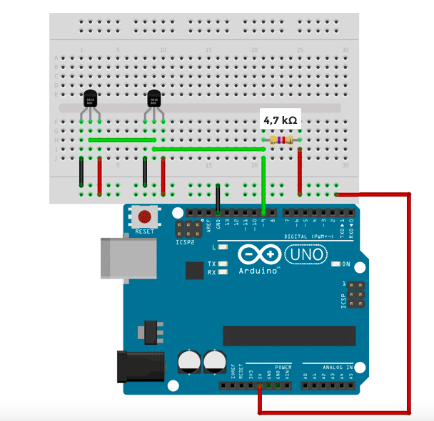
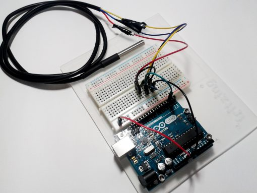

# Calorimetría: primera entrega del grupo 8

> Fuente: `2019/lab arduino/LaboratorioCalorimetria-Primer-Entrega(1).pptx`.
> SHA-256: `67a8eae4524e36cfdf074eeeed67f689dfdbb0b67857a3c88d2560a7380c1aac`.
> Se cotejaron las ocho diapositivas mediante MarkItDown, XML y PDF de
> LibreOffice. Ecuaciones y tabla recuperadas por comparación visual; figuras
> extraídas del original. La carpeta de origen es 2019; no se añade una fecha.

## Diapositiva 1 — Calorimetría

GRUPO Nº 8

INTEGRANTES:

- Blanco Lara
- Cuevas Nicolas
- Ferreyra Eduardo
- Perez Antonella
- Rojas Mauro

UNIVERSIDAD TECNOLOGICA NACIONAL

facultad Regional resistencia


## Diapositiva 2 — ¿Qué se busca medir con este experimento?

Calcular el calor especifico del agua para poder conocer la cantidad de energía
(cantidad de calor) que debo suministrar al agua para un termo de mate y obtener
una temperatura ideal (70 a 80 grados) para el mismo.



## Diapositiva 3 — Materiales a utilizar

- Un recipiente de telgopor.
- Un trozo de alambre.
- Un trozo de material cuyo calor especifico sea conocido.
- Un termo y calentador electrico.
- Hilo.
- Balzanza de presicion.
- Sensor de temperature ds18b20




## Diapositiva 4 — Calorimetría ¿Qué es?

Rama de la termodinámica que mide la cantidad de energía generada en procesos de
intercambio de calor.

### Calor especifico ¿Qué es?

La cantidad de energía que se debe suministrar a un gramo de sustancia para que
su temperatura aumente en un grado centígrado.



## Diapositiva 5 — Introducción teórica

Definimos la capacidad calorífica de un cuerpo o sustancia como:

```math
C=\frac{\Delta Q}{\Delta T}\qquad (1)
```

donde $`\Delta Q`$ es la cantidad de calor que debe intercambiar para efectuar
un cambio $`\Delta T`$.

El calor especifico definimos como

```math
c=\frac{C}{M}\qquad (2)
```

donde $`M`$ es la masa y $`C`$ la capacidad calorífica.

De aquí podemos de (1) y (2) obtenemos que la cantidad de calor necesario para
elevar la temperatura de $`M`$ gramos de agua es:

```math
\Delta Q=M c\Delta T\qquad (3)
```

<!-- markdownlint-disable MD026 -->

## Diapositiva 6 — PROCEDIMIENTO:

Determinar el equivalente en agua k.

```math
k=\frac{m(T-T_f)}{T_f-T_i}-M
```

Donde:

- m: masa de agua caliente
- T: temperatura inicial de la masa m de agua
- Tf: temperatura final del calorímetro.
- Ti: temperatura inicial del calorimetro
- M: masa de agua inicial en el calorimetro.

## Diapositiva 7 — PROCEDIMIENTO:

<!-- markdownlint-enable MD026 -->

Determinar el calor especifico del agua

```math
c_{\mathrm{H_2O}}=\frac{c\,m_2(T_2-T_f)}{(m_1+k)(T_f-T_1)}
```

Donde:

- c: calor especifico del material utilizado.
- m2: masa del material
- m1: masa de agua en el calorimetro.
- T1: temperatira del agua en el calorimetro
- T2: temperatira del material.

### Tabla de calores

| Material | Específico (C_e): Kcal/kg.°C | Específico (C_e): kJ/kg.K | Fusión (l_f): kJ/kg | Vaporización (l_v): kJ/kg |
| -- | -- | -- | -- | -- |
| Aceite de Oliva | 0,400 | 1,675 | - | - |
| Acero | 0,110 | 0,460 | 205 | - |
| Agua | 1,000 | 4,183 | 335 | 2250 |
| Alcohol | 0,600 | 2,513 | - | 880 |
| Alpaca | 0,095 | 0,398 | - | - |
| Aluminio | 0,217 | 0,909 | 377 | - |
| Antimonio | 0,050 | 0,210 | 164 | - |
| Azufre | 0,179 | 0,750 | 38 | - |
| Bronce | 0,086 | 0,360 | - | - |
| Cadmio | 0,056 | 0,234 | 46 | - |
| Carbón Mineral | 0,310 | 1,300 | - | - |
| Carbón Vegetal | 0,201 | 0,840 | - | - |
| Cinc | 0,093 | 0,389 | 117 | - |
| Cobalto | 0,104 | 0,435 | 243 | - |
| Cobre | 0,093 | 0,389 | 172 | - |
| Cromo | 0,108 | 0,452 | 59 | - |
| Estaño | 0,060 | 0,250 | 113 | - |
| Eter etílico | 0,540 | 2,261 | 113 | - |
| Fenol | - | - | 109 | - |
| Glicerina | 0,580 | 2,430 | 176 | - |
| Hierro | 0,113 | 0,473 | - | - |
| Ladrillo Refractario | 0,210 | 0,880 | - | - |
| Latón | 0,094 | 0,394 | 168 | - |
| Manganeso | 0,110 | 0,460 | 155 | - |
| Mercurio | 0,033 | 0,138 | 11,7 | 281 |
| Mica | 0,210 | 0,880 | - | - |
| Naftalina | - | - | 151 | - |
| Níquel | 0,110 | 0,461 | 234 | - |
| Oro | 0,031 | 0,130 | 67 | - |
| Parafina | 0,778 | 3,260 | 147 | - |
| Plata | 0,056 | 0,235 | 109 | - |
| Platino | 0,031 | 0,130 | 113 | - |
| Plomo | 0,031 | 0,130 | 23 | - |
| Potasio | 0,019 | 0,080 | 59 | - |
| Tolueno | 0,380 | 1,590 | - | 365 |
| Vidrio | 0,200 | 0,838 | - | - |



> Nota de transcripción: se conservan las grafías, unidades, guiones y valores
> del original, sin corregir la tabla.

## Diapositiva 8 — Esquema de conexión




