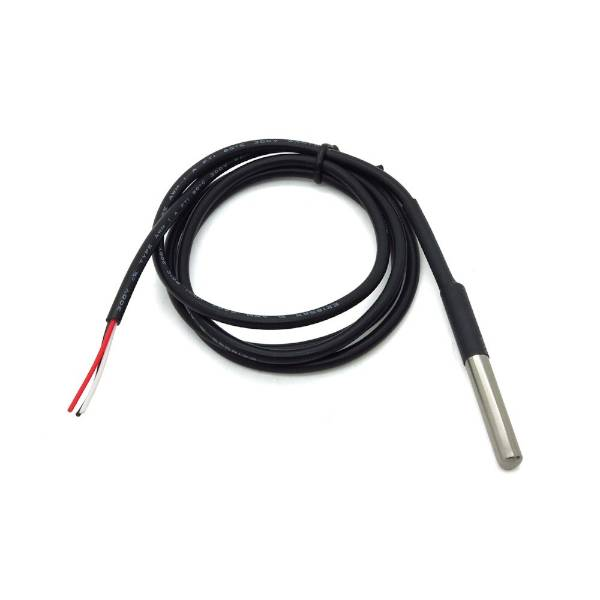
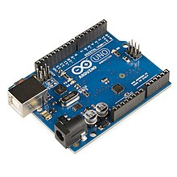

# Calorimetría: primera entrega del grupo 9

> Fuente: `2019/lab arduino/LaboratorioCalorimetria - Primer Entrega.pptx`.
> SHA-256: `3def53213b95ad72024351874cd374e873e89efa145b17b1f3125471e5ffd80a`.
> Se cotejaron las seis diapositivas mediante MarkItDown, XML y PDF de
> LibreOffice. Figuras extraídas del original. La carpeta de origen es 2019; no
> se añade una fecha de elaboración.

## Diapositiva 1 — Calorimetría

GRUPO Nº 9:

INTEGRANTES:

> Nota de transcripción: el campo de integrantes está vacío en el original.

UNIVERSIDAD TECNOLOGICA NACIONAL

facultad Regional resistencia

## Diapositiva 2 — Calorimetría ¿Qué es?

Rama de la termodinámica que mide la cantidad de energía generada en procesos de
intercambio de calor.

## Diapositiva 3 — ¿Qué se busca medir con este experimento?

Encontrar la temperatura exacta para el cebado de un mate uteniano, mediante la
utilización de herramientas de Arduino, el liquido se dispondrá en un recipiente
al que lo denominaremos “calorímetro”.

## Diapositiva 4 — La variable a medir ¿cambia con el tiempo?

> Nota de transcripción: la diapositiva contiene únicamente el título; no hay
> respuesta.

## Diapositiva 5 — Materiales a utilizar

> Nota de transcripción: no hay una lista escrita de materiales. La cuarta
> imagen incrustada es un fondo blanco sin contenido.

## Diapositiva 6 — Esquema de conexión

> Nota de transcripción: la diapositiva contiene únicamente el título; el
> esquema no está incluido.
