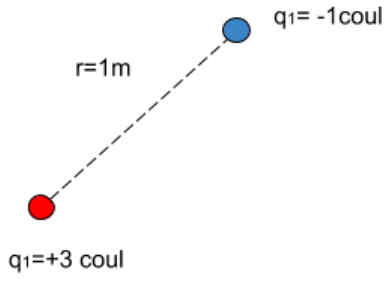
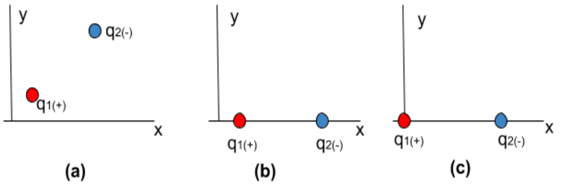
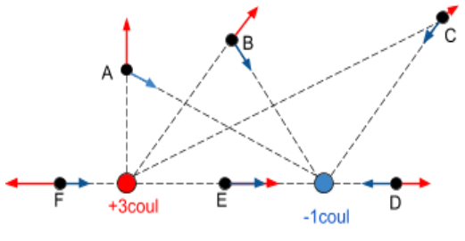
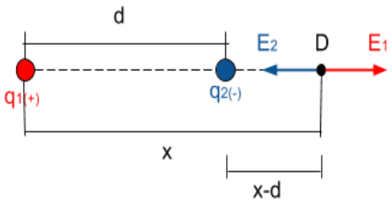

# Campo cero de dos cargas puntuales

**Problema:** “Una carga de 3 coul y otra de -1 coul se encuentran separadas una
distancia de 1m. Encontrar el o los puntos del espacio donde el campo eléctrico
se anule”

El problema plantea esto:



❖ A los fines de establecer posiciones, coloquemos un **SISTEMA DE REFERENCIA**.
De los siguientes, cuál elegirías?



- En (a) van a tener que usar ecuaciones para cada dirección, es un problema
  BIDIMENSIONAL.
- En (b) reducen a una coordenada (x) y siguen teniendo una para cada carga.
- En (c) se mejora la anterior, haciendo que la coordenada de la carga q1 sea
  cero, con la ventaja a la hora de hacer los cálculos.

Veamos donde se podría anular el campo eléctrico:



La pregunta que nos deberíamos hacer es la siguiente: ¿Cuál es la condición para
que dos vectores se anulen entre sí?

La respuesta sería: que estén en sentidos opuestos en la misma dirección.

Bajo esta condición descartamos los puntos A, B y C (en principio) y E (que
tiene igual dirección pero igual sentido).

Si a C lo llevo al infinito, los campos se anularían y todos los puntos en el ∞
serían una solución del problema.

El punto F y su entorno, si bien cumple con la primer condición, no orá ser
posible porque el campo de la carga (-) no podría igualar al de la carga (+) por
ser SIEMPRE más pequeño al valor de la carga y a mayor distancia.

Nos queda sólo el punto D, donde compensa la carga negativa su poco valor con la
corta distancia y tiene entonces posibilidades de cancelar el campo de la carga
puntual.

Ahora, demos nombres a las variables:



En D, los módulos de los campos son los mismos.

```math
|\vec E_1|=|\vec E_2|
```

```math
k\cdot\frac{q_1}{x^2}=k\cdot\frac{q_2}{(x-d)^2}
```

(1)

También, podría decir que

```math
\vec E_1+\vec E_2=0
```

```math
k\cdot\frac{q_1}{x^2}+k\cdot\frac{(-q_2)}{(x-d)^2}=0
```

(2)

(1) y (2) son idénticas ecuaciones:

```math
\begin{aligned}
k\cdot\frac{q_1}{x^2}=k\cdot\frac{q_2}{(x-d)^2}&\Rightarrow q_1\cdot(x-d)^2=q_2\cdot x^2\\
&\Rightarrow q_1\cdot x^2+q_1\cdot d^2-2\cdot q_1\cdot x\cdot d=q_2\cdot x^2\\
&\Rightarrow(q_1-q_2)\cdot x^2-2\cdot q_1\cdot x\cdot d+q_1d^2=0
\end{aligned}
```

Al reemplazar los valores tomo q₂ como positivo (el valor de -1 coul →1 coul)
porque ya lo supuse negativo al plantear las ecuaciones;

```math
(3coul-1coul)\cdot x^2-2\cdot3coul\cdot1m\cdot x+3coul\cdot1m^2=0
```

Nótese, también, que en la ecuación TODOS los términos tienen dimensiones de
[carga]\*$`[longitud]^2`$ (La “x” tiene dimensiones de longitud).

```math
2coul\cdot x^2-6coul\cdot m\cdot x+3coul\cdot m^2
```

Es una ecuación cuadrática y su solución es

```math
\begin{aligned}
x&=\frac{6coul\cdot m\pm\sqrt{(-6coul\cdot m)^2-4\cdot(2coul)\cdot3coul\cdot m^2}}{2\cdot2coul}\\
&=\frac{6coul\cdot m\pm\sqrt{12coul^2\cdot m^2}}{4coul}=\frac{6coul\cdot m\pm\sqrt{12}coul\cdot m}{4coul}
\end{aligned}
```

x₁=2,37m

x₂=0,63m → a este resultado no lo podemos tomar como solución porque es un punto
que se encuentra entre las dos cargas (punto E en el gráfico de la página 1)

## Hay otra forma de resolver más a lo “bestia” que es por “tanteo”

| x(m) | (x-d)(m) | E₁(N/coul) | E₂(N/coul) | E₁-E₂(N/coul) |
| -- | -- | -- | -- | -- |
| 1,2 | 0,2 | $`1{,}88*10^{10}`$ | $`2{,}25*10^{11}`$ | $`-2{,}06*10^{11}`$ |
| 1,4 | 0,4 | $`1{,}38*10^{10}`$ | $`5{,}63*10^{10}`$ | $`-4{,}25*10^{10}`$ |
| 1,6 | 0,6 | $`1{,}05*10^{10}`$ | $`2{,}5*10^{10}`$ | $`-1{,}45*10^{10}`$ |
| 1,8 | 0,8 | $`8{,}33*10^{10}`$ | $`1{,}41*10^{10}`$ | $`-5{,}73*10^9`$ |
| 2,0 | 1,0 | $`6{,}75*10^{10}`$ | $`9*10^9`$ | $`-2{,}25*10^9`$ |
| 2,2 | 1,2 | $`5{,}58*10^{10}`$ | $`6{,}25*10^9`$ | $`-6{,}71*10^8`$ |
| 2,4 | 1,4 | $`4{,}69*10^9`$ | $`4{,}59*10^9`$ | $`9{,}57*10^7`$ |

❖ En las diferencias resaltadas en amarillo pasó de (-) a (+), es decir, que en
algún punto se debió anular.

Ese punto está entre 2,2m y 2,4m (la solución que sacamos era 2,37)

## Procedencia y observaciones de transcripción

- Original: `2019/1er Parcial/Campo cero de dos cargas puntuales.pdf`, páginas
  1–3 de 3. No constan autor ni fecha.
- SHA-256: `bcf5bdd3a530fea8b6921b4a6678c4e8e9e6aa2ca45006d2cf9bc537c989c378`.
- Herramientas: PyMuPDF4LLM, Poppler y cotejo visual de todas las páginas,
  fórmulas, valores de tabla y cuatro diagramas; medios conservados por
  recorte/render PyMuPDF.
- Se conservan los dos rótulos q1 de la primera figura, «no orá», la referencia
  al infinito, los redondeos y todos los exponentes impresos. En la tabla E1 de
  las filas 1,8; 2,0 y 2,2 se imprime exponente 10 aunque las diferencias no
  concuerden con esos valores; no se corrigen.
- El original resalta en amarillo x1 y las diferencias de las dos últimas filas.
  Se conserva su identificación en el texto. La expresión simplificada de la
  cuadrática carece de =0 y se mantiene así. El desarrollo y las respuestas
  provienen del original, no son soluciones añadidas.
