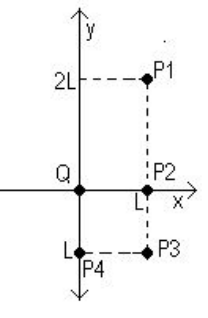
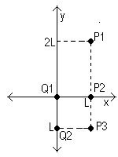
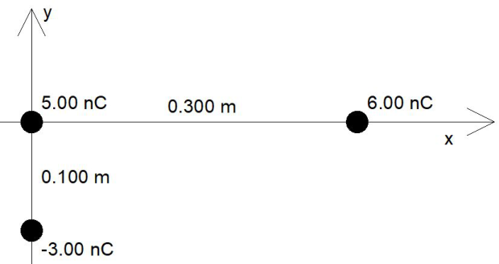
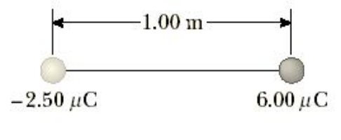
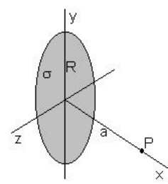
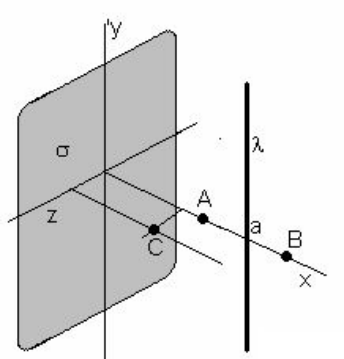
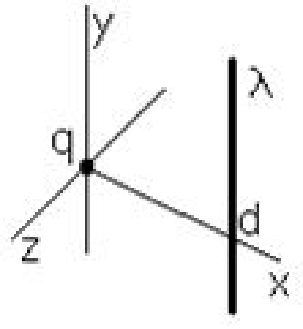
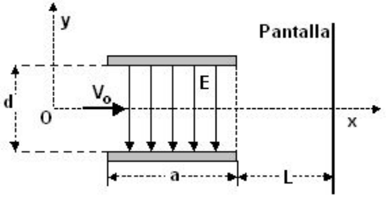

# Guía de problemas 1.2: Campo eléctrico

## Cuestionario

**1.** Conocido el campo eléctrico es posible calcular la fuerza sobre una
carga. también a partir de la Ley de Coulomb eso es posible, entonces, ¿Cuál es
la ventaja de definir campo eléctrico?

**2.** ¿Qué propiedades debe tener la carga de prueba en la definición de campo
eléctrico?.

**3.** ¿Qué tipo de función es el campo eléctrico? ¿Por qué?

**4.** Las líneas de fuerzas nunca se cruzan ¿por qué?

**5.** ¿Es posible que exista campo eléctrico en el vacío?

**6.** En un campo uniforme se colocan un protón y un electrón. Compare la
fuerza eléctrica que actúa sobre cada una de ellas Compare las aceleraciones.

**7.** Como se puede distinguir en forma experimental un campo eléctrico de uno
gravitatorio?

**8.** Dibuje las líneas de fuerzas existen entre dos cargas de igual magnitud y
signo contrario. Repita la gráfica considerando que la carga positiva se duplico
el valor

**9.** Una carga negativa se coloca en una región del espacio donde existe un
campo eléctrico uniforme orientado verticalmente hacia arriba ¿Cuál es la
dirección de la fuerza que experimenta la partícula?

## Problemas

### Problema 1

Calcule el vector campo eléctrico en función de sus componentes, creado por una
carga puntual ubicada en el origen de un sistema de referencia, en los puntos
$`P_1`$, $`P_2`$, $`P_3`$, $`P_4`$ (figura 1). L = 1 cm Q = $`10^{-9}`$ C

### Problema 2

Calcule el vector campo eléctrico en función de sus componentes, creado por dos
cargas puntuales en los puntos: $`P_1`$, $`P_2`$, $`P_3`$ (figura 2). L = 0.01
m, $`Q_1`$ = $`10^{-9}`$ C, $`Q_2`$ = -$`10^{-9}`$ C





figura 1

figura 2

### Problema 3

Tres cargas puntuales están dispuestas como se muestra en la figura. (a)
Encontrar el vector campo eléctrico que las cargas 6.00 nC y -3.00 nC crean en
el origen. (b) Hallar el vector de fuerza sobre la carga de 5.00 nC.



### Problema 4

Determinar la magnitud y la dirección del campo eléctrico que va a equilibrar el
peso de (a) un electrón y (b) un protón?

### Problema 5

Un objeto que tiene una carga neta de 24.0 μC se coloca en un campo eléctrico
uniforme de 610 N / C dirigido verticalmente. ¿Cuál es la masa de este objeto si
"flota'' en el campo?

### Problema 6

En la figura, determinar el punto (que no sea infinito) en el que el campo
eléctrico sea cero



### Problema 7

Demuestre que el campo eléctrico creado por una varilla delgada muy larga, con
densidad de carga lineal uniforme +λ a una distancia **a** de la misma es igual
a

```math
E=\frac{\lambda}{2\pi\varepsilon_o a}
```

En la dirección radial.

### Problema 8

Demuestre que el campo eléctrico creado por una placa plana muy grande, con
densidad de carga superficial uniforme +σ a una distancia **a** de la misma es
igual a

```math
E=\frac{\sigma}{2\cdot\varepsilon_o}
```

Con dirección perpendicular al plano de la carga saliente

### Problema 9



Demuestre que el campo eléctrico creado por un disco de radio R con densidad
superficial de carga σ en un punto P, como muestra la figura

```math
Ex=\frac{\sigma}{2\cdot\varepsilon_o}\cdot\left(1-\frac{a}{\sqrt{a^2+R^2}}\right)
```

### Problema 10



Un plano infinito tiene una distribución superficial de carga σ, en sus
proximidades se encuentra un hilo infinito con densidad lineal de carga λ.
Determine el campo eléctrico creado por ambos en los puntos A, B, C, (ver
figura).

### Problema 11



Una carga puntual q está ubicada en el origen de coordenadas y un hilo
infinitamente largo con densidad lineal λ paralelo al eje Y corta el eje en x =
d. Determinar los puntos sobre el eje X en los cuales el campo eléctrico se
anula. (ver figura).

### Problema 12

Entre dos placas conductoras paralelas existe un campo eléctrico uniforme E =
16⋅$`10^{4}`$ N/C, las placas están separadas una distancia d = 0.08 m y tienen
un ancho a = 0.02m, como muestra la figura. En esa región, ingresa un electrón
con velocidad $`V_o`$ = 4⋅$`10^{7}`$ m/s Determine la desviación respecto de su
dirección original y la velocidad en el instante que sale de las placas
paralelas. Determine la desviación respecto de su dirección original cuando
incide sobre la pantalla (L = 0.2 m).



### Problema 13

Para las siguientes distribuciones de cargas dibuje las líneas de fuerzas del
campo eléctrico


## Nota de transcripción

Archivo guardado en 2019, con 2018 en el nombre; autor y año impreso no constan
en las páginas. Se conserva Ex en la expresión del disco tal como figura en el
original. El título del problema 12 está cortado en el margen izquierdo del PDF;
se identifica por la secuencia y el texto extraído. No se resuelven los
ejercicios.

[Procedencia y comprobaciones](../../../resources/2019/fuentes.md).
