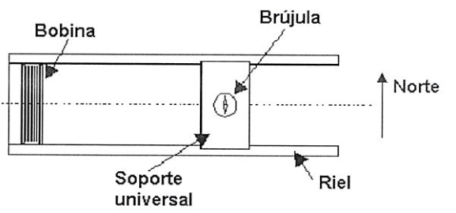
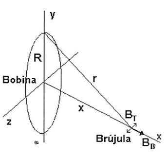
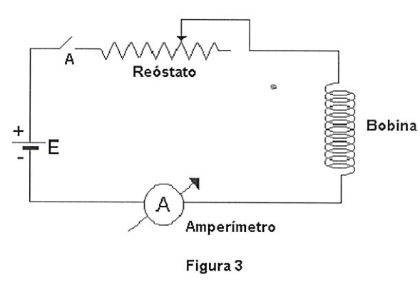
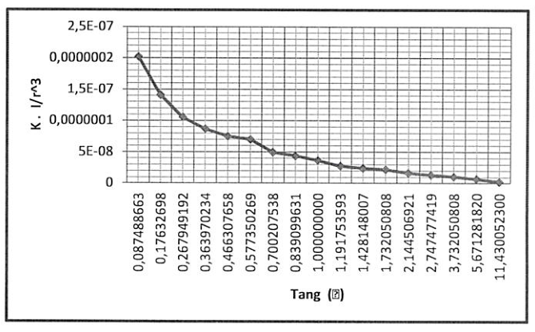
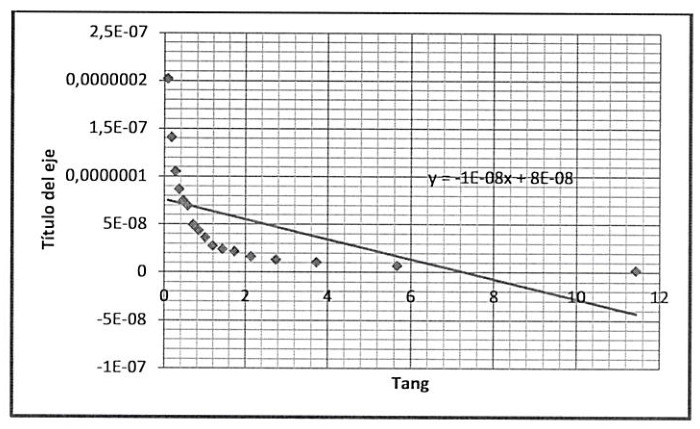
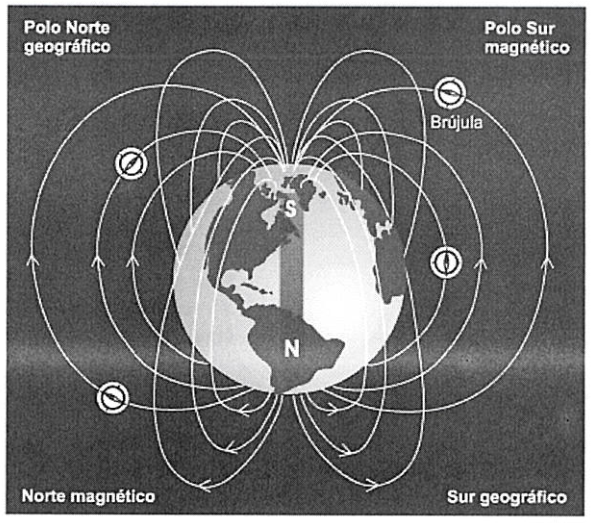
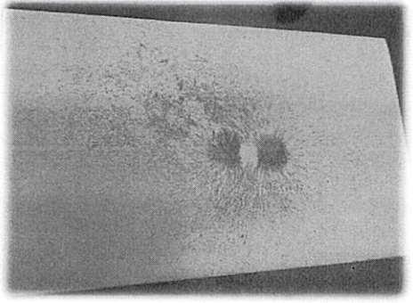
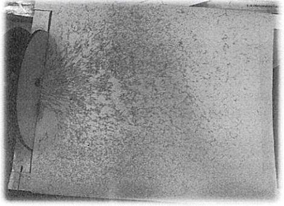

# Campo de inducción magnética: informe experimental

Universidad Tecnológica Nacional — Facultad Regional Resistencia

Física II: Campo de inducción magnética — Ingeniería Química

## Objetivo de la experiencia

Determinación de la componente horizontal del campo magnético terrestre mediante
el método de la brújula de tangentes. Análisis del campo magnético creado por
una bobina circular

## Marco teorico

Una.brújula es una aguja imantada que puede girar libremente en torno a un eje
vertical que posee en su centro y tiene la propiedad de orientarse respecto de
una dirección que coincide aproximadamente con el Norte geográfico. Esto
demuestra la existencia del campo magnético terrestre, de modo que la Tierra se
comporta como un gigantesco imán. En cada punto próximo a la superficie
terrestre queda definido el campo B que varía, en función del punto, en módulo y
dirección. El ángulo que este campo forma con el plano horizontal se llama
inclinación magnética El ángulo formado por la componente horizontal del campo
magnético con la verdadera dirección Norte — Sur esto es con la dirección del
meridiano del lugar, se llama declinación magnética. En esta experiencia se
determinará el valor de la componente horizontal del campo magnético terrestre
Bh.

El instrumento que se va a emplear se llama magnetómetro, el cual está compuesto
por una bobina circular, cuyas dimensiones se conocen (N: número de vueltas, R:
radio medio, Imax: corriente máxima que soporta) y una brújula convencional.
Ambos elementos están montados sobre un soporte universal que permite mantener
alineado el centro de la bobina con la brújula, a lo largo de distintas
posiciones que puede tomar la brújula cuando esta se desplaza a lo largo de
rieles pertenecientes al soporte (ver figura 1).

Si se coloca el magnetómetro en la dirección Este - Oeste, de modo que la
brújula se orienta naturalmente en la dirección Norte — Sur quedando
perpendicular a los rieles.

Cuando se coloca un cuerpo de momento magnético $`\vec m`$ en un campo magnético
$`\vec B`$ sobre él se ejerce un momento de fuerza dado por:

```math
\vec M=\vec m\wedge\vec B
```

(1)

Como la brújula tiene un momento magnético, estará sometida a dos campos
magnéticos: el terrestre y el de la bobina, cuando por esta circule una
corriente I., por lo tanto cada uno ejercerá un momento de fuerza sobre la aguja
magnética que intentará girarla, en concordancia con (1), en equilibrio será:

```math
\overline{M_B}-\overline{M_T}=0\rightarrow|\overline{M_B}|=|\overline{M_T}|
```

(2)

```math
mB_B\cos\theta=mB_T\sin\theta
```

(3)

Siendo θ el ángulo que forma la aguja con la dirección perpendicular a los
rieles (es decir el Norte).

```math
B_B\cos\theta=B_T\sin\theta
```

Haciendo pasaje de términos resulta:

```math
B_T=B_B\frac{\cos\theta}{\sin\theta}=\frac{B_B}{\tan\theta}
```

(5)

donde BT es la componente horizontal del campo magnético terrestre, BB es el
campo creado por la bobina en la posición donde está la brújula.



Haciendo la suposición que la intensidad del campo de la bobina es constante en
toda la región ocupada por la aguja magnética, entonces se puede calcular la
intensidad del campo mediante

```math
B_B\frac{\mu_0INR^2}{(R^2+x^2)^{3/2}}
```

(6)

Donde $`\mu_0=4\pi10^{-7}mKg\,s^2A^{-2}`$, N es el número de las espiras de la
bobina, R es el radio medio de la bobina e I es la intensidad de corriente que
circula por ella, x es la distancia entre el centro de la bobina y el eje de la
aguja magnética.



La (5) entonces puede escribirse:

```math
B_T=\frac{B_B}{\tan\theta}=K\frac I{r^3}\frac1{\tan\theta}
```

(7)

```math
B_T\tan\theta=K\frac I{r^3}
```

```math
k=\mu_0NR^2\qquad r=\sqrt{R^2+x^2}
```

## Materiales utilizados

1. Fuente de alimentación de CC.
1. Amperímetro. 3) Reóstato. 4) Bobina. 5) Brújula. 6) Soporte universal.

## Procedimiento seguido durante el desarrollo de la experiencia

1. Registre el valor del radio medio R de la bobina, el número de espiras N y el
   valor de la corriente máxima que soporta la bobina.
1. Arme el circuito de la Figura 3, adecue convenientemente el valor de la
   resistencia del reóstato para que la corriente que circule no supere la
   corriente máxima que soporta la bobina.



3\) Coloque la brújula lo más cerca posible de la bobina. 4) Antes de conectar el
circuito verifique la escala del amperímetro si es compatible con la corriente
máxima que soporta la bobina, luego conecte el circuito, cerrando el interruptor
A. 5) Aumente la distancia de la brújula a la bobina, x1, de tal forma que la
desviación de la aguja vaya disminuyendo en 5 hasta llegar a 10. Registre en la
hoja de datos la posición x para cada caso. 6) Calcule el valor de BB usando la
(6). 7) Empleando (7) calcule el BT para cada ángulo 8) Calcule el BT promedio.
9\) Grafique (K I / r3) en función de la tg para la serie de valores medidos. 10)
Aplique el método de cuadrados mínimos para obtener la pendiente y a partir de
ella BT 11) Aplique propagación de errores y determine ΔBT, admita que Δr~ 1 mm
y Δθ~2°.

## Procesamiento de los datos experimentales

<!-- markdownlint-disable MD060 -->

| Ángulo θ | Tang (θ) | x (m) | x²(m²) | $`r=\sqrt{R^2+x^2}`$ | Bb | Bt |
| -- | -- | -- | -- | -- | -- | -- |
| 5 | 0,087488663 | 0,048 | 0,002304 | 0,05531953 | 2,02089E-07 | 2,30989E-06 |
| 10 | 0,17632698 | 0,056 | 0,003136 | 0,0623879 | 1,40889E-07 | 7,9902E-07 |
| 15 | 0,267949192 | 0,063 | 0,003969 | 0,06874045 | 1,05327E-07 | 3,93086E-07 |
| 20 | 0,363970234 | 0,068 | 0,004624 | 0,07335019 | 8,6691E-08 | 2,38182E-07 |
| 25 | 0,466307658 | 0,072 | 0,005184 | 0,07707302 | 7,47258E-08 | 1,6025E-07 |
| 30 | 0,577350269 | 0,074 | 0,005476 | 0,0789446 | 6,95361E-08 | 1,2044E-07 |
| 35 | 0,700207538 | 0,084 | 0,007056 | 0,08838693 | 4,95466E-08 | 7,07598E-08 |
| 40 | 0,839099631 | 0,088 | 0,007744 | 0,0921968 | 4,36546E-08 | 5,20255E-08 |
| 45 | 1,000000000 | 0,094 | 0,008836 | 0,09794003 | 3,64164E-08 | 3,64164E-08 |
| 50 | 1,191753593 | 0,104 | 0,010816 | 0,10757439 | 2,74822E-08 | 2,30603E-08 |
| 55 | 1,428148007 | 0,109 | 0,011881 | 0,11241552 | 2,40824E-08 | 1,68626E-08 |
| 60 | 1,732050808 | 0,113 | 0,012769 | 0,11629811 | 2,175E-08 | 1,25574E-08 |
| 65 | 2,144506921 | 0,125 | 0,015625 | 0,12798926 | 1,63176E-08 | 7,60904E-09 |
| 70 | 2,747477419 | 0,135 | 0,018225 | 0,13777246 | 1,30825E-08 | 4,76164E-09 |
| 75 | 3,732050808 | 0,146 | 0,021316 | 0,14856732 | 1,0433E-08 | 2,79551E-09 |
| 80 | 5,671281820 | 0,169 | 0,028561 | 0,17122281 | 6,81542E-09 | 1,20174E-09 |
| 85 | 11,430052300 | 0,253 | 0,064009 | 0,25449018 | 2,0757E-09 | 1,816E-10 |
| Promedios: |  |  |  |  |  | 2,49947E-07 |
| Suma: | 34,55602184 |  | 0,231531 |  |  |  |

### Tabla de K·I/r³

|  |  |  |  |  |
| -- | -- | -- | -- | -- |
|  | 2,02089E-07 | 7,47258E-08 | 3,64164E-08 | 1,63176E-08 |
|  | 1,40889E-07 | 6,95361E-08 | 2,74822E-08 | 1,30825E-08 |
|  | 1,05327E-07 | 4,95466E-08 | 2,40824E-08 | 1,0433E-08 |
|  | 8,6691E-08 | 4,36546E-08 | 2,175E-08 | 6,81542E-09 |
|  |  |  |  | 2,0757E-09 |
| Suma: | 9,30914E-07 |  |  |  |

<!-- markdownlint-enable MD060 -->





De la gráfica obtenemos que el valor de la componente horizontal del campo
terrestre es

```math
-1\cdot10^{-8}T
```

## Cálculo de error

```math
B_t=2{,}49947\cdot10^{-7}T
```

```math
B_t=-1\cdot10^{-8}T
```

```math
E\%=\frac{|2{,}49947\cdot10^{-7}T-0{,}1\cdot10^{-7}T|}{2{,}49947\cdot10^{-7}T}\cdot100=95{,}99\%
```

## Análisis de los resultados y causas de error

En esta experiencia de laboratorio procedimos a armar un circuito (fuente,
amperímetro, reóstato) conectado a un magnetómetro (bobina y brújula montados
sobre un soporte universal) donde la brújula convencional podía deslizarse sobre
unos rieles, de esta manera analizar el comportamiento de las agujas
magnetizadas a medida que se acercaba o alejaba de la bobina circular.

Comenzamos analizando desde la posición en que la brújula se hallaba lo más
cerca posible de la bobina, observamos que las agujas de la brújula se
encontraban indicando la dirección Este- Oeste, a medida que la desplazábamos
sobre los rieles, alejándose de la bobina, observamos que las agujas se movía
una posición (5°) hasta llegar a indicar la dirección Norte-Sur, al encontrarse
en la posición más alejada posible de la bobina. Esto lo pudimos entender desde
la teoría, ya que este comportamiento se debe a que la brújula tiene un momento
magnético por lo que está sometida a dos campos magnéticos: el de la tierra y el
que genera la bobina, cuando comienza a circula corriente, por lo tanto cada uno
ejerce un momento de fuerza sobre la aguja magnética que intentará hacerla
girar. De esta manera fue necesario determinar una corriente de forma tal que
cumpla con los requisitos de:

- La aguja presenta una desviación máxima al encontrarse cerca de la bobina, las
  agujas se encuentran tangentes al campo generado por la bobina.
- La aguja presente una desviación mínima al encontrarse lejos de la bobina, las
  agujas se encuentran paralelas al campo generado por la bobina.

Mediante los datos obtenidos pudimos usar la fórmula (6) y determinar Bʙ, el
campo generado por la bobina, el cual en nuestro análisis es considerado como
constante en toda la región ocupada por la aguja magnética. Luego con los datos
y una vez obtenido el valor de Bʙ(PROMEDIO) = 5,47597E-08 Tesla, calculamos Bᴛ
que es la componente horizontal del campo magnético terrestre, tuvimos un
promedio de Bᴛ(PROMEDIO)= 2,49947E-07 Tesla.

Al analizar la gráfica donde se representa (KI/r³) en función de la Tg(θ)
observamos que a medida que el ángulo aumenta pasado de un ángulo mínimo de 5°
donde la Tg(θ) es 0,087488663 a un ángulo máximo de 85° y la Tg(θ) es
11,430052300 el valor de (KI/r³) va disminuyendo de modo que queda expresado una
función de pendiente negativa, la pendiente de la función ajustada por mínimos
cuadrados representa el valor de Bᴛ= -1E⁻⁰⁸ Tesla.

En cuanto al analizar los errores observamos que hubo un grado de error del
95,99%.

Estos errores pueden deberse a diversos factores:

- Errores de paralelaje, a la hora de observar las posiciones de la aguja, y
  medir la distancia que ocupó a lo largo de las distintas posiciones.

- Cabe aclarar que nuestra brújula no funcionaba correctamente, ya que indicaba
  la dirección Sur y no la Norte, aun así se pudo utilizar, pero esto pudo
  acarrear un porcentaje de error.

- El error es del 96 % porque nuestros valores dieron una curva y al utilizar
  una recta de ajustamiento el error es grande.

## Cuestionario

### 1) Hacer un esquema de las líneas de inducción magnética terrestre. A partir de este esquema, explicar cómo se comportaría una brújula de inclinación al ser trasladada desde el polo Sur magnético al polo norte magnético ¿Cuál será la definición de estos polos?



Las líneas de inducción magnética terrestre van desde el norte magnético (sur
geográfico) al sur magnético (norte geográfico), es decir que el polo norte
magnético tiende a atraerse con el polo sur de la brújula y viceversa. El polo
sur magnético de la Tierra debe atraer al polo norte de la brújula.

Si nos paramos en el norte geográfico (sur magnético) y nos dirigimos hacia el
sur geográfico (norte magnético), la brújula, siempre y cuando nos movamos sobre
una línea de inducción, va a marcar la dirección opuesta a la nuestra.

### 2) ¿Indica la brújula de declinación la dirección del Norte geográfico? ¿Qué información complementaria necesitamos para hacer un uso correcto de una brújula?

La brújula de declinación no indica la dirección del Norte geográfico, ya que
nos aporta información de la dirección del Norte magnético. Para hacer un uso
correcto de una brújula necesitamos la siguiente información:

- Sobre mapas de navegación, o incluso en mapas topográficos, se suele indicar
  la relación existente entre el norte de la proyección y los nortes verdadero y
  magnético para el centro de la hoja. Se acostumbra a indicar el norte
  magnético mediante las siglas NM y el norte geográfico NG con una flecha con
  una estrella en la parte superior. En una etiqueta se indica el valor de la
  separación entre ambas direcciones, en grados, minutos y segundos. El norte de
  la proyección se indica con una línea y las siglas NP. La diferencia entre el
  norte de la proyección y el norte verdadero se denomina convergencia de la
  cuadrícula. Por ejemplo, 15° O (quince grados oeste) indican que el norte
  magnético está a 15 grados respecto de la dirección que apunta al norte
  geográfico, contados en sentido contrario de las manecillas del reloj.
- Mediante curvas de igual declinación magnética o isogónicas, que
  frecuentemente aparecen en mapas aeronáuticos y mapas náuticos.
- En los diagramas, cuando el valor es positivo, se entiende que se suma en el
  sentido de las manecillas del reloj al norte verdadero, y si es negativo se
  adiciona en el sentido contrario a las manecillas del reloj. Por ejemplo, un
  valor de -15° equivale a 15° O.
- Existen reglas mnemotécnicas para aprender a realizar la operación. En inglés
  se dice: «east is least, west is best». Empleando este lema, si la declinación
  es hacia el este, la dirección magnética es menor que la del norte verdadero,
  y mayor si apunta hacia el oeste.

### 3) ¿Qué representa el momento magnético $`\vec m`$ de una aguja imantada? ¿En qué unidades se mide?

El momento magnético $`\vec m`$ de una aguja imantada representa la propiedad
física que corresponde al magnetismo existente en la aguja, es el vector,
momento dipolar magnético $`\vec m`$. En el SI las unidades en las que se mide
es en (A.m²).

## Análisis de las Fotos





En ambas fotos se muestran las líneas de fuerzas del campo de inducción
magnética.

Foto 1: generado por imán que se encuentra bajo la hoja.

Foto 2: las virutas del metal (virulana) se orientan en dirección al campo
generado por la bobina.

El campo magnético se puede visualizar (líneas de inducción magnética) al
distribuir limaduras de hierro, en nuestro caso virulana, en las proximidades de
un imán o de un conductor donde circula corriente (bobina circular), estas se
orientan a lo largo de las líneas de fuerza del campo magnético correspondiente
y esta distribución espacial forma: espectro magnético y proporciona una
representación espacial del campo. Por convenio se admite que las líneas de
fuerzas salen del polo Norte y se dirigen al polo Sur.

## Conclusión

Por medio de este trabajo hemos podido cumplir con los objetivos expuestos al
inicio del mismo. En primera instancia pudimos determinar la componente
horizontal del campo magnético terrestre mediante el método de la brújula de
tangentes. Donde analizamos el comportamiento de las agujas de una brújula
convencional, mediante un circuito conectado a un magnetómetro; esto lo pudimos
entender desde la teoría, ya que este comportamiento se debe a que la brújula
tiene un momento magnético por lo que está sometida a dos campos magnéticos: el
de la tierra y el que genera la bobina, cuando comienza a circula corriente, por
lo tanto cada uno ejerce un momento de fuerza sobre la aguja magnética que
intenta hacerla girar. En segundo lugar pudimos analizar el campo que genera una
bobina circular y que ejerce un campo de fuerza sobre la aguja magnetizada,
observando que al encontrarse cerca de la bobina la aguja se encuentra tangente
al campo de la bobina, produciéndose un máximo desplazamiento de la aguja, por
lo que se encuentra paralela a los rieles. Cuando está lejos de la bobina es el
campo magnético terrestre el que tiene mayor influencia sobre la brújula,
ejerciendo una fuerza magnética que hace que no presente desviación alguno,
indicando la dirección Norte-Sur, perpendicular a los rieles.

## Procedencia y observaciones de transcripción

- Original:
  `2019/2do Parcial/Laboratorios/Campo de Induccion Magnetica (1).pdf`,
  páginas1–13; año2019 por carpeta, sin fecha impresa. El encabezado identifica
  Ingeniería Química.
- SHA-256: `fe381f45db3f41d4505d241c796b942090c3f8d12582b62bd52d56c26c34aa68`.
- Herramientas: OCRmyPDF con spa sobre copia, PyMuPDF4LLM, Poppler y recortes
  PyMuPDF. Trece páginas cotejadas visualmente, tablas de17 filas y17 valores
  auxiliares comprobadas contra ampliaciones.
- Se conserva la ausencia de signo igual en (6), el denominador sin factor2, las
  unidades s², la numeración sin (4), los pasos con «5» y «10» sin signo de
  grados, k/K, el ajuste negativo, la fórmula de error y95,99% del original. No
  se recalculan resultados.
- Se omiten anotaciones de evaluación y datos personales enmascarados; las
  figuras publicadas contienen únicamente material académico. La copia de igual
  SHA-256 `2019/2do Parcial/Laboratorios/Campo de Induccion Magnetica.pdf`
  comparte esta transcripción.

### Derivación con OCR deteriorado

También se cotejaron las trece páginas de
`2019/2do Parcial/Laboratorios/Campo de Induccion Magnetica_apto_busqueda.pdf`
(SHA-256 `efd60fb6f541ddde38129ccd1ea38c4fa50d9885b4325e2fa77f1e5b64b3e236`).
Conserva la estructura, datos y fotografías del informe, pero reemplaza signos
por caracteres erróneos visibles: los momentos y flechas de página2, símbolos en
fórmulas de3, rótulos de gráficos de6–7 y vectores de11. No es un render
idéntico ni una nueva versión autoral; se usa el escaneo anterior como
referencia legible y se documenta esta pérdida en lugar de copiar su OCR.
