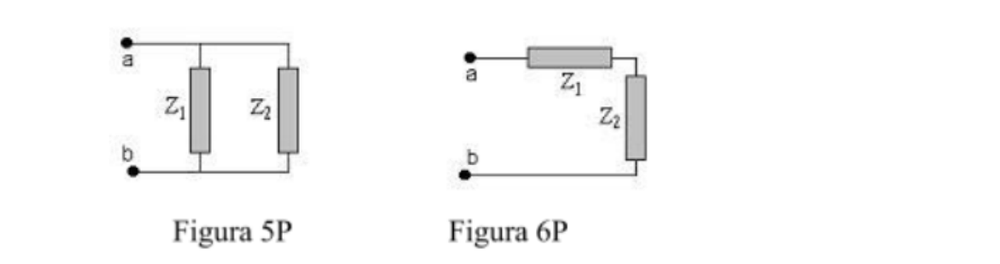

# Corriente alterna: impedancias en serie y paralelo

Para los circuitos de las figuras 5P y 6P determine la impedancia equivalente si

```math
Z_1=(10+6\,i)\,\Omega\quad\text{y}\quad Z_2=(8-4\,i)\,\Omega
```



## Procedencia y observaciones de transcripción

- Original: `2019/3er Parcial/2017 UT IX Corriente Alterna.pptx`, diapositiva 24
  de 35.
- SHA-256: `4642d02dd308180ca235fbb34bb0e99b9f8ea0f422c6a860bae65b6071494a3a`.
- Herramientas: MarkItDown, inspección XML del PPTX y render LibreOffice con
  perfil temporal. Enunciado y figuras cotejados visualmente; figura extraída de
  la imagen original incorporada en el PPTX.
- Esta diapositiva no aparece en el PDF homónimo de 34 páginas. Las otras
  diapositivas se corresponden con ese PDF, con desplazamiento de una posición
  desde la 25; no se declara identidad de renderizado.
- La fuente no incluye solución; el ejercicio se conserva sin resolver. El
  archivo se llama 2017 y está archivado bajo 2019; la fecha 13/06/2018 está
  impresa en el PDF, no en esta diapositiva del PPTX.
