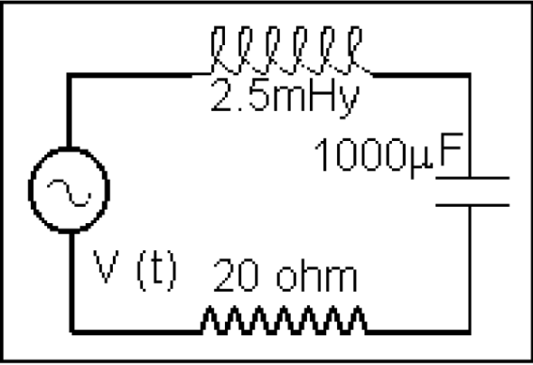
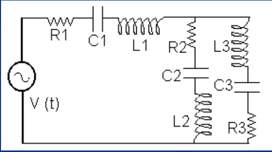

# Corriente alterna: problemas propuestos

Unidad Temática IX — Corriente Alterna

## Problema del circuito RLC

Problema: Para el circuito de la calcule: a) las reactancias inductivas y
capacitivas, b) la impedancia, c) la corriente y su desfasaje con la fem de la
fuente, d) la corriente eficaz e) la diferencia de potencial sobre cada
elemento. La expresión de
$`V(t)=20\mathop{\mathrm{seno}}\nolimits(2\cdot\pi\cdot f\cdot t)`$ con
$`f=50\,\mathrm{Hz}`$.



## Problema de la capacidad C₁

En el circuito de la figura determine la diferencia de potencial sobre la
capacidad C₁. La fem $`V(t)=100\cos(2\pi f t)`$ con $`f=50\,\mathrm{Hz}`$.



```math
f:=50\,\mathrm{Hz}
```

```math
R_1:=10\,\Omega\qquad R_2:=15\,\Omega\qquad R_3:=20\,\Omega
```

```math
L_1:=0.01\,\mathrm{henry}\qquad L_2:=0.02\,\mathrm{henry}\qquad L_3:=0.015\,\mathrm{henry}
```

```math
C_1:=50\,\mu\mathrm F\qquad C_2:=150\,\mu\mathrm F\qquad C_3:=100\,\mu\mathrm F
```

```math
\omega:=2\cdot\pi\cdot f\qquad\omega=314.159\,\mathrm{s}^{-1}
```

## Procedencia y observaciones de transcripción

- Original: `2019/3er Parcial/2017 UT IX Corriente Alterna.pdf`, páginas 23–24
  de 34. Fecha impresa: 13/06/2018; el archivo se llama 2017 y está archivado en
  2019\.
- SHA-256: `9e7ec2ad4e867b5dc688982d6b052f2b16e926ee1adcfc55f7007697c05cf263`.
- Herramientas: preflight PyMuPDF4LLM, Poppler y recortes PyMuPDF. Páginas,
  expresiones y figuras del tramo cotejadas visualmente.
- Se conserva «Para el circuito de la calcule», incompleto en la fuente. Los
  ejercicios no contienen resolución; se dejan sin resolver. Los datos
  insertados como imagen en la página 24 se transcriben a LaTeX.
