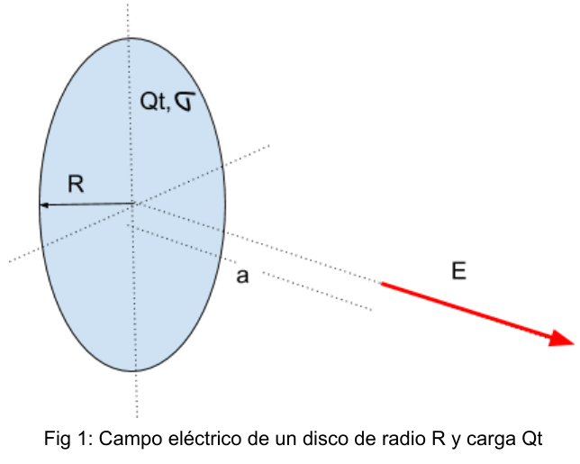
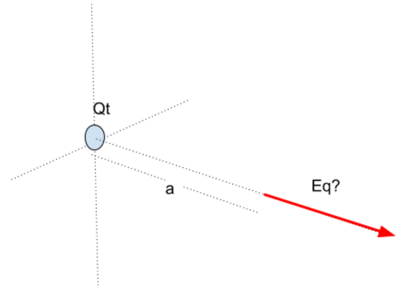
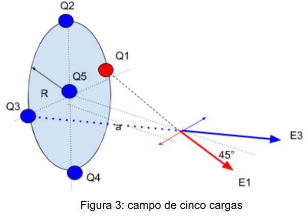
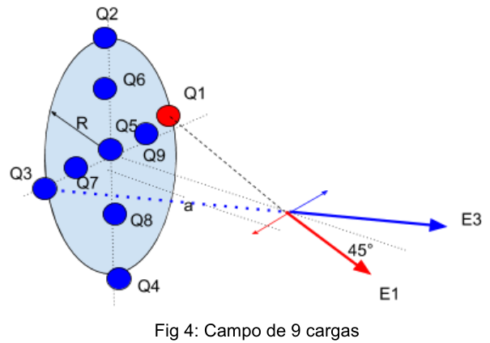

# Discretizando un sistema contínuo para cálculos de campos de distribuciones continuas de carga

Generalmente en el cálculo del campo eléctrico de distribuciones continuas de
carga, se buscan que los puntos donde se calcula en campo, sean puntos donde la
simetría nos permita llegar a la solución del problema.

En este tipo de demostraciones, se parte de la influencia de un elemento de
carga “dq” para la formación de un campo eléctrico “dE” cuya integración a todo
el espacio donde hay carga nos lleva a la expresión del campo total.

Así, por ejemplo, se puede ver que el campo eléctrico que genera un disco de
Radio R y densidad superficial de carga σ, sobre un eje perpendicular al plano y
a una distancia “a” del centro del disco (Fig 1), viene dado por la expresión:

```math
E=\frac{\sigma\cdot a}{2\cdot\varepsilon_0}\left(\frac1a-\frac1{\sqrt{R^2+a^2}}\right)\tag{1}
```



Fig 1: Campo eléctrico de un disco de radio R y carga Qt

A la expresión (1) se llegó mediante integración y usando condiciones de
simetría favorecidas por la ubicación del punto.

Hagamos unos cálculos: supongamos que el disco tiene una carga total de 5 coul,
que el radio del disco es de 1 m y que queremos calcular a una distancia de 1 m
del centro del anillo.

Carga total

```math
Qt:=5coul
```

Radio del disco

```math
Rd:=1m
```

Distancia entre el centro y el eje

```math
a:=1m
```

Densidad superficial de carga

```math
\sigma:=\frac{Qt}{\pi\cdot Rd^2}=1.592\frac{coul}{m^2}
```

De acuerdo a (1), el campo eléctrico generado será

```math
E:=\frac{\sigma\cdot a}{2\cdot\varepsilon_0}\cdot\left(\frac1a-\frac1{\sqrt{a^2+Rd^2}}\right)=2.632\times10^{10}\frac N{cou}
```

Es posible tener un “cálculo rápido” para tener idea si el orden de magnitud es
correcto?

Para tener una primer aproximación del resultado, podemos concentrar toda la
carga Qt en un punto ubicado en el centro del disco a 1 metro y calcular el
campo eléctrico Eq producido por la misma (Fig 2)

```math
Eq:=\frac{Qt}{4\cdot\pi\cdot\varepsilon_0\cdot a^2}=4.494\times10^{10}\frac N{coul}
```



Nótese que el orden de la magnitud ($`10^{10}`$) es el mismo (aunque la
concentración de toda la carga en un solo lugar hace que el campo Eq sea más
intenso que E).

Vamos a discretizar el sistema en cinco cargas de 1 coul cada una como ilustra
la Figura 3 de modo que siga respetando la carga total.

En la Figura 3 se aprecia que las componentes paralelas al plano del disco de
los campos producidos por Q1 y Q3 se cancelan entre sí. Lo mismo ocurre con las
componentes de las cargas Q2 y Q4. Todas estas cargas refuerzan la componente
del campo eléctrico en la dirección del eje x. El campo Ei producido por cada
una de ellas tiene el valor de

```math
Ei:=\frac{1coul}{4\cdot\pi\cdot\varepsilon_0\cdot\left[(1m)^2+(1m)^2\right]}=4.494\times10^9\frac N{coul}
```



Figura 3: campo de cinco cargas

La proyección en el eje de las x dará un campo Eix

```math
Eix:=Ei\cdot\cos(45deg)=3.178\times10^9\frac N{coul}
```

En este caso, el campo eléctrico total Et será:

```math
Et:=4\cdot Eix+\frac{1coul}{4\cdot\pi\cdot\varepsilon_0\cdot a^2}=2.17\times10^{10}\frac N{coul}
```

El resultado obtenido, se aproxima más al resultado obtenido a través de la
ecuación (1)

Discretizemos aún más, esta vez en 9 cargas, cada una de ellas con valor de 5/9
coul, como muestra la Figura 4



Fig 4: Campo de 9 cargas

En este caso, las componentes paralelas al plano del disco de las cargas Q7 y Q9
se cancelan entre sí, lo mismo que Q6 y Q8.

La contribución de las cargas Q1, Q2, Q3 y Q4 al campo total en la dirección del
eje x serán

```math
E1234:=4\cdot\frac{0.556coul}{4\cdot\pi\cdot\varepsilon_0\cdot\left[(1m)^2+(1m)^2\right]}\cdot\cos(45deg)=7.067\times10^9\frac N{coul}
```

La contribución de las cargas Q6, Q7, Q8 y Q9 al campo total serán:

```math
E6789:=4\cdot\frac{0.556coul}{4\cdot\pi\cdot\varepsilon_0\cdot\left[(0.5m)^2+(1m)^2\right]}\cdot\cos(26.565deg)=1.43\times10^{10}\frac N{coul}
```

El campo de la carga Q5 será:

Y el campo total Et

```math
Et:=E1234+E6789+E5=2.637\times10^{10}\frac N{coul}
```

Comparando con el resultado de la ecuación (1), se puede apreciar que el
resultado es casi el mismo

```math
E5:=\frac{0.556coul}{4\cdot\pi\cdot\varepsilon_0\cdot a^2}=4.997\times10^9\frac N{coul}
```

**Conclusión:** cualquier sistema contínuo se puede discretizar para el cálculo
de campos, teniendo la ventaja de que si bien son un poco más extensos, no
requieren de la aplicación de integrales y se pueden aplicar en puntos donde no
se usen condiciones de simetría.

## Procedencia y observaciones de transcripción

- Original: `2019/1er Parcial/Discretizando un sistema continuo.pdf`, páginas
  1–4 de 4. No constan autor ni fecha.
- SHA-256: `b7013ac36095abfc6ab7699191fbe3c3d366a16edbb735008eb1624fe634be20`.
- Herramientas: PyMuPDF4LLM, Poppler y cotejo visual de todas las páginas,
  valores y cuatro figuras. Medios conservados por recorte/render PyMuPDF.
- Se conservan «contínuo», «se calcula en campo», «Discretizemos», la referencia
  a anillo al describir el disco, la sintaxis de asignación :=, los nombres
  E1234/E6789/E5 y los redondeos. La primera fracción de unidad del valor E
  aparece recortada como N/cou.
- La fórmula E5 aparece después de Et y de la comparación en la página 4: se
  mantiene ese orden, sin rellenar el espacio que sigue a «El campo de la carga
  Q5 será». Los desarrollos y resultados son los impresos, no cálculos añadidos.
