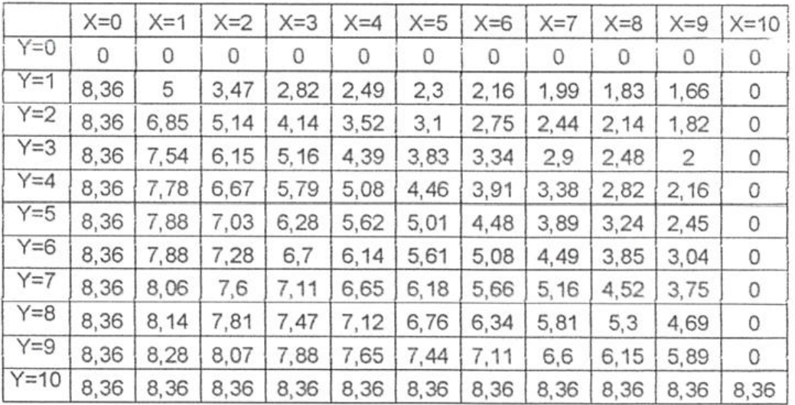
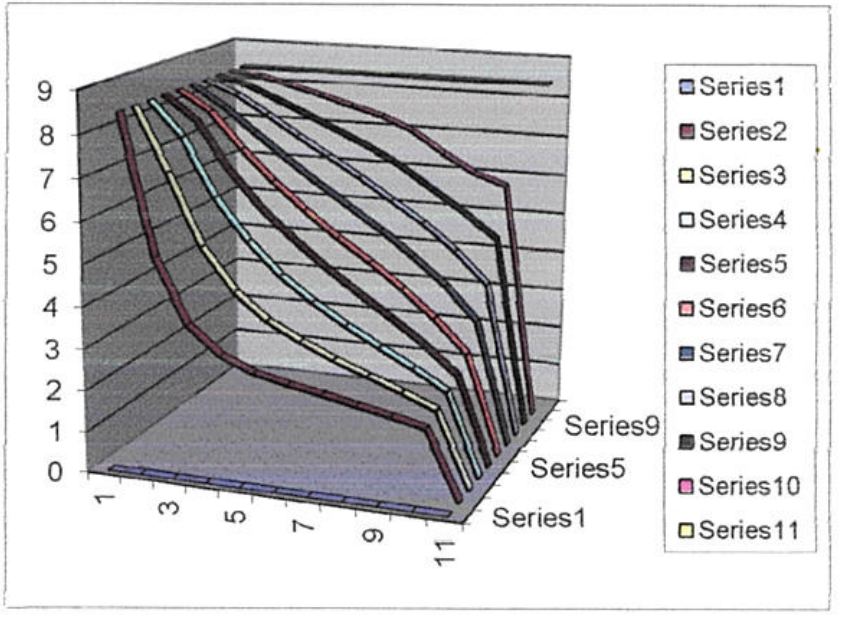
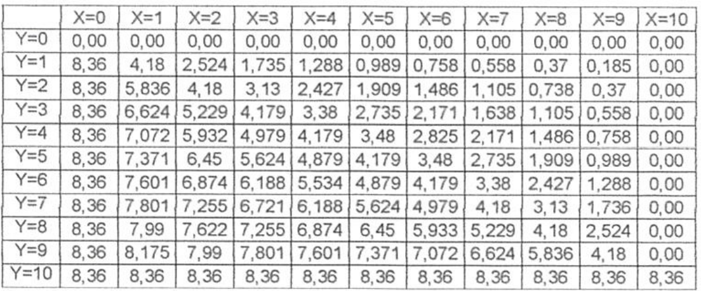
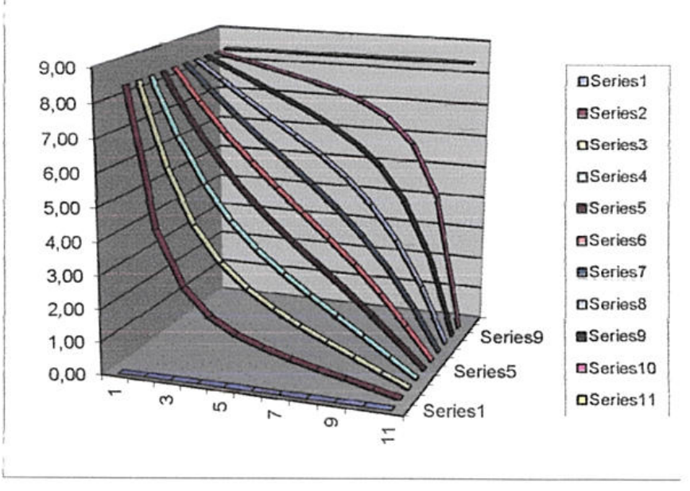
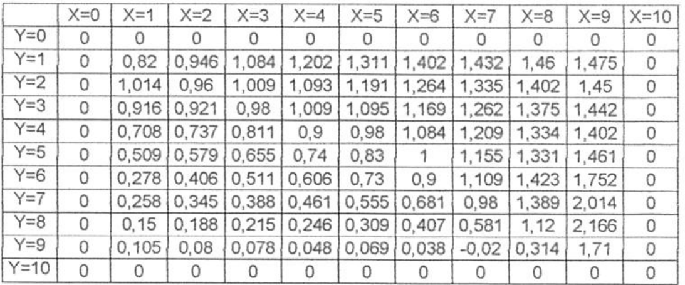
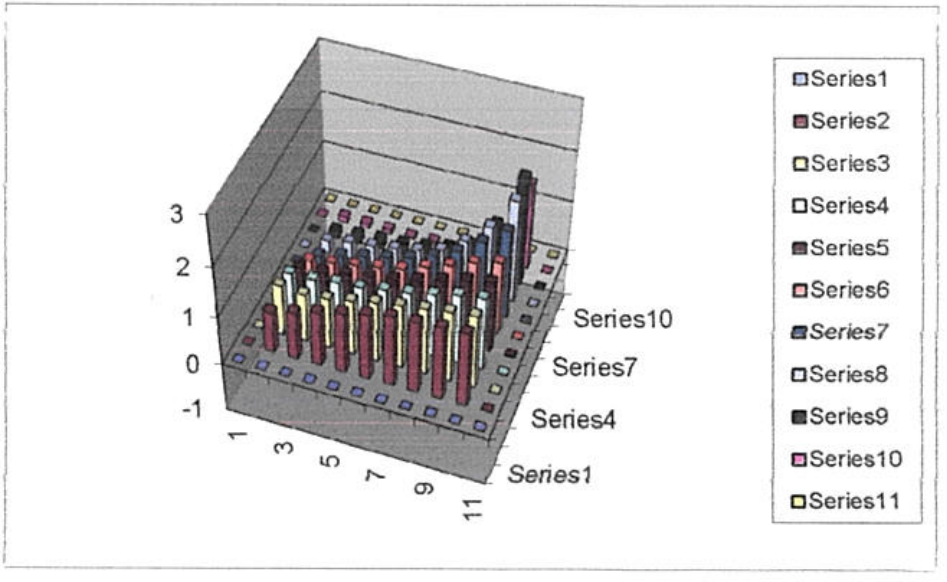

# POTENCIAL ELÉCTRICO. ECUACIÓN DE LAPLACE

Universidad Tecnológica Nacional — Facultad Regional Resistencia

Física II: Ecuación de Laplace — Ingeniería Química

## Objetivo de la experiencia

Verificar experimentalmente la ecuación de Laplace en dos dimensiones.

## Marco teórico

En una región en dos dimensiones desprovista de cargas cuyo contorno tiene un
potencial eléctrico determinado, la teoría predice que el potencial eléctrico en
el interior es solución de la ecuación de Laplace.

La ecuación en diferencia finita equivalente a la de Laplace en dos dimensiones
es

```math
\Phi(x,y)\cong\frac{\Phi(x+h,y)+\Phi(x-h,y)+\Phi(x,y+h)+\Phi(x,y-h)}4
```

De lo que podemos deducir que el potencial en un punto es el promedio de los
potenciales en los puntos circundantes.

La región donde se aplicará esta fórmula, la supondremos de forma cuadrada, se
retícula empleando una malla lo suficientemente fina formada con líneas
ortogonales entre sí. Se asigna inicialmente a los puntos de intersección
interiores el valor cero y los puntos de la malla que están en el contorno toman
el valor del potencial correspondiente. Se inicia el cálculo, en forma
sistemática desde un vértice de la región, concluida la evaluación de todos los
puntos, se reinicia el proceso. Puede observarse, que después de varios pasos,
los potenciales convergen hacia determinados valores. Esto puede continuarse
hasta que la diferencia del valor del potencial en un punto entre dos pasos
sucesivos sea menor que un valor previamente definido.

## Materiales Utilizados

1. Fuente de alimentación CC (12v)
1. Electrodos de forma rectangular
1. Cuba
1. Voltímetro (multimetro)
1. 3 conectores

La fuente de alimentación CC es la encargada de suministrar energía eléctrica a
los distintos elementos, convierte la corriente alterna (CA), en una o varias
corrientes continuas (CC) ("reduce" el voltaje -mediante un transformador- y
posteriormente convierte la corriente alterna en continua -con un puente de
diodos- para finalmente filtrarla (mediante condensadores electrolíticos).

Los electrodos son conductores eléctricos utilizados para hacer contacto con una
parte no metálica de un circuito, por ejemplo un semiconductor, un electrolito,
el vacío, un gas. Para sistemas eléctricos que usan corriente alterna, los
electrodos son conexiones del circuito hacia el objeto que actuará bajo la
corriente eléctrica.

La cuba es el recipiente de vidrio (tiene que ser un vidrio transparente para
visualizar el papel milimetrado que se encuentra debajo) se carga con agua
potable hasta aproximadamente 5mm y contiene los electrodos, nos brinda el medio
para el estudio experimental.

El voltímetro es un instrumento que sirve para medir la diferencia de potencial
entre dos puntos de un circuito eléctrico. Los voltímetros, en esencia, están
constituidos por un galvanómetro cuya escala ha sido graduada en voltios. Para
medir la diferencia de potencial, el voltímetro debe colocarse en paralelo, es
decir, en derivación sobre los puntos entre los que se desea efectuar la medida.
Por este motivo un voltímetro debe poseer una resistencia interna muy alta, para
que no se produzca un consumo muy apreciable de corriente, que puede dar lugar a
una medida errónea.

Los conectores son utilizados para unir cables o para conectar un cable a un
dispositivo (es un dispositivo para unir circuitos eléctricos); permite
establecer un nexo entre la energía eléctrica proveniente de la fuente de
alimentación, realizando a través del mismo un intercambio de impulsos
eléctricos.

## Procedimiento seguido durante el desarrollo de la experiencia

1. Con la punta de prueba se irá registrando los valores de los potenciales
   según su posición determinada por el reticulado del papel milimetrado, es
   aconsejable, hacerlo con paso de 5mm. Cuidando en cada registro que la punta
   de prueba se encuentre siempre perpendicular a la superficie.
1. Se puede completar un cuadro, con los datos experimentales, de modo que estén
   posicionados de acuerdo a sus coordenadas espaciales.
1. Una vez completo el cuadro se puede vuelcan los datos en una planilla de
   cálculo y los representarlos en un gráfico de 3-D.

## Procesamiento de los datos experimentales

### Datos experimentales

Φ (x,y) en voltios y longitudes en cm

<!-- markdownlint-disable MD060 -->

|  | X=0 | X=1 | X=2 | X=3 | X=4 | X=5 | X=6 | X=7 | X=8 | X=9 | X=10 |
| -- | -- | -- | -- | -- | -- | -- | -- | -- | -- | -- | -- |
| Y=0 | 0 | 0 | 0 | 0 | 0 | 0 | 0 | 0 | 0 | 0 | 0 |
| Y=1 | 8,36 | 5 | 3,47 | 2,82 | 2,49 | 2,3 | 2,16 | 1,99 | 1,83 | 1,66 | 0 |
| Y=2 | 8,36 | 6,85 | 5,14 | 4,14 | 3,52 | 3,1 | 2,75 | 2,44 | 2,14 | 1,82 | 0 |
| Y=3 | 8,36 | 7,54 | 6,15 | 5,16 | 4,39 | 3,83 | 3,34 | 2,9 | 2,48 | 2 | 0 |
| Y=4 | 8,36 | 7,78 | 6,67 | 5,79 | 5,08 | 4,46 | 3,91 | 3,38 | 2,82 | 2,16 | 0 |
| Y=5 | 8,36 | 7,88 | 7,03 | 6,28 | 5,62 | 5,01 | 4,48 | 3,89 | 3,24 | 2,45 | 0 |
| Y=6 | 8,36 | 7,88 | 7,28 | 6,7 | 6,14 | 5,61 | 5,08 | 4,49 | 3,85 | 3,04 | 0 |
| Y=7 | 8,36 | 8,06 | 7,6 | 7,11 | 6,65 | 6,18 | 5,66 | 5,16 | 4,52 | 3,75 | 0 |
| Y=8 | 8,36 | 8,14 | 7,81 | 7,47 | 7,12 | 6,76 | 6,34 | 5,81 | 5,3 | 4,69 | 0 |
| Y=9 | 8,36 | 8,28 | 8,07 | 7,88 | 7,65 | 7,44 | 7,11 | 6,6 | 6,15 | 5,89 | 0 |
| Y=10 | 8,36 | 8,36 | 8,36 | 8,36 | 8,36 | 8,36 | 8,36 | 8,36 | 8,36 | 8,36 | 8,36 |

<!-- markdownlint-enable MD060 -->



Gráfico:



### Datos teóricos

Φ (x,y) en voltios y longitudes en cm

<!-- markdownlint-disable MD060 -->

|  | X=0 | X=1 | X=2 | X=3 | X=4 | X=5 | X=6 | X=7 | X=8 | X=9 | X=10 |
| -- | -- | -- | -- | -- | -- | -- | -- | -- | -- | -- | -- |
| Y=0 | 0,00 | 0,00 | 0,00 | 0,00 | 0,00 | 0,00 | 0,00 | 0,00 | 0,00 | 0,00 | 0,00 |
| Y=1 | 8,36 | 4,18 | 2,524 | 1,735 | 1,288 | 0,989 | 0,758 | 0,558 | 0,37 | 0,185 | 0,00 |
| Y=2 | 8,36 | 5,836 | 4,18 | 3,13 | 2,427 | 1,909 | 1,486 | 1,105 | 0,738 | 0,37 | 0,00 |
| Y=3 | 8,36 | 6,624 | 5,229 | 4,179 | 3,38 | 2,735 | 2,171 | 1,638 | 1,105 | 0,558 | 0,00 |
| Y=4 | 8,36 | 7,072 | 5,932 | 4,979 | 4,179 | 3,48 | 2,825 | 2,171 | 1,486 | 0,758 | 0,00 |
| Y=5 | 8,36 | 7,371 | 6,45 | 5,624 | 4,879 | 4,179 | 3,48 | 2,735 | 1,909 | 0,989 | 0,00 |
| Y=6 | 8,36 | 7,601 | 6,874 | 6,188 | 5,534 | 4,879 | 4,179 | 3,38 | 2,427 | 1,288 | 0,00 |
| Y=7 | 8,36 | 7,801 | 7,255 | 6,721 | 6,188 | 5,624 | 4,979 | 4,18 | 3,13 | 1,736 | 0,00 |
| Y=8 | 8,36 | 7,99 | 7,622 | 7,255 | 6,874 | 6,45 | 5,933 | 5,229 | 4,18 | 2,524 | 0,00 |
| Y=9 | 8,36 | 8,175 | 7,99 | 7,801 | 7,601 | 7,371 | 7,072 | 6,624 | 5,836 | 4,18 | 0,00 |
| Y=10 | 8,36 | 8,36 | 8,36 | 8,36 | 8,36 | 8,36 | 8,36 | 8,36 | 8,36 | 8,36 | 8,36 |

<!-- markdownlint-enable MD060 -->



Gráfico:



### Errores

<!-- markdownlint-disable MD060 -->

|  | X=0 | X=1 | X=2 | X=3 | X=4 | X=5 | X=6 | X=7 | X=8 | X=9 | X=10 |
| -- | -- | -- | -- | -- | -- | -- | -- | -- | -- | -- | -- |
| Y=0 | 0 | 0 | 0 | 0 | 0 | 0 | 0 | 0 | 0 | 0 | 0 |
| Y=1 | 0 | 0,82 | 0,946 | 1,084 | 1,202 | 1,311 | 1,402 | 1,432 | 1,46 | 1,475 | 0 |
| Y=2 | 0 | 1,014 | 0,96 | 1,009 | 1,093 | 1,191 | 1,264 | 1,335 | 1,402 | 1,45 | 0 |
| Y=3 | 0 | 0,916 | 0,921 | 0,98 | 1,009 | 1,095 | 1,169 | 1,262 | 1,375 | 1,442 | 0 |
| Y=4 | 0 | 0,708 | 0,737 | 0,811 | 0,9 | 0,98 | 1,084 | 1,209 | 1,334 | 1,402 | 0 |
| Y=5 | 0 | 0,509 | 0,579 | 0,655 | 0,74 | 0,83 | 1 | 1,155 | 1,331 | 1,461 | 0 |
| Y=6 | 0 | 0,278 | 0,406 | 0,511 | 0,606 | 0,73 | 0,9 | 1,109 | 1,423 | 1,752 | 0 |
| Y=7 | 0 | 0,258 | 0,345 | 0,388 | 0,461 | 0,555 | 0,681 | 0,98 | 1,389 | 2,014 | 0 |
| Y=8 | 0 | 0,15 | 0,188 | 0,215 | 0,246 | 0,309 | 0,407 | 0,581 | 1,12 | 2,166 | 0 |
| Y=9 | 0 | 0,105 | 0,08 | 0,078 | 0,048 | 0,069 | 0,038 | -0,02 | 0,314 | 1,71 | 0 |
| Y=10 | 0 | 0 | 0 | 0 | 0 | 0 | 0 | 0 | 0 | 0 | 0 |

<!-- markdownlint-enable MD060 -->



Gráfico:



## Análisis de los resultados y causas de error

Analizando los datos experimentales y en concordancia con la gráfica podemos
deducir que:

- Cuando la punta exploradora se acerca al electro en forma de L conectado al
  borne negativo del voltímetro, los valores tienden a cero porque la diferencia
  de potencial es mínima.
- Cuando la punta exploradora se acerca al otro electrodo conectado al polo
  positivo de la fuente, los valores se aproximan al valor de corriente
  eléctrica suministrada por la fuente.
- Los valores intermedios de esta región oscilan entre 0v y 8,36v debido a la
  disposición y forma de los electrodos.
- Sobre el eje X, al desplazarnos de izquierda a derecha, registra datos que van
  disminuyendo de 8,36v a 0v.
- Sobre el eje Y, al desplazarnos de arriba hacia abajo, los valores obtenidos
  aumentan porque van desde 0v hasta 8,36v.
- Lo analizado en los ítems anteriores se plasma en las gráficas, en las cuales
  se pueden observar claramente una forma de “sabana” que cae hacia el extremo
  inferior derecho, representado de esta manera los valores de potenciales más
  altos hacia la izquierda. Y los potenciales más bajos hacia la derecha.
- Comparando las gráficas experimentales y teóricas observamos que son muy
  similares, esto demuestra que se puede determinar los potenciales de una
  región con la ecuación de Laplace.
- Si bien son muy parecidas las gráficas (teórica y práctica) presentan ciertas
  diferencias, esto son a errores mínimos que se les observan en la gráfica de
  errores, los cuales son despreciables porque teman valores muy pequeños, el
  error máximo es de 2,16

Las posibles fuentes de error son principalmente de carácter operativo:

- A la hora de tomar las mediciones el operario pudo haber cometido errores de
  paralelaje, influyendo negativamente en los valores de los potenciales.
- No haber utilizado una punta exploradora limpia.
- No haber mantenido la profundidad en cada lectura.

## CONCLUSIÓN

Por medio de este trabajo hemos podido verificar experimentalmente la ecuación
de Laplace en dos dimensiones comprobando, que la misma se puede utilizar para
determinar el potencial eléctrico en el interior de una región cuyo contorno
tiene un potencial eléctrico conocido. Esto lo deducimos al comparar los valores
teóricos y prácticos, y calculando a partir de ellos los errores cometidos, los
cuales fueron mínimos.

## Procedencia y observaciones de transcripción

- Original: `2019/1er Parcial/Ecuacion de Laplace.pdf`, páginas 1–6 de 6;
  informe de Ingeniería Química. No se recuperan datos personales de los
  recuadros cubiertos del original ni se publican imágenes de esas zonas.
- SHA-256: `2bba95ad33085c6c4f4edfd88db4f90c720c117ef69dc2b1a6bb7e34f69a014f`.
  No consta fecha visible.
- Herramientas: OCRmyPDF con español sobre copia temporal, PyMuPDF4LLM y
  Poppler; cotejo visual de las seis páginas, ecuación, 363 valores (tres tablas
  de 11×11) y tres gráficas. Tablas y gráficas conservadas por recorte/render
  PyMuPDF.
- Se mantienen todos los decimales originales, -0,02 en errores Y=9/X=7 y el
  máximo 2,16 declarado en el texto aunque la tabla muestre 2,166. No se
  recalculan ni corrigen valores.
- Se conservan «electro», «se puede vuelcan», «teman» y la referencia a
  corriente donde se habla de potencial. La palabra calculando lleva una marca
  manuscrita en la conclusión; se conserva sin inferir una sustitución. Los
  resultados y la conclusión pertenecen al informe original.
