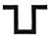
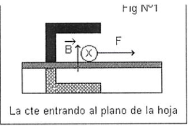
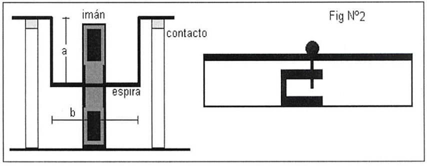
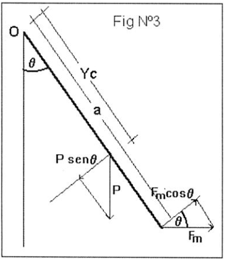
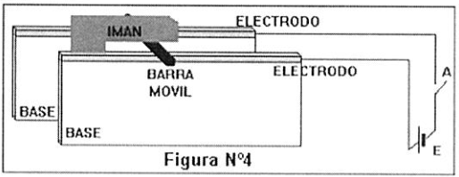
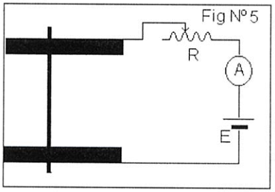
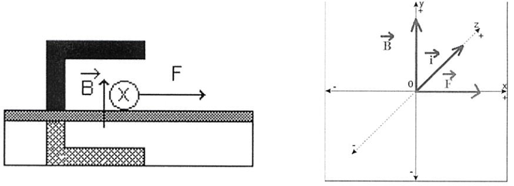
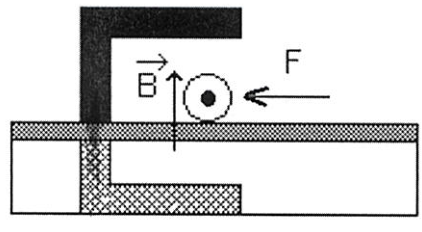
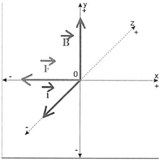
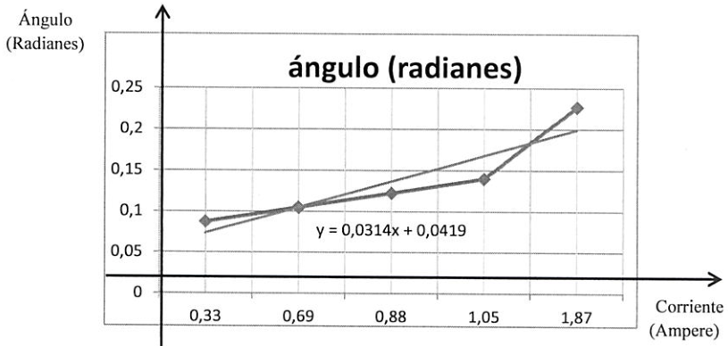

# Fuerza magnética sobre elementos de corriente: informe experimental

Universidad Tecnológica Nacional — Facultad Regional Resistencia

Física II — Ingeniería Química

## Objetivo de la experiencia

Análisis y verificación de la fuerza magnética sobre elementos de corriente.

## Resumen

Empleando un montaje sencillo y de bajo costo se estudia en forma cualitativa y
cuantitativa la expresión de la fuerza sobre conductores que transportan
corriente eléctrica en un campo magnético. Se desarrolla la teoría para obtener
las expresiones que predicen el movimiento del conductor bajo la acción de la
fuerza magnética. La comprobación experimental consiste en colocar un conductor
recto, de sección circular, simplemente apoyado sobre dos electrodos planos, en
una región donde existe un campo magnético, cambiando el sentido de la corriente
en el conductor y luego el sentido del campo se observa que el conductor se
rueda en sentido contrario cumpliendo la expresión vectorial de la fuerza. En
cuanto, a la verificación de la intensidad de la fuerza, se sustituye el
conductor recto por uno en forma

cuyos extremos se apoyan en los electrodos, la parte horizontal se coloca en un
campo magnético, cuando circula corriente por el conductor se desvía un ángulo
respecto de la vertical, que aumenta al aumentar la corriente, la relación que
surge es concordante con lo predicho en el modelo desarrollado.

## Equipamiento necesario

Para una estación de trabajo:

- 1 fuente de alimentación de CC 12 voltios 5 amp.
- 1 Imán en forma de U
- 1 amperímetro (max lectura posible durante la experiencia 4 amp).
- 1 reóstato 11ohm 5 amp.
- 1 Barra de aluminio sección circular
- 1 Espira de aluminio de forma


2 Electrodos planos

Conectores

## Marco teórico

Sobre un elemento de corriente $`|\vec d|`$, que está colocado en una región
donde existe un campo magnético $`\vec B`$ se produce una fuerza elemental dada
por

```math
d\vec F=I\,\overrightarrow{dl}\wedge\vec B
```

(1)

1.- Vamos a usar la expresión (1) en el dispositivo de la figura Nº1, que
representa una barra recta conductora colocada en un campo magnético
suministrado por un imán en forma de U. Cuando se hace circular corriente por la
barra aparece una fuerza de intensidad



```math
F=ILB
```

(2)

Siendo L el ancho de la región donde existe campo.

Esta fuerza actúa mientras la barra se halla en el campo, si la intensidad de
esta fuerza es suficiente para vencer el rozamiento, la barra se desplaza.

2.- Consideremos ahora el dispositivo de la figura Nº2, cuando circula corriente
por la espira de lados a y b actúa una fuerza que la aparta de la posición
vertical, haciendo que forme un ángulo,



para encontrar la forma este ángulo depende de los otros parámetros que están
involucrados, estudiemos el diagrama de fuerzas de la figura N°3.

De la cual, se desprende la condición de equilibrio

```math
M(O,P)+M(O,Fm)=0
```

(3)

donde

```math
P=\mu(2a+b)g
```

(4)



siendo la densidad de masa por unidad de longitud y:

```math
Fm=ILB
```

(5)

la (3) puede rescribirse

```math
Yc\,P\mathop{\mathrm{sen}}\nolimits\theta-a\,Fm\cos\theta=0
```

(6)

donde Yc es la distancia del eje de suspensión al centro de masa de la espira y
viene dada por

```math
Yc=\frac{a(a+b)}{2a+b}
```

(7)

reemplazando (4), (5) y la (7) en la (6) resulta

```math
Yc=\frac{a(a+b)}{2a+b}
```

(7)

para ángulos pequeños resulta

```math
\theta\approx\frac{ILB}{(a+b)a\mu g}
```

(9)

De la (9) se desprende que como la geometría (a, b y L), la masa por unidad de
longitud L y los campos (g y B) son constantes existe una relación lineal entre
el ángulo de inclinación de la espira respecto de la normal y la corriente que
circula por la misma, siendo este el principio de funcionamiento de los
instrumentos eléctricos de medida de aguja.

## Descripción del dispositivo

Para hacer la verificación experimental de la fórmula (1), emplearemos el
dispositivo de la figura N°4, que representa dos bases de madera que tienen cada
uno en la parte superior dos barras metálicas que actuarán de electrodos planos,
estos están conectados a través del interruptor A con una fuente de corriente
continua.



Sobre los electrodos planos se apoya una barra de aluminio, recta y de sección
cilíndrica y se coloca un imán en forma de U entre las bases y de modo que, la
barra de aluminio se ubique en el centro del "gap" del imán

Para el análisis de la intensidad de la fuerza se reemplaza la barra recta de
aluminio y se reemplaza por una espira de lados a y b de la forma


y se emplea el circuito de la figura N°5.



Sobre el lado interno de una de las bases está pegado un semicírculo graduado
que permite medir el ángulo de inclinación de la espira respecto de la
horizontal.

## Técnica operatoria

### 1. Comprobación vectorial de la expresión (1)

1.1.- Haga el montaje de la figura N°4

#### Precauciones

En el montaje de la figura N°4, debe tenerse presente que el valor de la
intensidad de corriente no debe superar el valor máximo de operación de la
fuente, de modo que basta dar pulsos (encendido y apagado) para comprobar que la
barra de aluminio se desplaza.

1.2.- Haga circular la corriente en un sentido, luego en otro: ¿Qué observa?
Dibuje los vectores correspondientes. ¿Cuáles son sus conclusiones?

1.3.-Haga circular la corriente en un sentido, y luego invertir los polos del
imán. ¿Qué observa?. Dibuje los vectores correspondientes. ¿Cuáles son sus
conclusiones?

### 2.- Determinación del campo magnético de un imán natural

2.1 Haga el montaje de la figura Nº5.

2.2 Mida las longitudes de la varilla según indica la figura Nº2

2.3 Pese la varilla y determine su densidad lineal

2.4 Variando el valor de la resistencia R del circuito de la figura Nº5, cambia
la intensidad de corriente que se registra en el amperímetro y la inclinación de
la espira respecto de la vertical empleando el semicírculo del montaje, podemos
confeccionar entonces la tabla de datos

Tabla 1

<!-- markdownlint-disable MD060 -->

| Corriente eléctrica I (A) | Angulo (Radianes) |
| -- | -- |
|  |  |
|  |  |
|  |  |
|  |  |

<!-- markdownlint-enable MD060 -->

2.5 Realice un ajuste de curva, (por ejemplo emplee el método de cuadrados
mínimos si la gráfica se corresponde con una recta) con los mismos datos.

```math
A=\frac{N\sum_i x_iy_i-\sum_i x_i\sum_i y_i}{N\sum_i x_i^2-\left(\sum_i x_i\right)^2}\qquad B=\frac{\sum_i x_i^2\sum_i y_i-\sum_i x_i\sum_i y_i}{N\sum_i x_i^2-\left(\sum_i x_i\right)^2}
```

2.6 Compare las pendientes de ambos métodos, indicando su significado

## Procedimiento seguido durante el desarrollo de la experiencia

Esta experiencia de laboratorio se dividió en dos partes: una que fue
demostrativa, ya que no procedimos a cuantificar y otra experiencia donde
cuantificamos para la determinación del campo magnético de un imán natural.

La primer parte la llevamos a cabo para la comprobación vectorial de la
expresión

```math
d\vec f=I\cdot\overrightarrow{dl}\vec B
```

para ello empleamos un montaje sencillo y de bajo costo que consistió en colocar
un conductor recto, de sección circular, simplemente apoyado sobre dos
electrodos planos, en una región donde existe un campo magnético, generado por
un imán, al cambiar el sentido de la corriente observamos que la varilla rodó
hacia direcciones distintas, verificamos que se manifiesta una fuerza ,cuando
circula corriente por un conductor que está sometido a un campo magnético, que
hace rodar la varilla hacia un sentido u otro respecto a que la circulación de
la corriente sea entrante o saliente. A continuación se representan imágenes de
como la varilla cambia de dirección de desplazamiento respecto del sentido de la
corriente:



Caso 1: el sentido de la circulación de la corriente es entrante (entra por el
electrodo positivo y va hacia el negativo), el campo se dirige hacia arriba por
consiguiente la fuerza resultante, que hará girar la varilla, se dirige hacia la
derecha, la varilla se desplaza hacia la derecha.





Caso 2: el sentido de la circulación de la corriente es saliente (para que sea
saliente se cambia la polaridad de los electrodos para que la corriente circule
en forma contraria al 1° caso), el campo se dirige hacia arriba por consiguiente
la fuerza resultante, que hará girar la varilla, se dirige hacia la izquierda,
la varilla se desplaza hacia la izquierda.

Aclaración: En la experiencia, según la guía de trabajo, deberíamos haber
realizado el análisis de esta experiencia, haciendo variar el sentido del campo
magnético, no lo hicimos por no disponer de un imán de forma en U, pero podemos
deducir que si invertíamos el sentido del campo ocurriría la situación contraría
en cada caso, en al caso 1: la fuerza resultante sería hacia la izquierda y en
el caso 2: la fuerza resultante tendría dirección hacia la derecha.

En cuanto a la segunda parte consistió en un análisis cuantitativo, ya que
procedimos a la verificación de la intensidad de la fuerza, volvimos a utilizar
el montaje sencillo pero cambiando la varilla por una espira de forma

cuyos extremos se apoyaron sobre los electrodos, la parte horizontal quedó bajo
la influencia de un campo magnético, creado por el imán, cuando comenzamos a
hacer circular corriente eléctrica por el conductor observamos que la espira se
desvió un ángulo θ respecto de la vertical, y al variar la corriente, mediante
el reóstato observamos que el ángulo de desplazamiento variaba, desde un ángulo
mínimo 0,087266463 radián cuando la resistencia era grande y la corriente que
circulaba por el conductor era de 0,33 A, hasta un ángulo de 0,226892803 radián
cuando la resistencia era mínima y la corriente era de 1,87 A, realizamos un
total de 5 mediciones, la espira describió un movimiento de hamaca cuando se
hizo variar la corriente, esto se justifica mediante la teoría que establece que
“El campo de inducción magnética $`\vec B`$ depende en forma proporcional de la
intensidad de corriente que circula por el conductor” por ello al aumenta la
corriente el ángulo de inclinación es mayor porque aumenta la fuerza del campo
magnético creado.

## Resultados



<!-- markdownlint-disable MD060 -->

| Número de lectura | I (A) | ángulo (radianes) | Cálculo del campo B (Tesla) |
| -- | -- | -- | -- |
| 1 | 1,87 | 0,226892803 | 0,01600956 |
| 2 | 1,05 | 0,13962634 | 0,017546 |
| 3 | 0,88 | 0,122173048 | 0,01831863 |
| 4 | 0,69 | 0,104719755 | 0,02002533 |
| 5 | 0,33 | 0,087266463 | 0,03489262 |
| Promedio del campo obtenido |  |  | 0,02135843 |

<!-- markdownlint-enable MD060 -->

Aclaración: Para el cálculo del campo (B) procedimos a aplicar la siguiente
fórmula:

```math
B=\frac{\theta\cdot(a+b)\cdot a\cdot\mu\cdot g}{I\cdot L}
```

Datos: a=0,066m; b=0,014m; L=0,025m; g=9,8 m/s²; μ (densidad lineal por unidad
de longitud) lo calculamos a partir de la masa de la varilla 7,5g y longitud
total de la varilla 23,6 cm lo pasamos a Kg y metro obteniendo μ=masa/longitud;
μ=0,03 Kg/m

Podemos observar que en el gráfico donde se representa el ángulo de desviación
en función de la corriente que circula por el conductor, se obtiene una función
creciente donde la pendiente representa la medida que aumenta la corriente por
cada 0,0314 radianes de desvío será equivalente a 1 Ampere. También se observa
que al aumentar la corriente que circula por el conductor de aluminio en forma
de espira el ángulo que describe es mayor de modo que esto verifica que existe
una relación lineal entre el ángulo de inclinación de la espira respecto de la
normal θ y la corriente que circula.

## Conclusión

Por medio de este trabajo hemos podido cumplir con los objetivos expuestos al
inicio del mismo. En la primer parte de la experiencia pudimos comprobar la
expresión vectorial de la fuerza mediante el desplazamiento de la barra de
aluminio, ya que al hacer variar el sentido de circulación de la corriente la
barra se desplazó hacia un sentido y hacia otro, esto permite verificar que se
manifiesta una fuerza que hace girar el conductor, por el que circula corriente
y se encuentra sometido bajo un campo magnético. En cuanto a la segunda parte
cuando se estudia la espira en el campo, mediante las observaciones hechas
pudimos llegar a comprobar que existe una relación lineal entre el pasaje de
corriente y el ángulo de inclinación de la espira, al aumentar la corriente
aumenta el ángulo de inclinación porque la fuerza magnética que se genera es
mayor, lo que permite que la espira describa un ángulo mayor, siendo este el
principio de funcionamiento de los instrumentos eléctricos de medida de agujas.

## Procedencia y observaciones de transcripción

- Original:
  `2019/2do Parcial/Laboratorios/Fza Magnetica sobre elementos de corriente.pdf`,
  páginas1–9. Año2019 por carpeta; sin fecha impresa. Encabezado Ingeniería
  Química.
- SHA-256: `774d656816c33c843a4066a34a82d7e25b1562a37a5921a0ec38e35dd7792bb6`.
- Herramientas: OCRmyPDF con spa sobre copia, PyMuPDF4LLM, Poppler y recortes
  PyMuPDF; nueve páginas, ecuaciones, tabla de cinco mediciones, formulario
  vacío y figuras cotejados visualmente.
- Se conserva la repetición literal de (7) en lugar de (8), «masa por unidad de
  longitud L», la fórmula B del ajuste con y_i en ambos sumandos y la expresión
  vectorial distinta de página6. Los resultados y la recta del gráfico
  pertenecen al informe; no se recalculan.
- Se mantiene la aclaración de que no se realizó la inversión del campo por
  falta de imán en U. Se omiten datos personales enmascarados y anotaciones de
  evaluación; los recortes sólo contienen material académico.

### Derivación con OCR deteriorado

Se cotejaron las nueve páginas de
`2019/2do Parcial/Laboratorios/Fza Magnetica sobre elementos de corriente_apto_busquedas.pdf`
(SHA-256 `b7c6ad28eccedebbac43e01c2fefa96d20763c7b06bd705559aee0a27cef5a2a`). Es
una derivación del mismo informe con sustituciones visibles de la forma de la
espira (páginas1–2 y4), flechas y letras de ecuaciones (2–3 y5–6), trazos de
circuitos (4) y gráfico (8). Se conserva como evidencia de una conversión
deteriorada; esta transcripción usa el escaneo legible. No se declaran píxeles
idénticos ni se reproducen sus símbolos corruptos como una formulación autoral
distinta.
