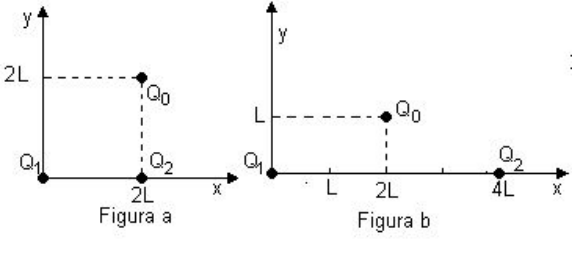
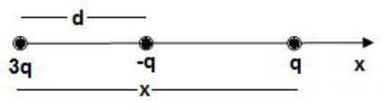
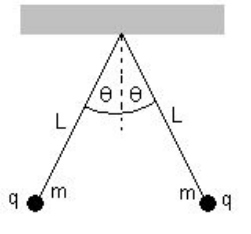
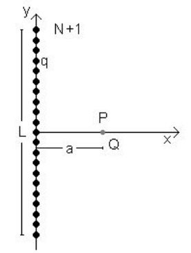
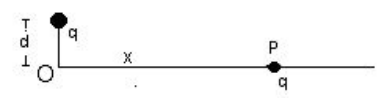

# Guía de problemas 1.1: Ley de Coulomb

## Cuestionario

1. ¿Cuál es la carga eléctrica total en un sistema aislado?

1. Puede destruirse o crearse una carga eléctrica? Justifique.

1. ¿Qué diferencia existe entre un conductor y no conductor?

1. Empleando la ley de Coulomb haga una representación gráfica:

   - a) $`F/q=F(r)`$ con q constante.

   - b) $`F/q=F(q)`$ con r constante

1. ¿Cuáles son los valores numéricos y unidades de la constante de
   proporcionalidad en la ley de Coulomb en los distintos sistemas de unidades?

1. La fuerza electrostática ejercida entre dos cargas puntuales de igual
   (distinto) signo es una magnitud vectorial. Hacer un diagrama vectorial en
   cada caso.

1. Plantear el caso de la fuerza sobre una carga (positiva o negativa) producida
   por un conjunto de cargas puntuales.

1. ¿Qué significa que la fuerza de interacción entre cargas sea de "acción a
   distancia" ?

1. Una varilla cargada atrae pedacitos de polvo de corcho seco los cuales
   después de tocar la varilla, a menudo saltan disparados violentamente fuera
   de ella. Explique lo que ocurre.

## Problemas

### Problema 1

La expresión de la ley de Coulomb para interacción entre cargas puntuales es

```math
\vec F=k\frac{q_1q_2}{r^2}\vec r_o
```

Determine las unidades de k si las cargas se mide en Coulomb (C), la distancia r
en metros (m) y la fuerza en Newton (N)

### Problema 2

Calcule el módulo de la fuerza electrostática que ejerce un cuerpo puntual
cargado con Q = $`10^{-6}`$ C sobre otro igual, cuando están distanciados:

- a) $`r_1`$ = 1m

- b) $`r_2`$ = 0,5m

- c) $`r_3`$ = 0,25m

- d) $`r_4`$ = 0,125m

Haga una representación gráfica de la fuerza en función de la distancia entre
los cuerpos.

### Problema 3

Dos cargas puntuales $`Q_1`$ y $`Q_2`$ respectivamente, como muestran las
figuras 1a), 1b) ejercen una fuerza electrostática sobre la carga puntual
$`Q_0`$.

- a) Haga un esquema del diagrama de fuerzas que ejercen las cargas puntuales
  $`Q_1`$ y $`Q_2`$ sobre $`Q_0`$ y encuentre geométricamente su resultante.

- b) Calcule la fuerza electrostática sobre el cuerpo puntual con carga $`Q_0`$



Datos: $`Q_0`$= 1x$`10^{-5}`$ C ; $`Q_1`$ = -2x$`10^{-5}`$ C ; $`Q_2`$ =
2x$`10^{-5}`$ C ; L = 0,4m.

### Problema 4

Dadas dos pequeñas esferas, una tiene carga positiva 3q y la otra carga negativa
-q están ubicadas como muestra la figura. Una tercera esfera con carga q es
libre para deslizarse solo sobre la horizontal. ¿En qué posición la tercera
esfera está en equilibrio? ¿Puede ser en equilibrio estable?



### Problema 5

Una cierta carga Q se divide en dos partes +q y Q - q. ¿Cuál es la relación de Q
a q si las dos partes separadas una cierta distancia deben producir una máxima
repulsión coulombiana entre si?

### Problema 6

Tres cargas puntuales iguales de Q = 1.$`10^{-4}`$ C. están colocadas en los
vértices de un triángulo equilátero de 20 cm de lado. Calcular la fuerza que
actúa sobre cada carga.

### Problema 7

Si la suma de dos cargas puntuales es 5.$`10^{-5}`$ C. Y la fuerza eléctrica
entre ellas cuando están separadas 2 m. es 1 N. ¿Cuál es el valor de cada carga?

### Problema 8

Dos cuerpos cargados $`Q_1`$ y $`Q_2`$ con cargas iguales a $`10^{-3}`$ C están
separados por una distancia d = 0,01m. ¿Qué valor de masa debería tener el
cuerpo de carga $`Q_2`$ para que su peso sea igual en magnitud a la fuerza
eléctrica que existe entre ambos cuerpos?



### Problema 9

A lo largo de la longitud L del eje y se colocan N cargas puntuales
equiespaciadas simétricas respecto del eje horizontal.



a) Calcular la fuerza sobre una carga puntual Q ubicada en el eje horizontal
como muestra la figura.

b) Si L =10 cm, N = 101 (para incluir la que coincide con el centro de
coordenadas) a =10 cm y el valor de las cargas es $`10^{-11}`$ C, determinar la
magnitud de la fuerza.

c) Calcule la fuerza sin incluir la carga del centro de coordenadas.

### Problema 10

Una carga puntual de +q C está a una distancia d (ver figura) del origen O.
Calcular **el trabajo por unidad de carga** necesario para traer a otra carga +q
desde un punto muy alejado (infinito) y a lo largo del eje x hasta el punto O.



## Nota de transcripción

Archivo conservado en la carpeta 2019, con 2018 en su nombre; no consta año
impreso ni autor en las tres páginas. Se conservan el enunciado y los datos sin
resolver los diez problemas ni armonizar los diagramas con el texto.

[Procedencia y comprobaciones](../../../resources/2019/fuentes.md).
