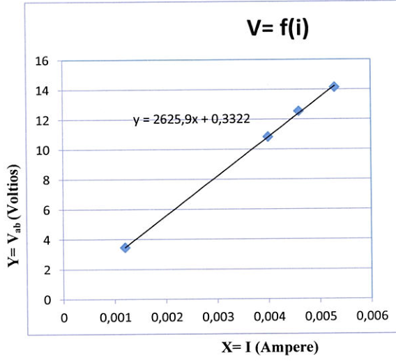
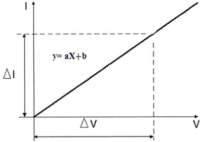
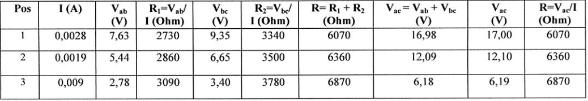
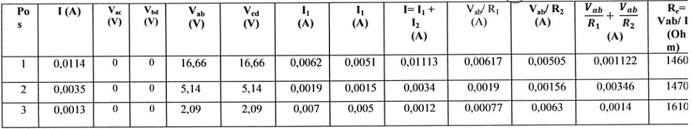
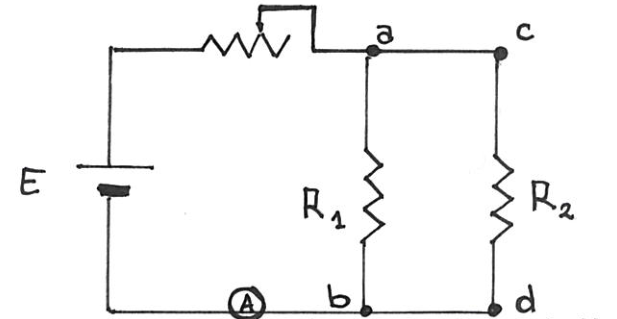

# Ley de Ohm: asociación de resistencias — informe experimental

Universidad Tecnológica Nacional — Facultad Regional Resistencia

Física II: Ley de Ohm: Asociación de Resistencia — Ingeniería Química

## Procesamiento de los datos experimentales para la comprobación de la Ley de Ohm

Datos experimentales:

| Posición | I (Ampere) | $`V_{ad}`$ (voltios) | $`R_X=V_{ad}/I`$ (Ohm) |
| -- | -- | -- | -- |
| 1 | 0,0063 | 16,97 | 2690 |
| 2 | 0,0053 | 14,14 | 2670 |
| 3 | 0,0046 | 12,54 | 2730 |
| 4 | 0,004 | 10,84 | 2710 |
| 5 | 0,0012 | 3,46 | 2880 |

Sacamos promedio de los $`R_X`$ (resistencia experimental):

```math
\frac{(2690+2670+2730+2710+2880)\mathrm{Ohm}}5=2736\mathrm{Ohm}
```

El valor obtenido es un valor próximo a la pendiente de la función de la gráfica
de abajo, porque representa el valor de la resistencia.

Gráfico en el que se representa los valores obtenidos experimentalmente de la
variación de la función respecto de la corriente eléctrica, I (Ampere).



Leyenda original: V=f(i); Lineal (V=f(i)). Ejes: X=I (Ampere), $`Y=V_{ab}`$
(Voltios).

```math
y=2625{,}9x+0{,}3322
```

## Análisis de los resultados y causas de error, de la comprobación de la Ley de Ohm

Para la comprobación de la Ley de Ohm procedimos primero a armar el circuito,
antes de encender la fuente pedimos al ayudante de cátedra que verifique que las
conexiones se hayan hecho adecuadamente. Una vez que conectamos la fuente
comenzamos a variar la resistencia en cinco posiciones distintas, como se
observa en la gráfica de valores, variamos en orden creciente, de modo que al
principio la resistencia era mínima y a medida que cambiábamos de posición
incrementábamos la resistencia, observando que el pasaje de corriente eléctrica
en el circuito era cada vez menor. Obteniendo valores de corriente eléctrica que
al inicio fue de 0,0063 A al aplicar una resistencia de 2690 Ω presentando una
tención de 16,97 V. A medida que la resistencia aumentaba la corriente eléctrica
disminuía, esto es lógico porque la Corriente es inversamente proporcional a la
Resistencia: ($`I=\frac{V_{ab}}{R_X}`$); de modo que al aumentar la resistencia
la corriente disminuye y la tensión disminuye. Finalmente regulamos la
resistencia variable en su posición máxima obteniendo los siguientes valores:
Resistencia 2880 Ω, corriente eléctrica: 0,0012 A y una tensión de 3,46 V.

En la gráfica, ubicada bajo el cuadro de datos se representa en el eje X los
valores de corriente eléctrica obtenidos, I (Ampere), y en el eje Y las
tenciones, $`V_{ab}`$ (V). Se observa una función de pendiente positiva
creciente, a medida que aumenta I aumenta la $`V_{ab}`$, en este caso el valor
último representaría nuestro 1° dato obtenido en la experiencia de modo que
relacionando con lo llevado a cabo en el laboratorio se observa que al aumentar
la Resistencia disminuyen los valores de corriente eléctrica y por consiguiente
de tensión en el circuito.

De la gráfica también podemos deducir que la pendiente de la función representa
la resistencia conectada al circuito, esto se deduce de saber lo siguiente:



```math
y=ax+b\qquad R=\frac VI
```

Donde a (pendiente) representa la resistencia

Podemos deducir que la pendiente a lo largo de toda la función se mantiene
constante, por lo tanto lo que mantiene la proporcionalidad constante de la
función es la Resistencia. En este circuito: la tensión, la intensidad y $`R_X`$
varían manteniéndose constante la resistencia R conectada al circuito.

Las posibles fuentes de error son principalmente de carácter operativo:

- Resistencia aportados por los conductores del circuito. Así como la
  resistencia de contacto en los puntos de conexión.
- El error aportado por el aparato de mediciones (multímetro), según la clase
  del instrumento empleado.
- El error de paralaje ya que en nuestro caso el amperímetro no nos daba un
  valor fijo, variaba constantemente entre dos decimales.

## Procesamiento de los datos experimentales de la asociación en serie de resistencias

Datos experimentales:

| Pos | I (A) | $`V_{ab}`$ (V) | $`R_1=V_{ab}/I`$ (Ohm) | $`V_{bc}`$ (V) | $`R_2=V_{bc}/I`$ (Ohm) | $`R=R_1+R_2`$ (Ohm) | $`V_{ac}=V_{ab}+V_{bc}`$ (V) | $`V_{ac}`$ (V) | $`R=V_{ac}/I`$ (Ohm) |
| -- | -- | -- | -- | -- | -- | -- | -- | -- | -- |
| 1 | 0,0028 | 7,63 | 2730 | 9,35 | 3340 | 6070 | 16,98 | 17,00 | 6070 |
| 2 | 0,0019 | 5,44 | 2860 | 6,65 | 3500 | 6360 | 12,09 | 12,10 | 6360 |
| 3 | 0,009 | 2,78 | 3090 | 3,40 | 3780 | 6870 | 6,18 | 6,19 | 6870 |



### Análisis de los resultados y causas de error, en la asociación en serie de resistencias

Para la verificación de las fórmulas de asociaciones en serie procedimos primero
a armar el circuito, en este caso a diferencia del primero se adicionó una
resistencia a la que ya estaba de 3,3 KΩ, estableciendo una asociación de
resistencias en serie. Antes de encender la fuente pedimos al ayudante de
cátedra que verifique que las conexiones se hayan hecho adecuadamente. Una vez
que conectamos la fuente comenzamos a variar la resistencia en tres posiciones
distintas (en esta experiencia se procedió a tomar sólo tres posiciones por
razones de tiempo), como se observa en la gráfica de valores, nuevamente
variamos en orden creciente, de modo que al principio la resistencia era menor y
a medida que cambiábamos de posición incrementábamos la resistencia, observando
que el pasaje de corriente eléctrica en el circuito era cada vez menor.

### Respuestas a la guía de laboratorio

Compare la columna 7 con la 10. ¿qué observa? ¿por qué?

Al comparar los valores de las columnas n°7: ($`R=R_1+R_2`$) con la columna
n°10: $`R=V_{ac}/I`$ observamos que los datos son iguales, esto es lógico ya que
ambos expresan la misma información pero relacionando los datos obtenidos por
medio de dos fórmulas diferentes, lo que verifica la veracidad de las fórmulas
utilizadas; en la columna 7 se obtiene el valor de la resistencia total del
circuito empleando la fórmula deducida a partir de la teoría de asociaciones de
resistencias en serie la cual expone: “La asociación de resistencias en serie
puede ser reemplazadas por una resistencia equivalente tal que en sus extremos
se mantenga la diferencia de potencial $`V_{ab}`$ y circule por ella una
corriente I, y además valga: $`R_e=R_1+R_2+\ldots+R_n`$”[¹](#cita-original).

En cuanto a la columna n°10 se obtiene la resistencia total del circuito
empleando la Ley de Ohm: “Establece que la diferencia de potencial ΔV existente
entre los extremos de un conductor es directamente proporcional a la corriente I
que circula por él es: $`\Delta V=R.I`$”, donde por despeje se obtiene la
resistencia.

Compare la columna 8 con la 9. ¿qué observa? ¿por qué?

Al comparar los valores de las columnas n°8: (Vac = Vab + Vbc) con la columna
n°9: (Vac), observamos que los datos son casi iguales, sólo difieren en
decimales, esto se debe a que ambos expresan la misma información, pero la
primera obtenida en forma indirecta y la segunda por medición directa. Ambas
columnas expresan la tensión total del circuito, la columna n° 8 lo obtiene
mediante la suma parcial de las tensiones Vab y Vbc mientras que la columna n°9
obtiene dicho valor, al medir mediante un voltímetro la diferencia de potencial
existente entre los bornes a y c del circuito. Al realizar esta medición se
obtiene la tensión total del sistema de forma directa.

Calculamos teóricamente el valor de la resistencia equivalente. Comparamos con
el valor obtenido y determinamos el error absoluto, relativo y porcentual
obtenido.

Aclaración: Utilizamos valor de Resistencia en KΩ.

Valores de resistencia equivalente teórica:

```math
\begin{aligned}
\mathrm{Re}_{(\text{teórico})}&=R1+R2\\
\mathrm{Re}_{(\text{teórico})}&=2{,}7\mathrm{K\Omega}+3{,}3\mathrm{K\Omega}\\
\mathrm{Re}_{(\text{teórico})}&=6\mathrm{K\Omega}
\end{aligned}
```

#### Cita original

¹ Cita extraída de la guía de estudio de laboratorio Física II \_2014. “Trabajo
de Laboratorio N°4: Ley de Ohm. Asociación de resistencias” (página 25)

Valores de resistencia equivalente experimental:

```math
\begin{aligned}
\mathrm{Re}_{(\text{experimental})}&=\sum R(\text{experimental})/3\\
\mathrm{Re}_{(\text{experimental})}&=(6{,}07\mathrm{K\Omega}+6{,}36\mathrm{K\Omega}+6{,}87\mathrm{K\Omega})/3\\
\mathrm{Re}_{(\text{experimental})}&=6{,}43\mathrm{K\Omega}
\end{aligned}
```

Cálculos de errores del ensayo:

Error absoluto:

```math
\Delta x=x-X\Rightarrow\Delta x=6{,}43\mathrm{K\Omega}-6\mathrm{K\Omega}=0{,}43\mathrm{K\Omega}
```

Error relativo:

```math
E_r=\frac{\Delta x}X=\left|\frac{0{,}43\mathrm{K\Omega}}{6\mathrm{K\Omega}}\right|=0{,}072
```

Error porcentual:

```math
E_{\%}=E_r.100=0{,}072.100=7{,}2\%
```

Analizando los valores obtenidos podemos apreciar que se ha cometido un error
porcentual del 7,2%, no es alto, ya que hemos obtenido una resistencia
equivalente en la práctica, cercana a la teórica, los posibles factores que
pueden contribuir a errores pudo ser principalmente de régimen operativo, a la
hora de tomar las mediciones, el operario pudo haber cometido errores de
paralaje, influyendo negativamente en los valores de los potenciales y de
corriente eléctrica. También podemos considerar errores debido a las
resistencias aportadas por los cables y los puntos de contactos en el circuito
empleado. El error cometido por los aparatos de mediciones (multímetro), según
la clase del instrumento empleado. De todas maneras hemos trabajado en equipo
siguiendo las recomendaciones del ayudante de cátedra y pudimos llegar a un
valor aproximado.

## Procesamiento de los datos experimentales de la asociación en paralelo de resistencias

Datos experimentales:

| Pos | I (A) | $`V_{ac}`$ (V) | $`V_{bd}`$ (V) | $`V_{ab}`$ (V) | $`V_{cd}`$ (V) | $`I_1`$ (A) | $`I_1`$ (A) | $`I=I_1+I_2`$ (A) | $`V_{ab}/R_1`$ (A) | $`V_{ab}/R_2`$ (A) | $`V_{ab}/R_1+V_{ab}/R_2`$ (A) | $`R_e=V_{ab}/I`$ (Ohm) |
| -- | -- | -- | -- | -- | -- | -- | -- | -- | -- | -- | -- | -- |
| 1 | 0,0114 | 0 | 0 | 16,66 | 16,66 | 0,0062 | 0,0051 | 0,01113 | 0,00617 | 0,00505 | 0,001122 | 1460 |
| 2 | 0,0035 | 0 | 0 | 5,14 | 5,14 | 0,0019 | 0,0015 | 0,0034 | 0,0019 | 0,00156 | 0,00346 | 1470 |
| 3 | 0,0013 | 0 | 0 | 2,09 | 2,09 | 0,007 | 0,005 | 0,0012 | 0,00077 | 0,0063 | 0,0014 | 1610 |



Aclaración: se ha cambiado los subíndices de los datos correspondientes a los
potenciales indicando de este modo que en nuestro circuito los bornes (a,b,c y
d) estaban dispuestos de forma distinta a como se encuentra en la tabla de datos
y el expuesto en la guía de laboratorio.

Nuestro circuito se encontraba conectado de la siguiente manera:



### Análisis de los resultados y causas de error, en la asociación en paralelo de resistencias

Para la verificación de las fórmulas de asociaciones en paralelo procedimos
primero a armar el circuito, en este caso a diferencia de la experiencia
anterior se agregó al circuito una resistencia, de 3,3 KΩ, en paralelo con el
que ya estaba y se volvió a repetir el procedimiento. Antes de encender la
fuente pedimos al ayudante de cátedra que verifique que las conexiones se hayan
hecho adecuadamente. Una vez que conectamos la fuente comenzamos a variar la
resistencia en tres posiciones distintas (en esta experiencia se procedió a
tomar sólo tres posiciones por razones de tiempo), como se observa en la gráfica
de valores, nuevamente variamos en orden creciente, de modo que al principio la
resistencia era menor y a medida que cambiábamos de posición incrementábamos la
resistencia, observando que el pasaje de corriente eléctrica en el circuito era
cada vez menor.

### Respuestas a la guía de laboratorio: asociación en paralelo

¿Qué conclusión saca de las tablas $`V_{ac}`$ y $`V_{bd}`$?

Podemos observar que los valores de tensión son cero en ambas columnas. Esto
significa que no hay resistencia y entonces no hay caída de tensión por lo que
no habrá diferencia de tensión entre los bornes (a-c) y (b-d), para cerrar el
circuito, los bornes, se encuentran conectados por medio de cables pero no
poseen una resistencia lo que hace que no exista caída de tensión y por lo tanto
tampoco diferencia de potencial entre los puntos medidos con el voltímetro.

¿Qué conclusión saca de las tablas Vab y Vcd?

Podemos observar que los valores de tensión son los mismos en ambas columnas
porque las resistencias $`R_1`$ y $`R_2`$ se encuentran conectadas en paralelo.
Las misma limitan la corriente que circulan por ellas respondiendo a la Ley de
Ohm ($`I=\frac VR`$). Las corrientes al atravesar $`R_1`$ y $`R_2`$ producen una
diferencia de tensión entre los bornes (a-b) y (c-d), que resultan ser iguales y
comprobado a través del voltímetro. De este modo, se pudo verificar que al
asociar resistencias en paralelo la diferencia de potencial en los extremos de
cada una de ellas es la misma.

¿Qué conclusión saca de las tablas I1+I2 y de Vab/R1 + Vab/R2?

Al comparar los valores de ambas columnas observamos que las intensidades
$`I_1`$ y $`I_2`$ medidas en forma directa a través del amperímetro y cuya suma
resultan ser aproximado a los obtenidos sumando las corrientes calculadas
aplicando la Ley de Ohm. Esto es lógico ya que ambas columnas expresan la misma
información; la columna n° 9 se obtiene mediante la suma parcial de las
intensidades $`I_1`$ e $`I_2`$ mientras que la columna n°12 se obtiene,
empleando la Ley de Ohm: “Establece que la diferencia de potencial ΔV existente
entre los extremos de un conductor es directamente proporcional a la corriente I
que circula por él es: $`\Delta V=R.I`$”, donde por despeje se obtiene la
intensidad.

Calcule teóricamente el valor de la resistencia equivalente. Compare con el
valor obtenido y determine el error absoluto, relativo y porcentual obtenido.

Aclaración: Utilizamos valor de Resistencia en KΩ.

Valores de resistencia equivalente teórica

```math
\begin{aligned}
\frac1{\mathrm{Re}(\text{teórico})}&=\frac1{R1}+\frac1{R2}\\
\frac1{\mathrm{Re}(\text{teórico})}&=\frac1{2{,}7\mathrm{K\Omega}}+\frac1{3{,}3\mathrm{K\Omega}}\\
\frac1{\mathrm{Re}(\text{teórico})}&=1{,}49\mathrm{K\Omega}
\end{aligned}
```

Valores de resistencia equivalente experimental:

```math
\begin{aligned}
\frac1{\mathrm{Re}(\text{experimental})}&=\frac{\sum 1/R(\text{experimental})}{3}\\
\frac1{\mathrm{Re}(\text{experimental})}&=\left(\frac1{1{,}46\mathrm{K\Omega}}+\frac1{1{,}47\mathrm{K\Omega}}+\frac1{1{,}61\mathrm{K\Omega}}\right)/3\\
\frac1{\mathrm{Re}(\text{experimental})}&=1{,}51\mathrm{K\Omega}
\end{aligned}
```

Cálculos de errores del ensayo:

Error absoluto:

```math
\Delta x=x-X\Rightarrow\Delta x=1{,}51\mathrm{K\Omega}-1{,}49\mathrm{K\Omega}=0{,}02\mathrm{K\Omega}
```

Error relativo:

```math
E_r=\frac{\Delta x}X=\left|\frac{0{,}02\mathrm{K\Omega}}{1{,}49\mathrm{K\Omega}}\right|=0{,}013
```

Error porcentual:

```math
E_{\%}=E_r.100=0{,}072.100=1{,}3\%
```

Analizando los valores obtenidos podemos apreciar que se ha cometido un error
porcentual bajo de 1,3%, ya que hemos obtenido una resistencia equivalente en la
práctica, muy cercana a la teórica, varía en sólo dos decimales. Los posibles
factores que pueden contribuir a este error que es despreciables por ser mínimo
pudo ser principalmente a los cálculos llevados a cabo, en donde no se toma
todos los decimales y esto acarrea a que el valor obtenido no sea exactamente el
mismo y sólo varíe en uno o dos decimales.

Errores del ensayo:

- Error de paralaje.
- Error por resistencia de los cables y de inserción en el circuito.
- Error aportado por el instrumento de medición.

## CONCLUSIÓN

Por medio de este trabajo hemos podido cumplir con los objetivos expuestos al
inicio del mismo.

En primera instancia comprobamos la Ley de Ohm la cual establece que la
diferencia de potencial ΔV existente entre los extremos de un conductor es
directamente proporcional a la corriente I que circula por él: $`\Delta V=R.I`$.
En el práctico se trabajó con un circuito compuesto por una fuente, una
resistencia variable (contaba con un dispositivo que permitía variar) y una
resistencia $`R_1`$, mediante el voltímetro medimos las tensiones entre los
extremos de la resistencia y el amperímetro para determinar la corriente
eléctrica. A partir de los datos obtenidos comprobamos experimentalmente la Ley
de Ohm, la cual establece una relación entre Tensión, Corriente y Resistencia
mediante la fórmula: $`V=R.I`$.

En segundo lugar pudimos verificar experimentalmente las resistencias
equivalentes en circuitos donde las mismas se encuentran asociadas en serie y en
paralelo. Comprobamos la coincidencia entre los valores obtenidos
experimentalmente y calculados en forma teóricas.

En cuanto a asociaciones en serie se pudo comprobar las siguientes
características:

- Diferencia de potencial existente en cada una es diferente.
- A través de cada resistencia circula la misma I (corriente eléctrica).
- “La asociación de resistencias en serie puede ser reemplazadas por una
  resistencia equivalente tal que en sus extremos se mantenga la diferencia de
  potencial $`V_{ab}`$ y circule por ella una corriente I, y además valga:
  $`R_e=R_1+R_2+\ldots+R_n`$”

En cuanto a asociaciones en paralelo se pudo deducir las siguientes
características:

- Diferencia de potencial existente en cada una es la misma.
- A través de cada resistencia circula distinta I (corriente eléctrica).
- “La asociación de resistencias en paralelo puede ser reemplazadas por una
  resistencia equivalente tal que en sus extremos estén a la diferencia de
  potencial $`V_{ab}`$ y circule por ella una corriente I, y tenga el valor:

```math
\frac1{R_e}=\frac1{R1}+\frac1{R2}+\cdots+\frac1{Rn}
```

”

## Procedencia y observaciones de transcripción

- Original: `2019/1er Parcial/Ley de Ohm.pdf`, nueve páginas PDF, numeradas 4–11
  y nuevamente 11 en la conclusión. El archivo comienza en el procesamiento de
  datos: no contiene las páginas impresas 1–3 del informe y no se reconstruyen.
- SHA-256: `2208a1c73fa18b49a8fb424a4338333358827fe17c2a0db62d57cd4bcf6e6f9c`.
  No consta fecha visible; 2019 corresponde a la carpeta. Informe de Ingeniería
  Química.
- Herramientas: OCRmyPDF con español sobre copia, PyMuPDF4LLM y Poppler; nueve
  páginas cotejadas visualmente, tres tablas, gráfico y dos diagramas. Recortes
  PyMuPDF conservan las figuras académicas. La leyenda del gráfico se transcribe
  aparte para excluir las anotaciones de evaluación; no se publica información
  personal, firmas ni calificaciones.
- Se conservan las erratas del original: encabezado V_ad en la primera tabla
  frente a V_ab en el gráfico y texto; corriente 0,009 en la tercera fila de
  serie; ambos encabezados I₁ y los decimales de la tabla de paralelo, incluidos
  0,001122, 0,007, 0,005 y 0,0063. No se recalculan datos.
- Se conserva el diagrama con I vertical y V horizontal junto a la afirmación de
  que su pendiente representa R. En paralelo se mantiene 1/Re igualado a valores
  en KΩ y la expresión 0,072·100=1,3%, aunque no coincidan. Las conclusiones,
  respuestas y cálculos pertenecen al informe original.
- La cita al manual de laboratorio de 2014 se conserva en una sección enlazada.
  Se preservan «tención», «tenciones», «Resistencia aportados», «Las misma» y
  otras discordancias del original.
