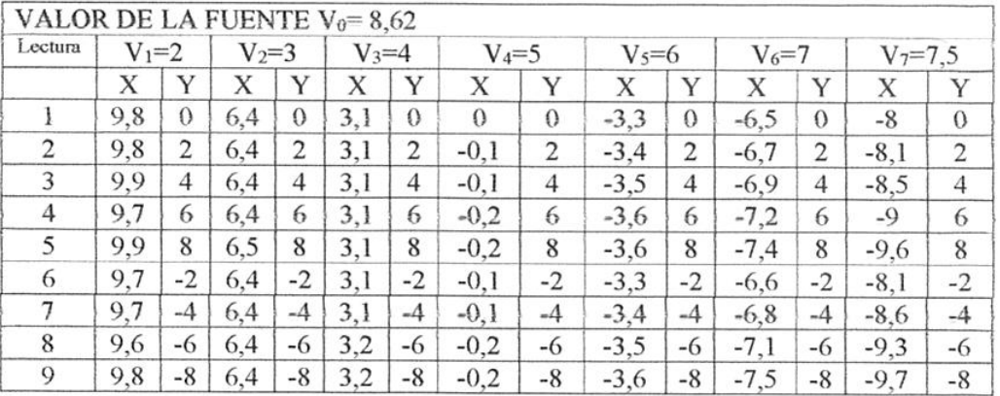
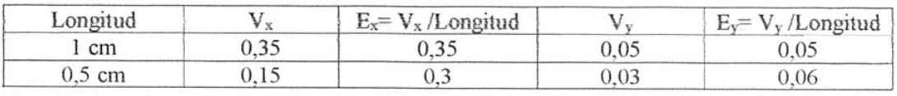

# POTENCIAL ELÉCTRICO. MAPEO DEL CAMPO ELÉCTRICO

Universidad Tecnológica Nacional — Facultad Regional Resistencia

Física II: Mapeo del Campo Eléctrico — Ingeniería Química

## Objetivo de la experiencia

Con este trabajo de laboratorio se pretende visualizar el espectro del campo
eléctrico en un plano producido por una distribución de carga obtenida a partir
del trazado de líneas equipotenciales.

## Marco teórico

### El campo eléctrico como gradiente del potencial

Si se aplica la definición de diferencia de potencial a dos puntos separados por
una distancia dl, suponiendo que en esa región, el campo $`\vec E`$ puede ser
considerado constante, entonces

```math
dV=-\vec E.\overrightarrow{dl}
```

y considerando el producto escalar se tiene

```math
dV=-E\cos(\theta)\,dl
```

despejando

```math
\frac{dV}{dl}=-E\cos(\theta).
```

Es posible interpretar que

a) si el vector dl es tangente a una superficie equipotencial entonces no hay
variación de potencial y el cociente $`\left|\frac{dV}{dl}\right|=0`$

b) si el vector dl es normal a la tangente de una superficie equipotencial,
entonces hay una máxima variación de potencial y el cociente
$`\left|\frac{dV}{dl}\right|_{Max}=E`$

c) si el vector dl forma un ángulo con la tangente de una superficie
equipotencial, entonces el cociente toma el valor
$`\left|\frac{dV}{dl}\right|=E\cos(\theta)`$.

Haciendo el desarrollo en coordenadas cartesianas el vector dl tiene como
componentes (dx, dy, dz) entonces

```math
dV=-(E_x\,dx+E_y\,dy+E_y\,dz).
```

Puesto que V es una función de la posición, es decir, de x, y, z, el diferencial
total puede expresarse

```math
dV=\frac{\partial V}{\partial x}\,dx+\frac{\partial V}{\partial y}\,dy+\frac{\partial V}{\partial z}\,dz.
```

De estas dos expresiones podemos deducir que

```math
E_x=-\frac{\partial V}{\partial x}\qquad E_y=-\frac{\partial V}{\partial y}\qquad E_z=-\frac{\partial V}{\partial z}
```

Entonces el campo eléctrico puede indicarse como

```math
\vec E=-\frac{\partial V}{\partial x}\vec\imath-\frac{\partial V}{\partial y}\vec\jmath-\frac{\partial V}{\partial z}\vec k
```

o bien $`\vec E=-\nabla V(x,y,z)`$ donde $`\nabla`$ representa el gradiente de
V(x,y,z). El campo eléctrico está indicando la dirección y magnitud de la
variación espacial máxima de la función escalar V(x, y, z), el signo negativo
indica el sentido contrario de la variación.

El gradiente de una función escalar gráficamente indica la dirección y sentido
de máxima variación de la función.

El gradiente $`\nabla V`$ es un operador vectorial sobre V (función de la
posición) que da información de V en un entorno del punto en el cual se calcula.

a) El sentido de $`\nabla V`$ es aquel en el cual la función escalar V varía más
rápidamente.

b) $`\nabla V`$ es perpendicular en cada punto a las superficies
equipotenciales.

c) El $`|\nabla V|`$ es igual al máximo de las derivadas direccionales de V.

### Superficies equipotenciales

Si una línea L es equipotencial, entonces satisface V(x, y) = C, si se calcula
el diferencial resulta

```math
dV=\frac{\partial V}{\partial x}\,dx+\frac{\partial V}{\partial y}\,dy=-E_x\,dx-E_y\,dy=0;
```

entonces es posible encontrar la expresión de la familia de líneas
equipotenciales a partir de las componentes del campo eléctrico haciendo

```math
\frac{dy}{dx}=-\frac{E_x}{E_y}.
```

Como las líneas de fuerzas del campo eléctrico son tangentes a este, entonces
siempre atraviesan las superficies equipotenciales en forma perpendicular y
corren en la dirección en la cual el potencial decrece más rápidamente. Entonces
es posible obtener la familia de líneas de fuerzas del campo eléctrico haciendo

```math
-\frac1{\dfrac{dy}{dx}}=-\frac{E_x}{E_y}.
```

## Materiales Utilizados

1. Fuente de alimentación CC(12V)
1. Electrodos
1. Cuba
1. Voltímetro (multitester)
1. 3 conectores

La fuente de alimentación CC es la encargada de suministrar energía eléctrica a
los distintos elementos, convierte la corriente alterna (CA), en una o varias
corrientes continuas (CC) ("reduce" el voltaje -mediante un transformador- y
posteriormente convierte la corriente alterna en continua -con un puente de
diodos- para finalmente filtrarla (mediante condensadores electrolíticos).

Los electrodos son conductores eléctricos utilizados para hacer contacto con una
parte no metálica de un circuito, por ejemplo un semiconductor, un electrolito,
el vacío, un gas. Para sistemas eléctricos que usan corriente alterna, los
electrodos son conexiones del circuito hacia el objeto que actuará bajo la
corriente eléctrica.

La cuba es el recipiente de vidrio (tiene que ser un vidrio transparente para
visualizar el papel milimetrado que se encuentra debajo) se carga con agua
potable hasta aproximadamente 5mm y contiene los electrodos, nos brinda el medio
para el estudio experimental.

El voltímetro es un instrumento que sirve para medir la diferencia de potencial
entre dos puntos de un circuito eléctrico. Los voltímetros, en esencia, están
constituidos por un galvanómetro cuya escala ha sido graduada en voltios. Para
medir la diferencia de potencial, el voltímetro debe colocarse en paralelo, es
decir, en derivación sobre los puntos entre los que se desea efectuar la medida.
Por este motivo un voltímetro debe poseer una resistencia interna muy alta, para
que no se produzca un consumo muy apreciable de corriente, que puede dar lugar a
una medida errónea.

Los conectores son utilizados para unir cables o para conectar un cable a un
dispositivo (es un dispositivo para unir circuitos eléctricos); permite
establecer un nexo entre la energía eléctrica proveniente de la fuente de
alimentación, realizando a través del mismo un intercambio de impulsos
eléctricos.

## Procedimiento seguido durante el desarrollo de la experiencia

1. Llenar del recipiente de vidrio con agua potable hasta una altura de unos 5
   mm.

1. Coloque debajo del recipiente un papel milimetrado tamaño oficio que servirá
   de referencia.

1. Antes de colocar los electrodos verifique que están limpios, póngalos en
   forma firme y ajústelos en el borde del recipiente, establezca la posición de
   los mismo tomando usando como referencia el papel milimetrado.

1. Arme el circuito presentado. Compruebe que la escala del voltímetro es la
   adecuada.

   Solicite la autorización al auxiliar docente para hacer la conexión a la
   fuente de alimentación.

1. Cuando se conecta el circuito, entre los electrodos se establece una
   diferencia de potencial Vo, igual a la de la fuente, que puede ser medida con
   el voltímetro, si se elije el electrodo conectado al borne negativo del
   voltímetro como punto de referencia (V=0) y se conecta el otro borde a una
   punta exploradora.

1. Con la punta exploradora determine las coordenadas (x,y) de al menos 8 de los
   puntos que están a un determinado potencial (2, 3, 4, 5, 6, 7, 7.5), mediante
   la lectura del voltímetro completamos con los datos obtenidos una tabla.

Para el cálculo del campo eléctrico:

1. Elija un punto entre los dos electrodos con desee conocer el campo, coloque
   ahí la punta exploradora que está conectada al borne (-) del voltímetro, la
   otra colóquela a una distancia de 1 cm en dirección horizontal, registre la
   lectura en el voltímetro V1x. Repita acercando la punta exploradora a 1/2 cm
   y registre la lectura en el voltímetro V2x.
1. Haga lo mismo en dirección perpendicular a la anterior.

## Procesamiento de los datos experimentales

### 1. Datos para la construcción de las líneas equipotenciales y líneas de fuerzas del campo eléctrico

VALOR DE LA FUENTE $`V_0=8{,}62`$

| Lectura | V₁=2: X | Y | V₂=3: X | Y | V₃=4: X | Y | V₄=5: X | Y | V₅=6: X | Y | V₆=7: X | Y | V₇=7,5: X | Y |
| -- | -- | -- | -- | -- | -- | -- | -- | -- | -- | -- | -- | -- | -- | -- |
| 1 | 9,8 | 0 | 6,4 | 0 | 3,1 | 0 | 0 | 0 | -3,3 | 0 | -6,5 | 0 | -8 | 0 |
| 2 | 9,8 | 2 | 6,4 | 2 | 3,1 | 2 | -0,1 | 2 | -3,4 | 2 | -6,7 | 2 | -8,1 | 2 |
| 3 | 9,9 | 4 | 6,4 | 4 | 3,1 | 4 | -0,1 | 4 | -3,5 | 4 | -6,9 | 4 | -8,5 | 4 |
| 4 | 9,7 | 6 | 6,4 | 6 | 3,1 | 6 | -0,2 | 6 | -3,6 | 6 | -7,2 | 6 | -9 | 6 |
| 5 | 9,9 | 8 | 6,5 | 8 | 3,1 | 8 | -0,2 | 8 | -3,6 | 8 | -7,4 | 8 | -9,6 | 8 |
| 6 | 9,7 | -2 | 6,4 | -2 | 3,1 | -2 | -0,1 | -2 | -3,3 | -2 | -6,6 | -2 | -8,1 | -2 |
| 7 | 9,7 | -4 | 6,4 | -4 | 3,1 | -4 | -0,1 | -4 | -3,4 | -4 | -6,8 | -4 | -8,6 | -4 |
| 8 | 9,6 | -6 | 6,4 | -6 | 3,2 | -6 | -0,2 | -6 | -3,5 | -6 | -7,1 | -6 | -9,3 | -6 |
| 9 | 9,8 | -8 | 6,4 | -8 | 3,2 | -8 | -0,2 | -8 | -3,6 | -8 | -7,5 | -8 | -9,7 | -8 |



### 2. Datos para el cálculo del campo eléctrico

Coordenadas del punto en X: (1,0); (0.5,0)

Coordenadas del punto en Y(0,1); (0,0.5)

| Longitud | $`V_x`$ | $`E_x=V_x/\mathrm{Longitud}`$ | $`V_y`$ | $`E_y=V_y/\mathrm{Longitud}`$ |
| -- | -- | -- | -- | -- |
| 1 cm | 0,35 | 0,35 | 0,05 | 0,05 |
| 0,5 cm | 0,15 | 0,3 | 0,03 | 0,06 |



## Análisis de los resultados y causas de error

Nuestro equipo se armó de modo que el electrodo en forma de I se ubicó del lado
derecho, conectado al borne negativo del voltímetro. El electrodo en forma de U,
se hallaba del lado izquierdo, conectado al polo positivo de la fuente. Una vez
armado el equipo, y conectado a la fuente de corriente continua de 8 voltios,
aproximadamente, se comenzaron a medir los potenciales de izquierda a derecha,
desde V₁= 2 voltios, ya que fue imposible hacerlo desde un V= 1 voltios, porque
se encontraba muy cercano al electrodo y por lo tanto no se podía ubicar la
punta exploradora de manera adecuada para tomar dichas mediciones.

Se realizaron 8 determinaciones, desplazándonos en el eje X hasta encontrar el
potencial deseado, y luego en el eje Y, desplazamos la punta exploradora hacia
arriba y abajo (4 puntos, distanciados cada dos unidades), ubicando los puntos
equipotenciales. De esta forma se midieron potenciales de 2,4,5,6,7 y 7.5
voltios. Se tomó un potencial intermedio entre 7 y 8, es por ello que utilizamos
el valor de 7.5v, permitiendo visualizar de este modo un espectro del campo
eléctrico mas curvo (a medida que nos desplazamos hacia el electrodo conectado
al polo positivo de la fuente se esperaría que las familias de las curvas
equipotenciales sean más pronunciadas).

Una de las posibles explicaciones de porque la familia de líneas equipotenciales
obtenidas fueron mayormente líneas rectas y no curvas, se debe a que nuestra
fuente de corriente continua era de 8 voltios con lo que el voltaje suministrado
al equipo era bajo, y sabiendo que el potencial eléctrico es inversamente
proporcional a la distancia, los valores cercanos al electrodo I conectados al
borne negativo formará una familia de líneas rectas, porque la diferencia de
potencia es mínima. Pero aquellos puntos que se ubiquen cerca del electro en U,
presentan una gran diferencia de potencial dando familias de líneas
equipotenciales más curvas.

En cuanto al cálculo del campo eléctrico podemos deducir que:

Aclaración: no hemos realizado las tres determinaciones para calcular la
intensidad del campo eléctrico, sólo hemos tomado un valor, esto repercutió
negativamente en el análisis de la experiencia porque no tenemos los datos
suficientes para las conclusiones y deducciones del mismo. Pero basándonos en el
único dato recolectado y en base a la teoría podemos deducir:

- La intensidad del campo eléctrico es mayor a desplazarnos sobre el eje X, esto
  se debe a la diferencia de potencial establecida por la ubicación de los
  electrodos.

- Cuanto mayor es la distancia entre los puntos seleccionados, menor es la
  intensidad del campo eléctrico.

- Al desplazaros en el eje Y, la intensidad del campo eléctrico es mínima, ya
  que la diferencia de potencial es pequeña debido a la posición en la que se
  encuentran los electrodos.

## CONCLUSIÓN

Al finalizar el trabajo podemos expresar satisfactoriamente que hemos cumplido
con el objetivo propuesto, hemos visualizado el espectro del campo eléctrico en
un plano producido por la distribución de cargas obtenido a partir del trazado
de líneas equipotenciales. Demostramos también que el campo eléctrico siempre es
perpendicular a las líneas de curvas equipotenciales.

Mediante la experiencia establecimos una región de estudio donde analizamos y
comprobamos las características que presenta el campo eléctrico, permitiéndonos
incorporar a nuestros conocimientos la noción de campo: el mismo es una idea de
amplia importancia en descripción de un conjunto de fenómenos físicos. Un campo
es una función o conjunto de funciones que representa por ejemplo a cada
componente de un vector, definida en todos los puntos en un espacio dado de
coordenadas y que asocia determinada cantidad física a cada punto en el espacio.

## BIBLIOGRAFÍA

- Eisberg R. y Lerner L. “Física: Fundamentos y Aplicaciones” Vol. I y II Ed.
  McGraw-Hill
- Serway R. “Física Vol I y II Ed. Mc Graw-Hill
- Sears Física Universitaria 6ᵗᵃ ed. Addison Wesley
- Zahn M. “Teoría Electromagnética y Magnetismo” Ed. McGraw-Hill
- Gettys y otros “Física Clásica y Moderna” Ed. McGraw-Hill

## Procedencia y observaciones de transcripción

- Original: `2019/1er Parcial/Mapeo de Campo Electrico.pdf`, páginas 1–7 de 7;
  informe de Ingeniería Química. No consta fecha visible; 2019 es la carpeta.
- SHA-256: `9967197aee682d3117c6553b04d6550e588cf48710ece7f08c137bbabacd2e94`.
- Herramientas: OCRmyPDF con español sobre copia, PyMuPDF4LLM, Poppler y
  recortes PyMuPDF; siete páginas cotejadas visualmente, todas las expresiones y
  dos tablas. No se recuperan ni publican datos personales de las zonas
  cubiertas del original.
- Se conserva E_y dz en el desarrollo cartesiano de página 1, aunque después se
  emplee E_z; los signos de las pendientes y las afirmaciones del informe no se
  corrigen. Se preservan todas las coordenadas y decimales de las tablas.
- El propio informe indica que sólo se tomó un valor para el cálculo del campo,
  y su análisis enumera potenciales 2,4,5,6,7 y 7.5 sin mencionar el 3 de la
  tabla. No se completan mediciones ni se inventan trazados o diagramas del
  circuito que no están en el archivo.
- Se conservan «con desee», «tomando usando», «diferencia de potencia», «a
  desplazarnos» y «desplazaros». Las conclusiones y explicaciones pertenecen al
  original; no son soluciones añadidas.
