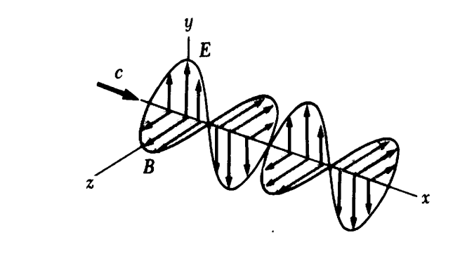

# Maxwell: problema de una onda plana

Unidad Temática X — Ecuaciones de Maxwell

Problema: La Figura muestra una onda electromagnética plana senoidal que se
propaga en la dirección del eje x. La longitud de onda es de 25 m, el campo
eléctrico vibra en el plano xy con una amplitud de 20V/m. Calcule a) la
frecuencia senoidal b) la amplitud y dirección de B cuando el campo eléctrico
tiene su valor máximo en la dirección negativa de y. c) Escriba una expresión
para B en la forma $`B(x,t)=B_m\cos(Kx-\omega t)`$.

Con lo valores numéricos de $`B_m`$, K y $`\omega`$.

## Procedencia y observaciones de transcripción

- Original: `2019/3er Parcial/2017 UT X - Ecuaciones de Maxwell.pdf`, páginas
  34–34 de 44. Fecha impresa: 22/06/2018; el archivo se llama 2017 y está
  archivado en 2019.
- SHA-256: `a3fbcbd2a058fabe49a11845b069458b60cb348b3497ce7097a46a131603a856`.
- Herramientas: preflight y extracción PyMuPDF4LLM, Poppler, inspección y medios
  PyMuPDF. Todas las páginas, expresiones y figuras del tramo cotejadas
  visualmente.
- Se conserva «Con lo valores» del enunciado original. El problema no contiene
  resolución y se deja sin resolver.
