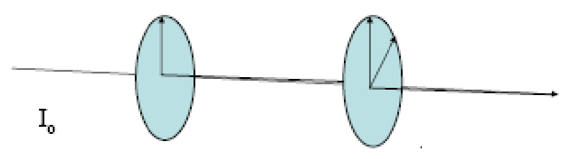

# Ejemplo: dos polarizadores

> Fuente: `2019/3er Parcial/2017 UT XIV - Polarización (1).pptx`, diapositivas
> 20\. SHA-256:
> `cdbb4a10bd2ae311654780d7928425abe5fad492cc8b8600f298f0a7ace6fc4f`. El nombre
> indica 2017 y la carpeta 2019; no consta fecha de clase impresa. Extracción
> MarkItDown, XML y PDF normalizado con LibreOffice, comparación Poppler y
> cotejo visual. Se conservan los GIF incrustados; no hay notas adicionales del
> presentador.

Ejemplo: Un haz de luz no polarizado incide sobre dos polarizadores que tienen
sus ejes de polarización formando un ángulo de 45º. Si la luz incidente tiene
intensidad I0, ¿Cuál es la intensidad final?

## Observaciones de transcripción

Enunciado original sin solución.
