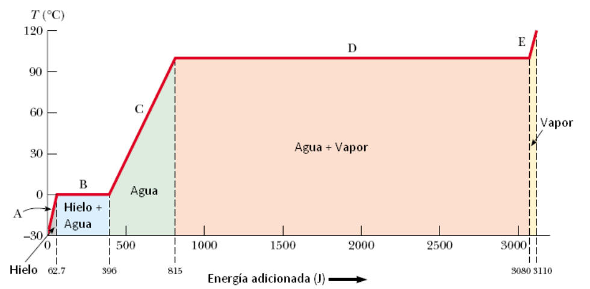

# Ejemplo: de hielo a vapor

> Fuente: `2019/3er Parcial/2018 UT XV Introducción a la Termodinámica.pdf`,
> páginas 60. SHA-256:
> `0c255d1c462cf23cf43e89eb6031d28084ef096c4512689fc85322d752c7b15c`. Nombre
> 2018, carpeta 2019; sin fecha de clase impresa. Extracción PyMuPDF4 LLM y
> Poppler, cotejo visual de las páginas originales y recuperación de figuras. Se
> preservan las erratas y preguntas sin resolver.

¿Cuál es la cantidad necesaria de energía para transformar 1 g de hielo a−30ºC
en vapor a 120ºC?



Parte A:

```math
Q=m_ic_i\Delta T=(1{,}00\cdot10^{-3}\mathrm{kg})(2090\,\mathrm{J/kg}\,{}^\circ C)(30.0\,{}^\circ C)=62.7\,\mathrm J
```

Parte B:

```math
Q=mL_f=(1{,}00\cdot10^{-3}\mathrm{kg})(3.33\cdot10^5\,\mathrm{J/kg})=333\,\mathrm J
```

Parte C:

```math
Q=m_wc_w\Delta T=(1{,}00\cdot10^{-3}\mathrm{kg})(4.19\cdot10^3\,\mathrm{J/kg}\,{}^\circ C)(100.0\,{}^\circ C)=419\,\mathrm J
```

Parte D:

```math
Q=mL_v=(1{,}00\cdot10^{-3}\mathrm{kg})(2.26\cdot10^6\,\mathrm{J/kg})=2260\,\mathrm J
```

Parte E:

```math
Q=m_sc_s\Delta T=(1{,}00\cdot10^{-3}\mathrm{kg})(2.01\cdot10^3\,\mathrm{J/kg}\,{}^\circ C)(20.0\,{}^\circ C)=40.2\,\mathrm J
```

## Observaciones de transcripción

Se transcribe la resolución por partes ya presente, sin sumar un total ausente.
La gráfica usa energías acumuladas redondeadas 62.7,396,815,3080 y 3110 J; se
conservan. Las unidadesJ/kg°C mantienen la disposición de la fuente.
