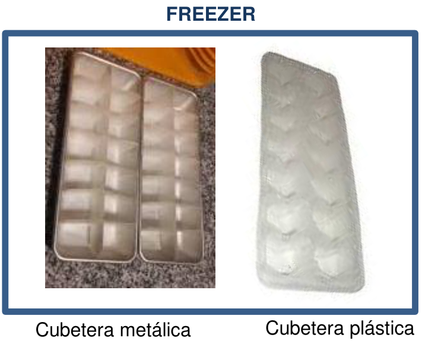
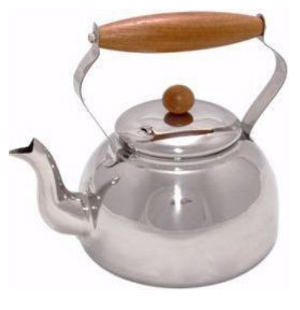
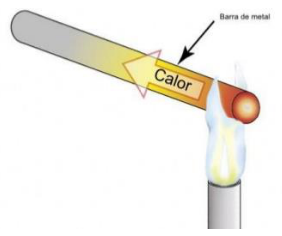

# Preguntas conceptuales sobre sistemas y temperatura

> Fuente: `2019/3er Parcial/2018 UT XV Introducción a la Termodinámica.pdf`,
> páginas 3, 9, 11, 26. SHA-256:
> `0c255d1c462cf23cf43e89eb6031d28084ef096c4512689fc85322d752c7b15c`. Nombre
> 2018, carpeta 2019; sin fecha de clase impresa. Extracción PyMuPDF4 LLM y
> Poppler, cotejo visual de las páginas originales y recuperación de figuras. Se
> preservan las erratas y preguntas sin resolver.

## Temperatura y calor

(Temperatura y calor es lo mismo?)

FREEZER

Cubetera metálica — Cubetera plástica

Cuál de las dos está más fría?

## Sistema y subsistema

Supongamos una pava con agua hirviendo en su interior

Mencione a qué llamaría

- Sistema
- Subsistema
- Medio
- Pared

## Estado cinemático

Cómo se definía cinemáticamente el estado de un sistema en movimiento?

## Explicación microscópica

Como podemos explicar desde el punto de vista microscópico el aumento de
temperatura que se produce en el extremo de una barra cuando se coloca su otro
extremo sobre el fuego?

## Observaciones de transcripción

Las cuatro preguntas se conservan sin responder; no se agregan signos de
apertura ausentes ni soluciones.
