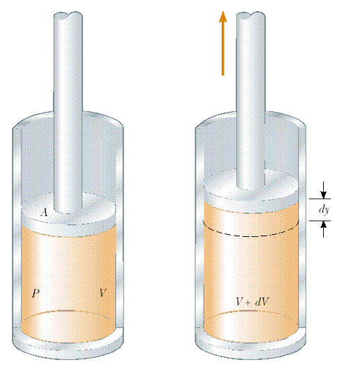

# Ejemplo: trabajo de expansión de un gas

> Fuente: `2019/3er Parcial/2018 UT XVI - Principios de la Termodinámica.pdf`,
> páginas 7. SHA-256:
> `dc2644f583b907ef2bdf7d3841e6e39009b5e41d2b9f8fdf64d02a47287f5df4`. Nombre
> 2018 y carpeta 2019; sin fecha de clase impresa. Extracción PyMuPDF4 LLM y
> Poppler, cotejo visual y recuperación de figuras originales. Se preservan las
> convenciones y erratas.

El gas que se encuentra en el cilindro de la figura tiene una presión de 8000 Pa
y el émbolo tiene un área de 0.10 m². Cuando se agrega calor lentamente al gas,
éste empuja al émbolo una distancia de 4 cm. ¿Cuánto trabajo realiza el gas
sobre su entorno por su expansión?. Suponga que la presión permanece constante.



```math
W=\int_{V_i}^{V_f}P\,dV=P(V_f-V_i)=P\Delta V
=8000\,(\mathrm{N/m^2})\,0.1\mathrm{m^2}\,4\times10^{-2}\mathrm m
```

```math
W=32\,\mathrm J
```

## Observaciones de transcripción

Se conserva la resolución presente en el original.
