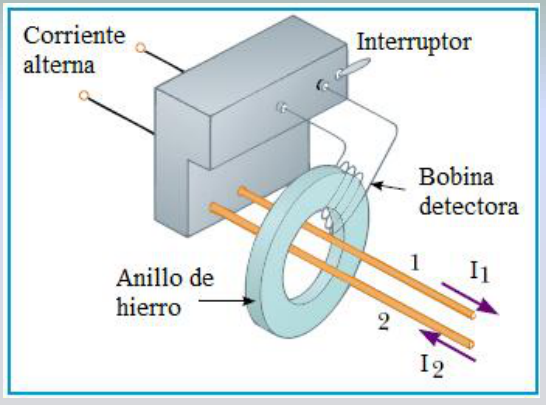
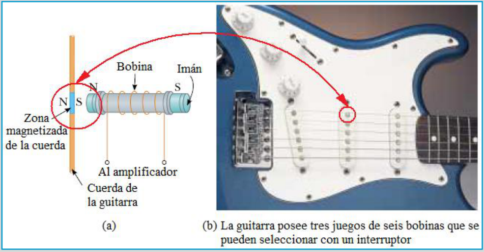

# Aplicaciones de la inducción: interruptor y guitarra eléctrica

Unidad Temática VII — Electromagnetismo

## APLICACIONES

Interruptor por fallas a tierra. El cable 1 va de la toma de energía al aparato,
y el 2 del aparato a la toma. Las corrientes alternas I1 e I2 son iguales y
opuestas => el flujo a través de la bobina es nulo. Si hay un cambio en I2 (fuga
a tierra), se induce una fem en la bobina que dispara el interruptor antes de
que la corriente alcance una intensidad peligrosa.

a) El imán permanente magnetiza la zona cercana de la cuerda. Al vibrar esta con
una cierta frecuencia induce una fem en la bobina que es trasmitida al
amplificador.

b) La guitarra posee tres juegos de seis bobinas que se pueden seleccionar con
un interruptor

## Procedencia y observaciones de transcripción

- Original: `2019/2do Parcial/2019 UT VII Electromagnetismo.pdf`, páginas 25 de
  62\. No consta fecha impresa; 2019 corresponde al nombre del archivo.
- SHA-256: `eff3447774cadfcb2726a6caabbe8e257782276fce3e67dda465673d5ef67a6a`.
- Herramientas: PyMuPDF4LLM, Poppler y recortes PyMuPDF; páginas, expresiones,
  diagramas y etiquetas del tramo cotejados visualmente. Se conserva esta
  versión sin añadir explicaciones ajenas al original.
- Se mantienen los dos ejemplos y sus figuras con todos los rótulos. Son
  explicaciones del material original, sin instrucciones de montaje añadidas.
