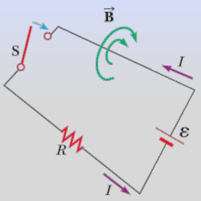
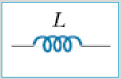

# Autoinducción de una bobina y unidad henrio

Unidad Temática VII — Electromagnetismo



## Autoinducción

Si en un circuito circula una corriente variable, esta provocará la aparición de
una fem inducida por su propio campo magnético variable, denominada fem
autoinducida. La corriente que circula debido a esta fem autoinducida se
denomina corriente autoinducida.

La variación del flujo es producida por la variación de la corriente I que
circula en el circuito, y cuanto más rápido varia I más rápido varia el flujo,
es decir

```math
\frac{d\phi_B}{dt}=k\frac{dI}{dt}
```

k: Cte que depende de la forma y dimensiones del circuito

Ley de Faraday para la fem autoinducida

```math
\varepsilon=-N\frac{d\phi_B}{dt}=-Nk\frac{dI}{dt}=-L\frac{dI}{dt}
```

```math
\varepsilon=-L\frac{dI}{dt}\qquad L=Nk
```

L es una constante característica del circuito, denominada coeficiente de
autoinducción

```math
[L]=\frac{[\varepsilon][t]}{[I]}=\frac{\text{Volt segundo}}{\text{Ampere}}=\text{henrio (H)}
```

1 H: autoinducción de una bobina el la que la variación de la corriente en 1
Ampere por segundo produce una fem autoinducida de 1 Volt.



Símbolo que representa las inductancias en diagramas de circuitos

## Autoinducción de una bobina

```math
\varepsilon=-N\frac{d\phi_B}{dt}=-L\frac{dI}{dt}\Rightarrow N\frac{d\phi_B}{dt}=L\frac{dI}{dt}\Rightarrow N\phi_B=LI
```

```math
L=\frac{N\phi_B}I
```

L depende del N° de espiras, del flujo y de la corriente

Vimos que:

```math
B=\frac{\mu NI}{Long}=\mu nI\quad\text{y que}\quad\phi_B=BA
```

```math
L=\frac{N\phi_B}I=\frac NI BA=\frac NI\frac{\mu NI}{Long}A=\frac{\mu N^2A}{Long}
```

## Procedencia y observaciones de transcripción

- Original:
  `2019/2do Parcial/2019 UT VII - Fenómenos de Inducción Electromagnética.pdf`,
  páginas 41–44 de 67. Fecha impresa: 14/05/2019.
- SHA-256: `cbefa338a0f56f56079880a84f05a963257a6473febd8da50f944a67f2210a8f`.
- Herramientas: PyMuPDF4LLM, Poppler y recortes PyMuPDF; todas las páginas,
  expresiones y figuras del tramo cotejadas visualmente. Se conserva el
  desarrollo original.
- La página 41 contiene sólo el circuito. Se conservan «el la que», Long y la
  afirmación sobre la dependencia de L del flujo y la corriente.
