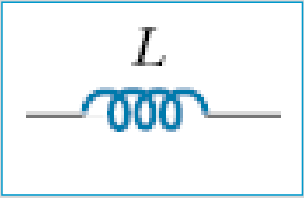

# Autoinducción y geometría de la bobina: versión Electromagnetismo

Unidad Temática VII — Electromagnetismo

## Autoinducción

Cuando una corriente variable pasa a través de una bobina (o solenoide), dentro
de la bobina se produce un flujo magnético variable, y este, a la vez induce una
fem en esa misma bobina. Esta fem inducida se opone al cambio en el flujo (Ley
de Lenz). Por ejemplo, si la corriente a través de la bobina aumenta, el flujo
magnético creciente induce una fem que se opone a la corriente original y tiende
a retardar su aumento. Si la corriente disminuye en la bobina, el flujo
decreciente induce una fem en la misma dirección que la corriente, lo que, de
esta forma, tiende a mantener la corriente original.

La variación del flujo es producida por la variación de la corriente I que
circula en el circuito, y cuanto más rápido varia I más rápido varia el flujo,
es decir

```math
\frac{d\phi_B}{dt}=k\frac{dI}{dt}
```

k: Cte que depende de la forma y dimensiones del circuito

Ley de Faraday para la fem autoinducida

```math
\varepsilon=-N\frac{d\phi_B}{dt}=-Nk\frac{dI}{dt}=-L\frac{dI}{dt}
```

```math
L=Nk
```

L es una constante característica del circuito, denominada coeficiente de
autoinducción

```math
[L]=\frac{[\varepsilon][t]}{[I]}=\frac{\text{Volt segundo}}{\text{Ampere}}=\text{henrio (H)}
```

1 H: autoinducción de una bobina el la que la variación de la corriente en 1
Ampere por segundo produce una fem autoinducida de 1 Volt.



Símbolo que representa las inductancias en diagramas de circuitos

## Autoinducción de una bobina

```math
\varepsilon=-N\frac{d\phi_B}{dt}=-L\frac{dI}{dt}\Rightarrow N\frac{d\phi_B}{dt}=L\frac{dI}{dt}\Rightarrow N\phi_B=LI
```

```math
L=\frac{N\phi_B}I
```

L depende del N° de espiras, del flujo y de la corriente

Vimos que:

```math
B=\frac{\mu NI}{Long}\quad\text{y que}\quad\phi_B=BA
```

```math
L=\frac{N\phi_B}I=\frac NI BA=\frac NI\frac{\mu NI}{Long}A=\frac{\mu N^2A}{Long}
```

La magnitud de L depende de la geometría y de la presencia de un material
ferromagnético.

## Procedencia y observaciones de transcripción

- Original: `2019/2do Parcial/2019 UT VII Electromagnetismo.pdf`, páginas 38–40
  de 62. No consta fecha impresa; 2019 es del nombre del archivo.
- SHA-256: `eff3447774cadfcb2726a6caabbe8e257782276fce3e67dda465673d5ef67a6a`.
- Herramientas: PyMuPDF4LLM, Poppler y recortes PyMuPDF; páginas, expresiones y
  figuras del tramo cotejadas visualmente.
- Se conservan «el la que», Long y la afirmación de dependencia de L del flujo y
  la corriente. La última frase sobre geometría y material ferromagnético
  pertenece a página 40.
