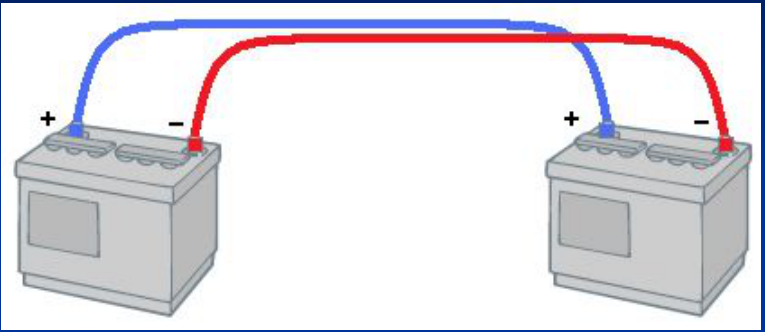
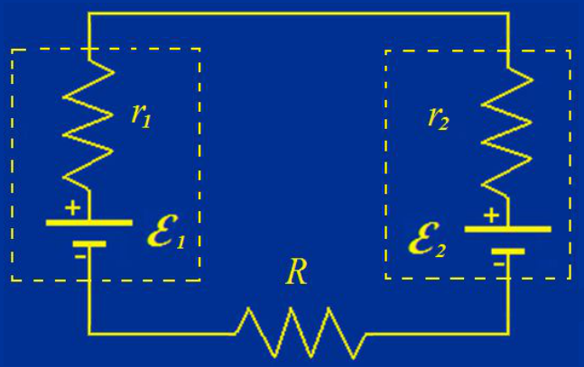
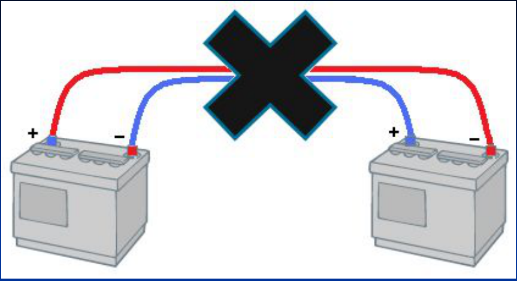
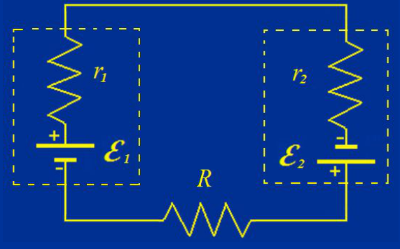

# Ejemplo: baterías y conexiones

Ejemplo: Queremos dar arranque con un auto que tiene la batería ε₁=12V cargada,
a otro auto con una batería ε₂=11V descargada. R=0,01Ω es la resistencia de los
cables de conexión y r₁=0,02Ω y r₂=0,02Ω las resistencias internas de las
baterías.

Conexión correcta:

Borne positivo con borne positivo y negativo con negativo.





```math
\varepsilon_1-Ir_1-Ir_2-IR-\varepsilon_2=0
```

```math
I=\frac{\varepsilon_1-\varepsilon_2}{R+r_1+r_2}=\frac{1\,V}{0{,}05\,\Omega}=20\,A
```

## Conexión incorrecta





```math
\varepsilon_1-Ir_1-Ir_2-IR+\varepsilon_2=0
```

```math
I=\frac{\varepsilon_1+\varepsilon_2}{R+r_1+r_2}=\frac{23\,V}{0{,}05\,\Omega}=460\,A!!
```

La corriente es muy grande y las baterías pueden explotar y salpicar acido.

## Procedencia y observaciones de transcripción

- Original: `2019/1er Parcial/2017 UT IV - Electrocinética.ppt.pdf`, páginas 48,
  49 de 55.
- SHA-256: `5593bcdeb59339b25f4dfee074beac1812300dcec491fb423777a4e776ba1399`.
- El nombre del archivo indica 2017; se conserva bajo 2019 por su ubicación
  canónica. No consta autor en estas páginas.
- Herramientas: PyMuPDF4LLM, PyMuPDF y Poppler; cotejo visual de texto,
  fórmulas, tablas y diagramas. Figuras originales conservadas por recorte y
  render.
- Se conserva íntegro el ejemplo y su advertencia original, incluidos los signos
  de exclamación, los colores de cables y las polaridades de ambas figuras. No
  se agrega procedimiento ni solución adicional.
