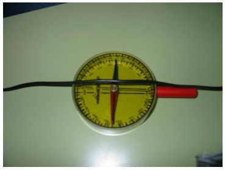
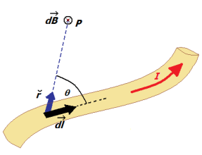
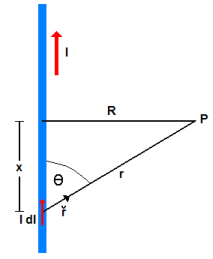
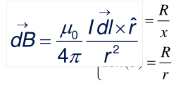
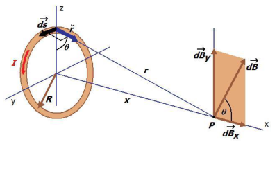

# Ley de Biot y Savart: corrientes rectilínea y circular

Unidad temática VI — Campo de Inducción Magnética. Propiedades.

Fecha impresa: 08/05/2019.

## Contenido de la unidad

Campo de Inducción magnética. Propiedades

Campo magnético generado por una corriente estacionaria. Ley de Biot y Savart.
Aplicaciones. Fuerza magnética entre conductores paralelos. El Ampere.
Propiedades del campo de inducción magnética: Ley de Gauss para el magnetismo y
ley de Ampere en el vacío. Forma integral y diferencial. Aplicaciones: Solenoide
y toroide.

## Campos Magnéticos debidos a Corrientes



[VIDEO](https://www.youtube.com/watch?v=E8TFjZTszL4)

El experimento de Oersted

La aguja de una brújula se desvía en presencia de una corriente eléctrica
cercana.

Aunque las cargas eléctricas en reposo carecen de efectos magnéticos, las
corrientes eléctricas, es decir, las cargas en movimiento, crean campos
magnéticos y se comportan, por lo tanto, como imanes

## Ley de Biot y Savart



```math
d\vec B=\frac{\mu_0}{4\pi}\frac{I\,\overrightarrow{dl}\times\hat r}{r^2}
```

módulo

```math
dB=\frac{\mu_0}{4\pi}\frac{I\,dl\,\mathop{\mathrm{sen}}\nolimits(\theta)}{r^2}
```

Permeabilidad magnética del vacio

```math
\mu_0=4\pi\,10^{-7}\frac{\mathrm{Tm}}{\mathrm A}
```

Expresión integral de la ley de Biot y Savart

```math
\vec B=\frac{\mu_0I}{4\pi}\int\frac{\overrightarrow{dl}\times\hat r}{r^2}
```

## Campo magnético debido a una corriente rectilínea

Calcularemos B en el punto P utilizando Biot y Savart



```math
d\vec B=\frac{\mu_0}{4\pi}\frac{I\,\overrightarrow{dl}\times\hat r}{r^2}
```

```math
dl=dx\quad\text{y}\quad\begin{cases}\tan(\theta)=\dfrac Rx\\\mathop{\mathrm{sen}}\nolimits(\theta)=\dfrac Rr\end{cases}
```



```math
x=R\cot(\theta)\Rightarrow dx=\frac R{\mathop{\mathrm{sen}}\nolimits(\theta)^2}\,d\theta
```

```math
dB=\frac{\mu_0}{4\pi}\frac{I\,dx\,\mathop{\mathrm{sen}}\nolimits(\theta)}{r^2}=\frac{\mu_0I}{4\pi}\frac{\mathop{\mathrm{sen}}\nolimits(\theta)}{(R^2/\mathop{\mathrm{sen}}\nolimits(\theta)^2)}\frac R{\mathop{\mathrm{sen}}\nolimits(\theta)^2}\,d\theta=\frac{\mu_0I}{4\pi R}\mathop{\mathrm{sen}}\nolimits(\theta)\,d\theta
```

```math
B=\int dB=\frac{\mu_0I}{4\pi R}\int_0^\pi\mathop{\mathrm{sen}}\nolimits(\theta)\,d\theta=\frac{\mu_0I}{4\pi R}\left[-\cos(\theta)\big|_0^\pi\right]=\frac{\mu_0I}{4\pi R}(1+1)=\frac{\mu_0I}{2\pi R}
```

## Campo magnético debido a una corriente circular



Las componentes dBy Se cancelan por simetría, Solo tenemos en cuenta las
componentes según x

```math
dB_x=dB\cos(\theta)
```

```math
r=(R^2+x^2)^{1/2}\Rightarrow\cos(\theta)=\frac Rr=\frac R{(R^2+x^2)^{1/2}}
```

```math
dB_x=dB\cos(\theta)=\frac{\mu_oi}{4\pi}\frac{|\overrightarrow{ds}\times\vec r|}{r^2}\cos(\theta)=\frac{\mu_oi}{4\pi}\frac R{(R^2+x^2)^{3/2}}\,ds
```

Integrando para todas las contribuciones de la espira

```math
B_x=\int dB_x==\frac{\mu_oi}{4\pi}\frac R{(R^2+x^2)^{3/2}}\oint ds
```

Campo a lo largo del eje de la espira

```math
B_x=\frac{\mu_oi}{4\pi}\frac R{(R^2+x^2)^{3/2}}\,2\pi R=\frac{\mu_oi}{2}\frac{R^2}{(R^2+x^2)^{3/2}}
```

Campo en el Centro de la espira

```math
\text{si }x=0\Rightarrow B_x=\frac{\mu_oi}{2R}
```

## Procedencia y observaciones de transcripción

- Original:
  `2019/2do Parcial/2019 UT VI - Campo de Inducción Magnética. Propiedades.pdf`,
  páginas PDF 1–4 de 16, diapositivas 1–8 de 31.
- SHA-256: `b9bb8ec5e8acfa36814e15207ee532a00e566ff5ea72bd139eff27ae0b2d634f`.
- Herramientas: PyMuPDF4LLM, Poppler y recortes PyMuPDF; cotejo visual de todas
  las páginas y expresiones de este tramo. Se conservan figuras, etiquetas y
  erratas del original.
- La diapositiva 6 superpone la ecuación vectorial sobre las relaciones
  trigonométricas: se transcriben los objetos de texto recuperados y se conserva
  el detalle visible. Se mantiene el signo positivo de dx y el doble igual de la
  diapositiva 8.
- El PDF enlaza además un archivo local
  `../Videos Eperiencias Labs/Campos Magneticos de Corrientes/Aguja de Oersted.RM`,
  no incluido; no se sustituye por un vídeo supuesto.
