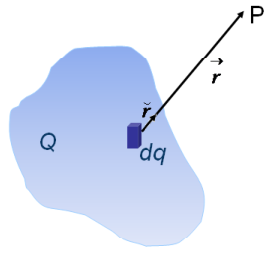
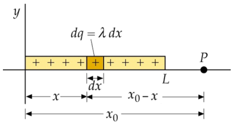
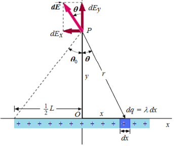
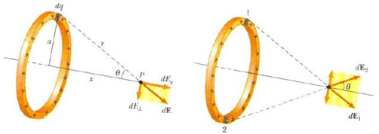
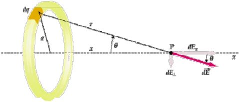

# Campo eléctrico de una distribución continua de carga

2\) Campo eléctrico en un punto, creado por una distribución continua de carga :



En este caso dividimos la distribución en pequeños elementos infinitesimales de
carga dq, de forma que la contribución al campo eléctrico total que crea cada
una de ellos es

```math
d\vec E=k\frac{dq}{r^2}\breve r
```

El campo eléctrico total para toda la distribución será

```math
\vec E=\int d\vec E=k\int\frac{dq}{r^2}\breve r
```

Dependiendo de la dimensionalidad de la distribución, se definen las siguientes
densidades de carga según la misma sea uniforme o no:

## Lineal

```math
\lambda=\frac Q L\quad\mathrm o\quad\lambda=\frac{dq}{dl}
```

```math
\vec E=k\int_L\lambda\frac{dl}{r^2}\breve r
```

## Superficial

```math
\sigma=\frac Q S\quad\mathrm o\quad\sigma=\frac{dq}{ds}
```

```math
\vec E=k\int_S\sigma\frac{ds}{r^2}\breve r
```

## Volumétrica

```math
\rho=\frac Q V\quad\mathrm o\quad\rho=\frac{dq}{dv}
```

```math
\vec E=\int_v\rho\frac{dv}{r^2}\breve r
```

Las integrales se extienden a la zona del espacio ocupada por la distribución de
cargas.

## Cálculo de campo de sistemas continuos

Ejemplos

## Ejemplo 4: Campo eléctrico sobre el eje de una carga lineal finita

Ejemplo 4: Campo eléctrico sobre el eje de una carga lineal finita.



```math
E=k\lambda\int_0^L\frac{dx}{(x_0-x)^2}=k\lambda\frac L{x_0^2-x_0L}
```

## Ejemplo 5: Campo eléctrico fuera del eje de una carga lineal finita

A partir del resultado analice el caso de L→∞.

Por simetría las componentes dEₓ de las contribuciones de cada dq se cancelan
con las de su dq simétrico respecto de O.

14.196

```math
\int\frac{dx}{(x^2+a^2)^{3/2}}=\frac x{a^2\sqrt{x^2+a^2}}
```



```math
dE_y=dE\cos(\theta)=k\lambda\frac{\cos(\theta)\,dx}{y^2+x^2}
```

```math
\cos(\theta)=\frac y r=\frac y{\sqrt{y^2+x^2}}
```

```math
E_y=k\lambda y\int_{-L/2}^{L/2}\frac{dx}{(y^2+x^2)^{3/2}}
```

```math
E_y=k\lambda y\left.\frac x{y^2(y^2+x^2)^{1/2}}\right|_{-L/2}^{L/2}
```

```math
E_y=2k\frac\lambda y\frac L{\sqrt{L^2+y^2}}
```

## Ejemplo 6: Campo eléctrico creado por una distribución uniforme de carga en forma de anillo de radio a, en un punto de su eje



Ejemplo 6: Campo eléctrico creado por una distribución uniforme de carga en
forma de anillo de radio a, en un punto de su eje.



Cada elemento dq creara en P una componente de dE perpendicular al eje x, que se
cancelará con la contribución de su dq simétrica. Además r, x y θ son constantes
en la integración. Q es la carga total del anillo.

```math
E_x=\int dE_x=\int dE\cos(\theta)=k\int\frac{\cos(\theta)}{r^2}\,dq=k\frac{\cos(\theta)}{r^2}\int dq=kQ\frac{\cos(\theta)}{r^2}
```

```math
\cos(\theta)=\frac x{\sqrt{x^2+a^2}}\quad\mathrm y\quad r^2=x^2+a^2\Rightarrow E_x=kQ\frac x{(x^2+a^2)^{3/2}}
```

Gracias a Dios que soy ateo

## Procedencia y observaciones de transcripción

- Original:
  `2019/1er Parcial/2018 UT I - Fuerza Eléctrica y Campo Elécrtico.pdf`, páginas
  22, 24, 25, 26, 27 de 42.

- SHA-256: `326bb078ddbf25b43f166e198c175106027b686dde0d0ea9688c025795f46ca7`.

- El nombre del archivo indica 2018; ubicación canónica 2019. No consta autor ni
  fecha completa en estas páginas.

- Herramientas: PyMuPDF4LLM y Poppler para extracción; todas las expresiones y
  figuras cotejadas visualmente. Medios conservados por recorte/render PyMuPDF.

- Cubre 22, inferior de 24 y ambas diapositivas de 25–27. El original omite k en
  la integral volumétrica y pasa del ejemplo 1 al 4: se conserva. En el ejemplo
  5 los límites son ±L/2 pero la expresión final utiliza L sin mitades; no se
  corrige. La superior de 25 solo presenta título; la inferior de 27 únicamente
  contiene la frase final, que se conserva.

- La figura de campo puntual o de anillo se recompone desde las franjas raster
  incrustadas, conservando posiciones y máscaras de transparencia, para excluir
  restos de texto vecino sin cortar ejes ni etiquetas.
